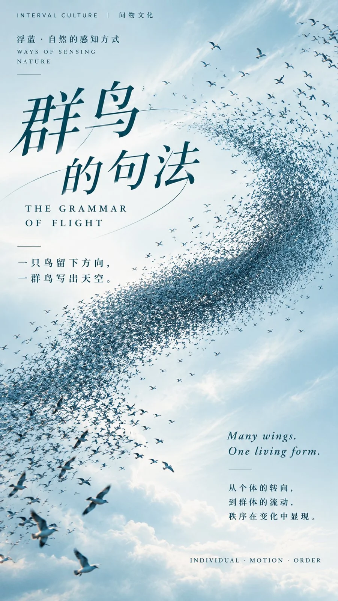

# Nature Art Poster Template: Poetic Eastern Design (9:16)

**中文标题：** 自然艺术海报模板：东方诗性平面（9:16）  
**ID:** `gi25-x-1684` · **Mode:** `generate`  
**Categories:** `poster-typography`  
**Tags:** `x-twitter`, `community`, `gpt-image-2.5`, `x-direct`, `zh`



### Nature Art Poster Template: Poetic Eastern Design (9:16)

```text
【海报主题】：
【核心视觉主体】：
【主标题及英文标题】：
【主题短句及其他文字】：
【主色调】：低饱和青蓝色系
【画幅比例】：9:16

设计一张具有东方诗性美学的自然艺术海报，融合成熟日系平面设计、真实自然摄影、科学观察、视觉隐喻与自由编辑式排版。

深入挖掘主体独特的自然结构、材质特征、物理现象或运动规律，将其转化为核心视觉创意。通过自然生长、尺度反差、光影折射与空间关系，呈现自然本身的秩序与艺术美感。

采用雾蓝、灰青蓝、海盐蓝、暖白与深墨青，保持低饱和、通透而富有层次的色彩关系。强化真实材质、自然光影、微观细节与空间纵深，不局限于纸本质感。

坚持内容驱动构图，让主体轮廓、生长方向、运动轨迹与负空间决定版式。灵活运用大胆裁切、非对称平衡、虚实交错、尺度反差与疏密变化，形成独立而富有视觉张力的构图。

使用精致现代宋体、日文明朝体、英文衬线字体与纤细无衬线字体。结合巨字、错位排版、横竖混排、诗意短句及必要的科学标注，让文字自然参与构图，而非简单覆盖在图像上。

整体具有专业艺术设计工作室的审美水准，兼具自然摄影的真实质感、东方美学的诗意表达与现代平面设计的视觉冲击力。远看有大形，近看有细节，图文之间具有内在联系。

避免机械式模块化排版、固定信息栏、模板化构图、廉价特效、无意义文字、虚构数据及水印。直接输出一张独立、完整、高清且具有原创设计价值的艺术海报。
```

- **Recommended model:** `gpt-image-2.5-flare`
- **Settings:** _(defaults)_
- **Source:** [community](https://x.com/MrLarus/status/2125984196619636739) — @MrLarus
- **License note:** Original public X post; quoted with attribution — remix with attribution
- **Notes:** Collected directly from X; prompt posted as the author's own reply https://x.com/MrLarus/status/2125984196619636739 to https://x.com/MrLarus/status/2125983796768178361, which carries the images; GPT Image 2.5 is named in the reply; discovered via X search, prompt re-verified against the original X post via api.fxtwitter.com; verified=True; fill-in poster template posted as the author's public reply; the parent post carries the four example images; this post does not name a Flare/Sunburst variant; preview is image 1 of the parent
- **Preview:** `previews/gi25-x-1684.webp`
