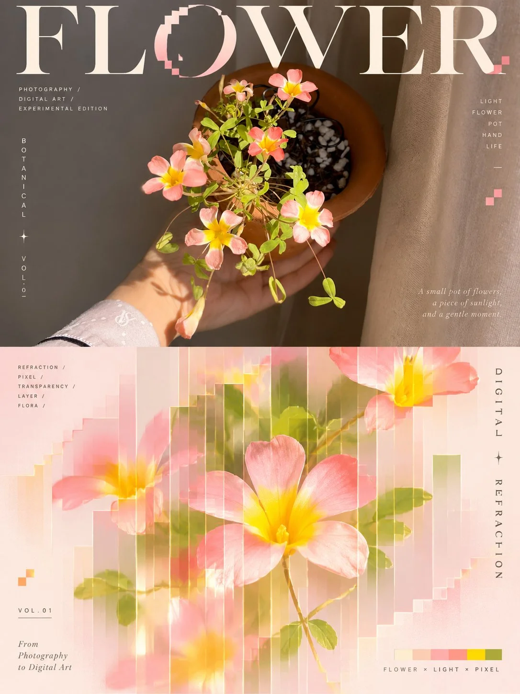

# Photo-to-Diptych Poster: Digital Refraction Grid (3:4)

**中文标题：** 照片转双联海报：数字折射栅格（3:4）  
**ID:** `gi25-x-1686` · **Mode:** `edit`  
**Categories:** `poster-typography`, `edit-change-preserve`  
**Tags:** `x-twitter`, `community`, `gpt-image-2.5`, `x-direct`, `zh`



### Photo-to-Diptych Poster: Digital Refraction Grid (3:4)

```text
将照片创作成3:4竖版上下双联海报：上半保持真实摄影风貌，下半以浅色底呈现数字折射艺术。提炼照片中的核心主体，转译为纵向半透明栅格，通过长短错落、阶梯像素边缘与色层叠透形成虚实交融的视觉焦点。依据原图色彩建立主色渐层、邻近色过渡与局部对比色点睛，保持通透光感。主体放大居中、局部溢出裁切，顶部横贯超大高反差衬线英文标题，嵌入像素化字形，四周搭配无衬线微字与侧边竖排，形成复古优雅与数字先锋交融的实验性编辑设计。

整体画布严格沿水平中线划分为上下两个等宽等高的独立画面，各占画布总高度的50%，上下高度比固定为1:1，此比例为不可变更的硬性构图约束，优先于任何主体尺度、图文排版及艺术表现需求。
```

- **Recommended model:** `gpt-image-2.5-flare`
- **Settings:** _(defaults)_
- **Source:** [community](https://x.com/xiaoxiaodong/status/2125999282805449073) — @xiaoxiaodong
- **License note:** Original public X post; quoted with attribution — remix with attribution
- **Notes:** Collected directly from X; original post https://x.com/xiaoxiaodong/status/2125999282805449073; post text names GPT Image 2.5; discovered via X search, prompt re-verified against the original X post via api.fxtwitter.com; verified=True; edit-style template as posted (upload a photo); post uses the author's GPT2 x tag and does not name a Flare/Sunburst variant; preview is image 1 of 2
- **Preview:** `previews/gi25-x-1686.webp`
