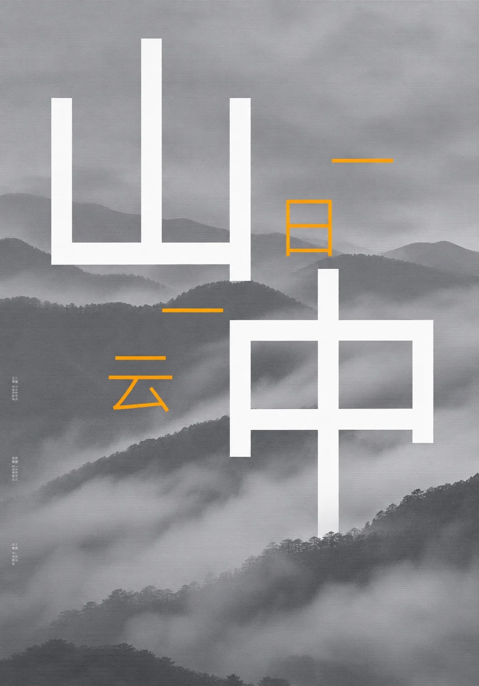

# Typography on Landscape: Shan Zhong / Yi Ri Yi Yun (Visual System)

**中文标题：** 风景上的细线字：山中·一日一云（画面风格模板）  
**ID:** `gi25-x-1688` · **Mode:** `generate`  
**Categories:** `poster-typography`  
**Tags:** `x-twitter`, `community`, `gpt-image-2.5`, `x-direct`, `zh`



### Typography on Landscape: Shan Zhong / Yi Ri Yi Yun (Visual System)

```text
Create an image with the following visual system. Replace the subject as specified.

Visual system (light, color, composition, medium, mood):
【画面风格】一张竖幅约 7:10 的展览海报。底图是一张黑白风景照片，整体覆盖细密的横向网线，像丝网印刷的灰阶，层次柔和、偏冷灰，没有其他颜色。画面中上部压着两个超大的汉字，用纯白等宽细直线搭成，笔画只有横、竖、斜线和直角，像用尺子画出来的线框字，从左上往右下斜向错位排列，字跨过山和天空，部分笔画超出照片里的地平线。在白色大字旁边，另有一行四个较小的汉字，同样是细线字，但颜色是明亮的橙黄色，沿着另一条斜线排布，和白字交错。左侧边缘竖着放三四小块很小的白色说明文字，像展览信息，字号极小，看不清内容也可以。整体是东方平面设计和留白感，照片占满全幅，没有边框。不是插画，不是 3D，不是书法毛笔字。除主体指定的汉字外，不要英文大标题、水印、签名和 logo。

New subject:
【主体】底图是云雾缠在层层山脊上的黑白照片。两个白色大字写「山中」，一行橙色小字写「一日一云」。汉字必须写对。
```

- **Recommended model:** `gpt-image-2.5-flare`
- **Settings:** _(defaults)_
- **Source:** [community](https://x.com/static_stare/status/2126175529011495033) — @static_stare
- **License note:** Original public X post; quoted with attribution — remix with attribution
- **Notes:** Collected directly from X; original post https://x.com/static_stare/status/2126175529011495033; post text names GPT Image 2.5; discovered via X search, prompt re-verified against the original X post via api.fxtwitter.com; verified=True; visual-system + replaceable-subject template; prompt for image 1 of 4 (the author offers the other three on request); post names GPT Image 2.5 without a Flare/Sunburst variant; preview is image 1
- **Preview:** `previews/gi25-x-1688.webp`
