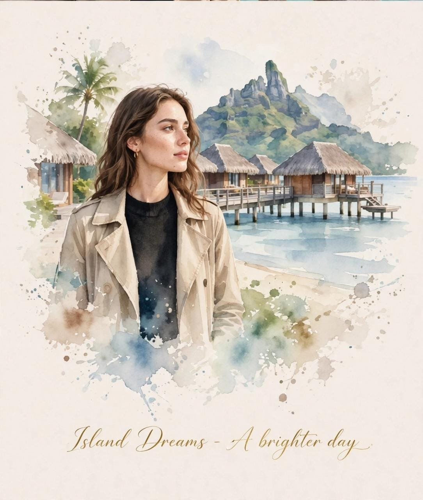

# Four-Destination Luxury Travel-Journal Artwork

**中文标题：** 四地合一奢华旅行手账艺术  
**ID:** `gi25-x-709` · **Mode:** `multi_ref`  
**Categories:** `poster-typography`, `edit-change-preserve`  
**Tags:** `x-twitter`, `community`, `gpt-image-2.5`, `x-direct`, `en`



### Four-Destination Luxury Travel-Journal Artwork

```text
Create a refined luxury editorial travel-art composition inspired by all four reference photographs, seamlessly combining four distinct travel moments into one sophisticated vertical travel journal artwork: Dubai coastline with the iconic sail-shaped Burj Al Arab and a stylish woman in a beige trench coat during golden hour; Icelandic snowy mountains beneath a dramatic glowing green and violet Northern Lights sky, with the woman wearing a warm beige knit beanie, turtleneck and coat; lush tropical Bali rice terraces surrounded by palm trees and misty green mountains, with the woman in a beige trench coat and soft cream knitwear; and a dreamy tropical island setting with turquoise ocean, traditional overwater thatched villas, palm trees and a dramatic volcanic mountain in the background, with the woman wearing a beige trench coat over a black top.

Upper section: create a sophisticated realistic cinematic travel photography sequence that naturally blends these four destinations while keeping each environment visually recognizable and beautifully composed. Preserve the woman’s facial identity, facial proportions, hairstyle, skin tone, expression and overall appearance consistently across the different scenes. Authentic candid travel photography, natural realistic lighting appropriate to each destination, subtle film grain, detailed textures, realistic skin and clothing, atmospheric depth, elegant muted color grading, premium high-end travel magazine photography, cinematic composition, refined European-editorial travel aesthetic.

Lower section: transform the exact same four travel scenes into delicate handmade watercolor illustrations, maintaining the recognizable landscapes, architecture, mountains, ocean, rice terraces, Burj Al Arab, Northern Lights, overwater villas, palm trees, clothing, poses and overall composition from the photographic scenes. Use loose translucent watercolor washes, delicate ink outlines, soft pigment bleeding, imperfect hand-painted brushwork, visible paper texture, airy negative space, subtle pastel tones and naturally faded watercolor edges. Keep the woman recognizable and consistent across all four illustrated scenes.

Arrange the four destinations as one harmonious artistic travel story rather than four unrelated images, with smooth visual transitions and balanced spacing. Surround the artwork with generous warm ivory/off-white textured handmade paper. Add a small elegant handwritten travel-journal caption near the bottom, such as “Four Places, One Journey” or “Wander Beyond the Ordinary”, followed by a thin minimalist horizontal line.

Overall aesthetic: luxury travel journal, fine-art watercolor postcard, cinematic travel photography, nostalgic wanderlust, contemporary editorial design, sophisticated and serene, tactile handmade paper, premium art direction, elegant natural proportions, highly detailed realistic photography transitioning beautifully into airy watercolor artwork, clean composition, no clutter, no heavy borders, no unnecessary graphic elements.

Portrait orientation, premium editorial layout, cohesive visual storytelling, realistic-to-watercolor transformation, sophisticated travel magazine quality, high detail.
```

- **Recommended model:** `gpt-image-2.5-sunburst`
- **Settings:** _(defaults)_
- **Source:** [community](https://x.com/KrishnaBio1/status/2102793013143412829) — @KrishnaBio1
- **License note:** Original public X post; quoted with attribution — remix with attribution
- **Notes:** Collected directly from X; prompt posted as the author's reply https://x.com/KrishnaBio1/status/2102793013143412829 to https://x.com/KrishnaBio1/status/2102793005837242737, which carries the images and names GPT Image 2.5; discovered via Bin0754/gpt-image-gallery index, prompt re-verified against the original X post; verified=True
- **Preview:** `previews/gi25-x-709.jpg`
