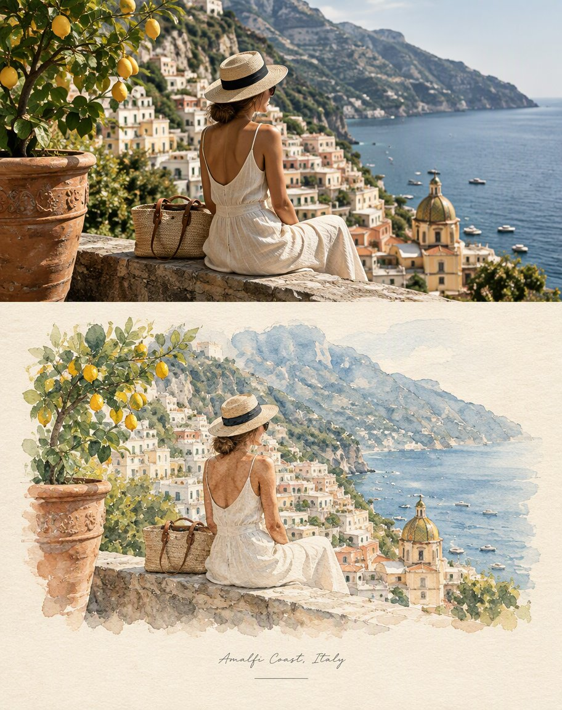

# Double-Style Travel Journal: Photo Above, Illustration Below

**中文标题：** 上实拍下插画的双风格旅行手账  
**ID:** `gi25-x-713` · **Mode:** `multi_ref`  
**Categories:** `poster-typography`, `edit-change-preserve`  
**Tags:** `x-twitter`, `community`, `gpt-image-2.5`, `x-direct`, `en`



### Double-Style Travel Journal: Photo Above, Illustration Below

```text
Create a refined editorial travel-art composition in the same distinctive double-style format as the reference image.

Divide the image vertically into two connected sections showing the EXACT SAME scene.

UPPER SECTION:
A realistic cinematic travel photograph based on the provided image. Preserve the exact subject, face, pose, clothing, objects, surroundings, architecture and perspective. Natural daylight, soft shadows, realistic textures, subtle film grain, elegant muted colors and premium luxury travel-magazine photography.

LOWER SECTION:
Transform the exact same scene into a beautiful handmade watercolor illustration. Keep the same subject, pose, objects, background and perspective perfectly recognizable. Use delicate translucent watercolor washes, fine ink details, soft imperfect brushwork, subtle pigment bleeding, faded edges
```

- **Recommended model:** `gpt-image-2.5-sunburst`
- **Settings:** _(defaults)_
- **Source:** [community](https://x.com/SadiaMalik182/status/2103337334909604158) — @SadiaMalik182
- **License note:** Original public X post; quoted with attribution — remix with attribution
- **Notes:** Collected directly from X; prompt posted as the author's reply https://x.com/SadiaMalik182/status/2103337334909604158 to https://x.com/SadiaMalik182/status/2103337256237113379, which carries the images and names GPT Image 2.5; discovered via Bin0754/gpt-image-gallery index, prompt re-verified against the original X post; verified=True; the original X post text ends abruptly — quoted verbatim as published
- **Preview:** `previews/gi25-x-713.jpg`
