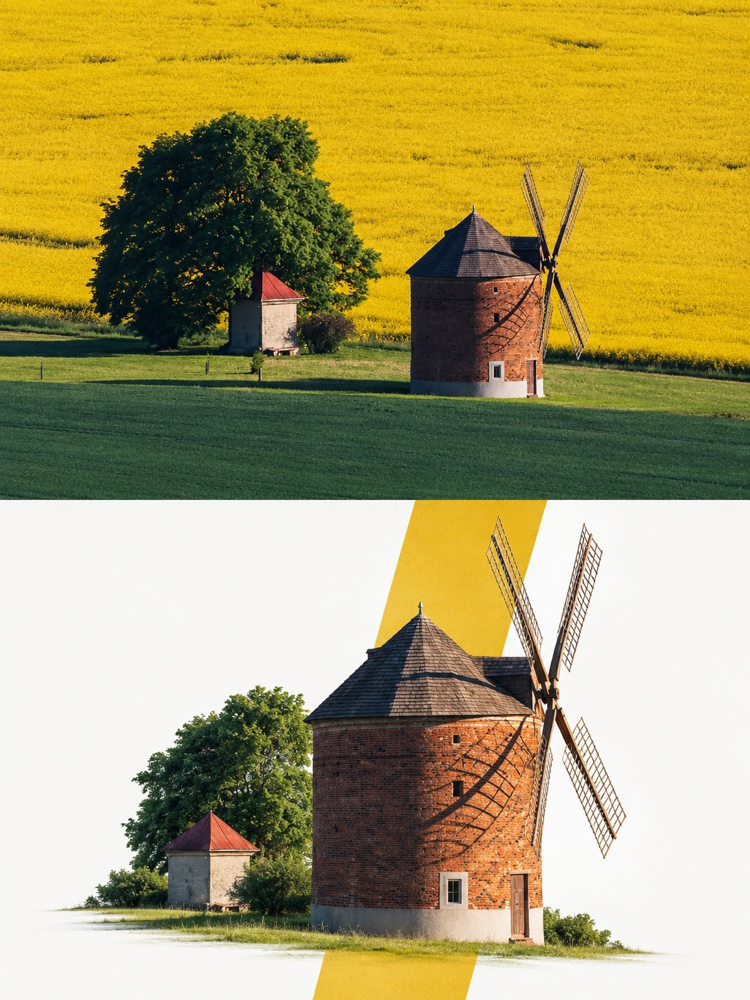

# Premium Editorial Poster: Original Photo Top, Art Bottom

**中文标题：** 高级编辑海报：上半原图下半艺术重构  
**ID:** `gi25-x-715` · **Mode:** `edit`  
**Categories:** `poster-typography`, `edit-change-preserve`  
**Tags:** `x-twitter`, `community`, `gpt-image-2.5`, `x-direct`, `en`



### Premium Editorial Poster: Original Photo Top, Art Bottom

```text
Premium Editorial Poster Instructions

Each uploaded photo must be made into a separate, independent, premium editorial poster, and multiple photos must not be combined. Use a strict 3:4 vertical canvas. Split the canvas horizontally in the exact center: the upper half and the lower half each occupy 50% of the height, are equally wide, and equally high, with no alteration of proportion.

The upper half uses the original photo directly and must not be regenerated. Preserve the identity of the main subject, the human body or architectural structure, proportions, perspective, spatial relationships, texture, natural light and shadow, color, and environment in their entirety. Only slight cropping and restrained premium color grading are permitted; re-drawing the main subject, fictional light, HDR, excessive saturation, plastic texture, and fictional content are prohibited. When needing to adapt to the frame, only environmental areas such as sky, water surface, ground, walls, plants, or background can be extended.

The lower half extracts and reconstructs the "narrative core" of the photo: it can be a single primary subject, or a group of related elements that together embody the photo's identity, scale, action, o story relationship. Maintain its realistic, recognizable appearance, proportion, internal structure, texture, and relative position. Do not remove important related elements, and do not directly use rectangular photo cutouts. The reconstructed subject typically occupies 55%-80% of the width of the lower area. It should naturally extend based on the photo's primary direction and retain plausible ground, water lines, shadows, or softly dissipated edges to integrate into the background, avoiding a sticker-like or floating appearance.

Incorporate a narrow, low-saturation geometric color field behind or through the center of the subject, serving as a "critical window" between reality and editorial abstraction. The color of the window must be extracted from the original photo, and its orientation (horizontal, vertical, or diagonal) chosen based on the overall narrative direction.

The subject must actively pass through the window: part of it is within the color field, and part enters the open negative space, naturally crossing the window's boundary to create occlusion, penetration, and spatial depth. The window is not a frame or a card; it must not fully enclose the subject. Only one primary window is allowed; multiple color blocks, thick borders, rounded corners, strong gradients, and drop shadows are prohibited.

Use a white, cool white, very light gray, or near-white background for the lower half, coordinated with the photo. Employ a restrained asymmetrical composition and abundant negative space to establish a three-tier hierarchy:

Reconstructed subject or narrative composition

Low-saturation geometric window
```

- **Recommended model:** `gpt-image-2.5-sunburst`
- **Settings:** _(defaults)_
- **Source:** [community](https://x.com/harboriis/status/2108082784665473508) — @harboriis
- **License note:** Original public X post; quoted with attribution — remix with attribution
- **Notes:** Collected directly from X; original post https://x.com/harboriis/status/2108082784665473508; post text names GPT Image 2.5; discovered via Bin0754/gpt-image-gallery index, prompt re-verified against the original X post; verified=True; the original X post text ends abruptly — quoted verbatim as published
- **Preview:** `previews/gi25-x-715.jpg`
