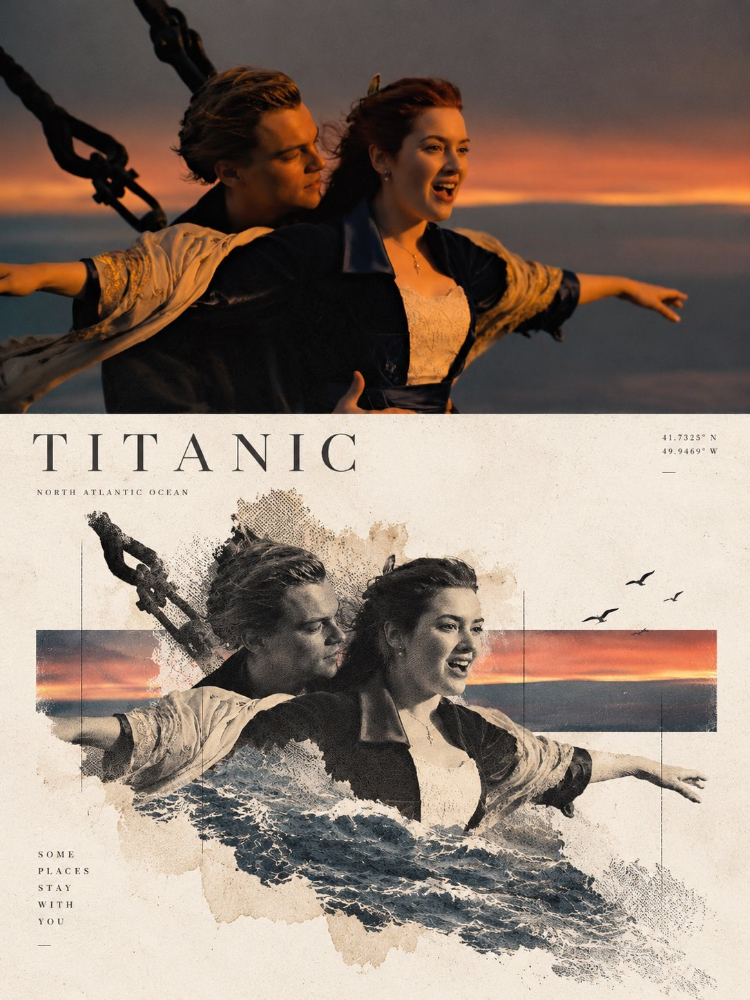

# Contemporary Travel-Art Poster from a Landscape Photo

**中文标题：** 风景照→当代旅行艺术海报  
**ID:** `gi25-x-718` · **Mode:** `edit`  
**Categories:** `poster-typography`, `edit-change-preserve`  
**Tags:** `x-twitter`, `community`, `gpt-image-2.5`, `x-direct`, `en`



### Contemporary Travel-Art Poster from a Landscape Photo

```text
Create a sophisticated contemporary travel-art poster from the uploaded londscape photograph.
Strict 3:4 vertical format.
The upper half must remain the original landscape photogroph. Preserve all important environmental structures, natural textures, lighting, shadows, horizon, architecture, people and perspective. Do not regenerate the scene.
The lower half reconstructs the landscape's strongest narrative element using delicate photographic fragments, halftone printing, subtle paper fibers and fading edges.
Use a single horizontal geometric color field sampled from the landscape. Let the reconstructed subject or horizon physically intersect this field.
Keep the background most white with muted tones derived from the original image. Avoid saturated colors.
The result should resemble a limited-edition museum travel poster rather than a conventional photo collage.
```

- **Recommended model:** `gpt-image-2.5-sunburst`
- **Settings:** _(defaults)_
- **Source:** [community](https://x.com/weiinberg/status/2108471613536739652) — @weiinberg
- **License note:** Original public X post; quoted with attribution — remix with attribution
- **Notes:** Collected directly from X; original post https://x.com/weiinberg/status/2108471613536739652; post text names GPT Image 2.5; discovered via Bin0754/gpt-image-gallery index, prompt re-verified against the original X post; verified=True
- **Preview:** `previews/gi25-x-718.jpg`
