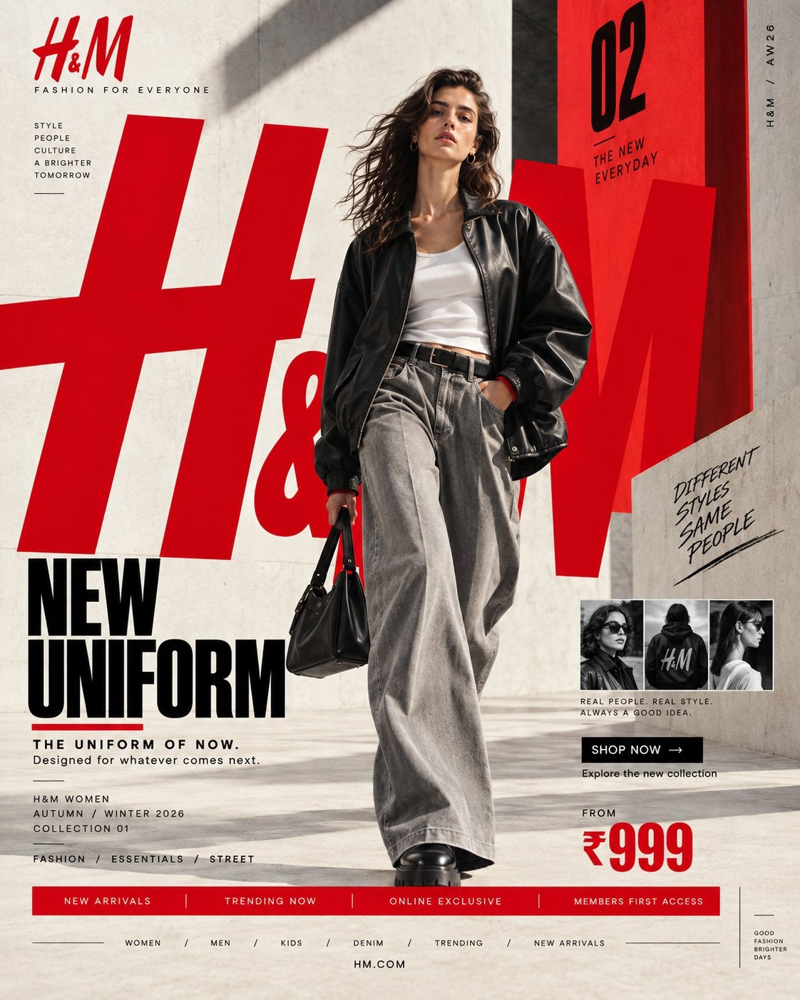

# H&M 'New Uniform' Brand Campaign Poster

**中文标题：** H&M「NEW UNIFORM」品牌广告海报  
**ID:** `gi25-x-721` · **Mode:** `generate`  
**Categories:** `poster-typography`, `ecommerce`  
**Tags:** `x-twitter`, `community`, `gpt-image-2.5`, `x-direct`, `en`



### H&M 'New Uniform' Brand Campaign Poster

```text
H&M — “NEW UNIFORM” I researched H&M’s current brand/visual system first. The strongest identifiable elements are H&M red + black/white, a bold fashion-led typographic system, dramatic in-the-moment photography, and H&M’s own type family. H&M’s published style guide specifically emphasizes dramatic contrast, captivating in-the-moment/action photography, while its typography system uses IBM Plex Sans for supporting copy and a condensed headline face for impact. H&M also maintains proprietary fonts including HMSans, HMSerif, HM Amperserif and HMMove. So unlike the MANGO direction, this should be more energetic, graphic, youthful and high-contrast rather than Mediterranean/minimal. ⸻ PROMPT — H&M “NEW UNIFORM” FORMAT Ultra-Premium H&M Fashion SMM Promotional Poster Vertical 4:5 Instagram Hero Creative Global Fashion Retail Campaign Contemporary Fashion Advertising Commercial Fashion Graphic Design Agency-Level Art Direction Behance Front Page Quality 8K UHD Hyper-Realistic Fashion × Graphic Design × Street Culture Fusion High-Impact Visual Communication Zero AI Slop Zero Generic Fast-Fashion Advertising Zero Catalogue Aesthetic Zero Luxury-Copycat Aesthetic ⸻ CORE STRATEGY This is not simply a clothing advertisement. This is H&M turned into a visual statement. The campaign should communicate: fashion moves fast. culture moves faster. H&M should feel: accessible + expressive + contemporary + youthful + global + confident. The visual language should combine: H&M fashion campaign × editorial magazine × street-culture poster × high-fashion graphic design × digital-first social advertising The result should feel unmistakably H&M, not Zara, Mango, COS or a generic luxury fashion brand. H&M’s own published style direction emphasizes dramatic contrast and in-the-moment photography, so the photography should feel alive rather than static. ⸻ CAMPAIGN IDEA “NEW UNIFORM” Forget traditional uniforms. This is: THE UNIFORM OF NOW. The clothes represent the constantly changing identity of a new generation. One day: minimal. Next day: street. Next: tailored. Next: experimental. H&M becomes the wardrobe that keeps up. The campaign message: THE UNIFORM CHANGES. YOU DON’T HAVE TO. ⸻ MASTER VISUAL Create an enormous typographic structure reading: H&M The typography should occupy approximately 60–70% of the entire composition. But unlike the MANGO concept, the H&M typography should feel: bold compressed graphic energetic slightly disruptive The giant H&M lettering can be: partially cropped, stacked, repeated, layered, hidden behind the model, intersected by red graphic blocks, cut by diagonal photographic frames, and pushed beyond the canvas. The typography should feel like a physical poster installation, not simple text. ⸻ HERO SUBJECT Young female fashion model. Contemporary global fashion appearance. Natural skin texture. Strong expressive face. Minimal but polished makeup. Confident expression. No artificial influencer smile. No exaggerated luxury pose. The model should feel like someone who actually belongs in the city. Youthful. Self-assured. Energetic. Culturally aware. ⸻ WARDROBE Create a contemporary H&M fashion look. HERO LOOK Oversized black leather-effect bomber jacket. Crisp white fitted tank. Relaxed wide-leg grey trousers. Chunky black footwear. Small silver jewelry. Structured mini shoulder bag. Subtle red accessory detail. Layered styling. The clothing should feel: accessible fashion elevated through styling. Not couture. Not runway costume. Not quiet luxury. Not excessive branding. The clothes should look genuinely wearable. ⸻ POSE / MOVEMENT The model is captured mid-stride. One foot forward. Jacket moving naturally. Hair slightly moving. Body turned approximately 15 degrees. Direct eye contact. One hand adjusting the jacket. Other hand relaxed. The image should feel like a moment captured rather than a pose performed. This directly aligns with H&M’s published preference for dramatic, in-the-moment/action-oriented imagery. ⸻ COMPOSITION TYPOGRAPHY 60–70% MODEL 20–25% GRAPHIC / PROMOTIONAL INFORMATION 10–15% Visual hierarchy: H&M ↓ NEW UNIFORM ↓ MODEL ↓ COLLECTION INFORMATION ↓ CTA Create strong visual tension between the model and typography. The model should partially cover the giant letters. ⸻ H&M COLOR SYSTEM PRIMARY H&M RED Strong saturated red. Use approximately: #E50010 as the primary visual reference. BLACK #000000 Used for: typography, fashion, graphic blocks, borders, micro typography. WHITE #FFFFFF Used for: negative space, copy, graphic panels, background areas. The recognizable H&M visual palette is strongly associated with red, black and white. ⸻ COLOR RATIO 60% White / light neutral 20% Black 15% H&M Red 5% photographic natural tones The red should be strategic, not flooding the entire poster. Use red as a visual trigger. Red graphic rectangle. Red typography. Red edge strip. Red accessory. Red CTA. The eye should naturally travel toward the red elements. ⸻ BACKGROUND Create a contemporary urban studio environment. White architectural walls. Concrete floor. Large geometric panels. Sharp sunlight. Hard shadows. One massive H&M red architectural block. Black graphic planes. Subtle paper/poster texture. The environment should feel halfway between: fashion studio and urban billboard installation. No recognizable city. No distracting scenery. No luxury hotel. No generic streetwear alley. The graphic environment itself should create the H&M world. ⸻ GRAPHIC DESIGN SYSTEM Create an aggressive but controlled editorial grid. Use: bold horizontal rules, vertical lines, red rectangles, black blocks, oversized numerals, micro typography, cropped type, collection codes, thin borders, small directional arrows, photographic crop windows. Introduce a subtle poster-within-poster system. For example: a small secondary campaign image appears inside a red frame. Beside it: 01 / 04 NEW SEASON H&M WOMEN This gives the composition the feeling of a sophisticated global fashion campaign rather than a basic Instagram advertisement. ⸻ TYPOGRAPHY SYSTEM Use H&M’s established typographic character rather than generic fashion fonts. PRIMARY HEADLINE Condensed, uppercase, bold display typography inspired by H&M’s headline system. Extremely large scale. Tight leading. Minimal tracking. Hard geometric presence. H&M’s published style guide identifies a condensed caps-only headline typeface for high-impact headlines, while IBM Plex Sans is used for longer supporting copy. SUPPORTING COPY Clean grotesk / sans-serif. IBM Plex Sans-style characteristics. Highly readable. Neutral. Modern. ⸻ TOP LEFT Small official-style H&M logo placement. Below: FASHION FOR EVERYONE Very small. Do not compete with the hero typography. Preserve generous clear space around the logo. H&M’s published logo guidance stresses maintaining clear space and avoiding distortion or unsuitable treatment. ⸻ GIANT CENTER TYPOGRAPHY Massive: H&M Then layered behind it: NEW UNIFORM The giant H&M lettering should extend outside the frame. Crop: left side, top, right side. The typography should physically interact with the model. ⸻ CAMPAIGN TITLE Lower-left: NEW UNIFORM Use extremely bold condensed uppercase typography. Make UNIFORM substantially larger than NEW. Add a small red underline. ⸻ SUPPORTING COPY THE UNIFORM OF NOW. Secondary line: Designed for whatever comes next. Keep it short. No paragraph. No unnecessary marketing copy. ⸻ COLLECTION INFORMATION Small structured block: H&M WOMEN AUTUMN / WINTER 2026 COLLECTION 01 NEW SEASON FASHION / ESSENTIALS / STREET Use micro typography. ⸻ PROMOTIONAL STRIP Create a thin H&M red horizontal block containing: NEW ARRIVALS TRENDING NOW ONLINE EXCLUSIVE MEMBERS FIRST ACCESS White uppercase typography. The strip should feel integrated into the grid. Not like a sale banner. ⸻ CTA Bottom-right: SHOP NOW → Black rectangular button. White typography. Underneath: Explore the new collection Keep the button compact. ⸻ PRICE Bottom-right corner: FROM ₹999 Large enough to be commercially readable. But secondary to the fashion statement. Do not make the poster look like a discount advertisement. ⸻ BOTTOM FEATURE STRIP Thin black rule. Then: WOMEN / MEN / KIDS / DENIM / TRENDING / NEW ARRIVALS Centered beneath: ⸻ VERTICAL EDGE TEXT Right edge: H&M / AW26 Rotated vertically. Small. Precise. ⸻ RED GRAPHIC DEVICE Create one enormous H&M-red rectangle behind the model. Inside the rectangle: 02 Large black number. Underneath: THE NEW EVERYDAY This becomes the campaign’s visual signature. The red block should feel almost like a piece of Swiss graphic design translated into contemporary fashion advertising. ⸻ PHOTOGRAPHIC STYLE High-energy fashion photography. Dramatic contrast. Sharp moment. Natural movement. Hard directional light. Deep shadows. Bright whites. Saturated H&M red. Natural skin. Realistic fabric. Subtle motion in clothing. H&M’s published style guide specifically calls for dramatic contrast and captivating in-the-moment imagery, with action shots as the primary photographic direction. ⸻ LIGHTING Large directional studio source. Strong side lighting. Controlled hard shadows. Bright white highlights. Deep black clothing separation. Red surfaces receiving rich saturated light. Natural skin exposure. No beauty-dish glamour. No soft luxury haze. No excessive bloom. No artificial neon. ⸻ CAMERA ARRI Alexa Mini LF 50mm fashion/editorial lens Slightly low camera angle. Full-body composition. Fast-fashion campaign energy. Moderate depth of field. Extremely sharp clothing texture. Natural movement. High dynamic range. Premium commercial fashion photography. ⸻ POST-PRODUCTION Contemporary global fashion campaign grading. Clean whites. Deep blacks. Highly saturated controlled red. Natural skin tones. Subtle film grain. Visible textile texture. Crisp typography. Sharp graphic edges. Controlled contrast. No excessive retouching. No plastic skin. No artificial HDR. No fake luxury glow. No cinematic teal-orange grade. No excessive grain. ⸻ BRAND SAFETY / CONSISTENCY The final visual must immediately read as: H&M without relying solely on the logo. Brand recognition should come from: red / black / white bold condensed typography dramatic in-motion photography accessible contemporary styling graphic campaign language youthful global fashion energy strong commercial communication Do not make it resemble: ZARA’s restrained editorial minimalism. MANGO’s Mediterranean warmth. COS’s architectural minimalism. Prada’s intellectual luxury. Louis Vuitton’s heritage luxury. The visual identity must remain H&M. ⸻ FINAL FEEL If: H&M × a global fashion magazine × a contemporary graphic design studio × street culture × a giant urban billboard created one campaign together. Not a catalogue. Not a generic fast-fashion ad. Not a luxury fashion imitation. Not a simple red-and-white poster. A high-impact H&M campaign where typography, movement, fashion and graphic design become one visual system. Vertical 4:5 — 8K UHD — hyper-realistic — dramatic in-the-moment fashion photography — H&M red/black/white palette — oversized condensed typography — precise editorial grid — realistic human anatomy — natural skin — detailed fabrics — accurate H&M branding treatment — crisp readable typography — premium commercial photography — agency-level art direction — Instagram hero creative — Behance front-page quality — print-ready.
```

- **Recommended model:** `gpt-image-2.5-sunburst`
- **Settings:** _(defaults)_
- **Source:** [community](https://x.com/Diplomeme/status/2107784613708136595) — @Diplomeme
- **License note:** Original public X post; quoted with attribution — remix with attribution
- **Notes:** Collected directly from X; original post https://x.com/Diplomeme/status/2107784613708136595; post text names GPT Image 2.5; discovered via Bin0754/gpt-image-gallery index, prompt re-verified against the original X post; verified=True; Nano Banana 2.1 vs GPT Image 2.5 comparison — preview is image 2 (GPT Image 2.5)
- **Preview:** `previews/gi25-x-721.jpg`
