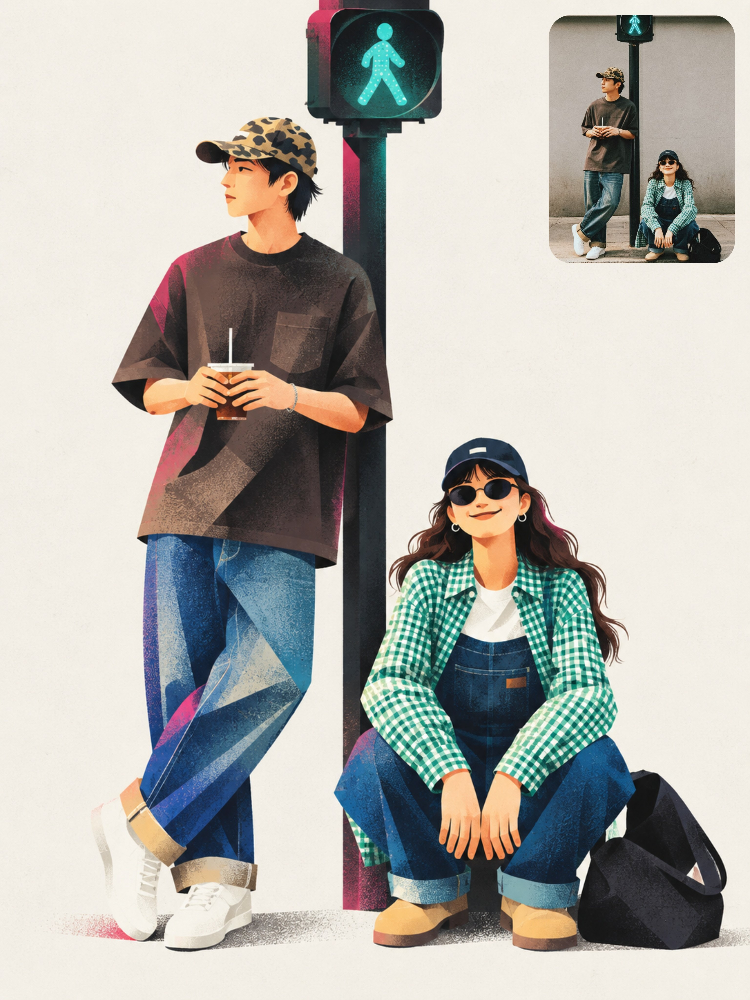

# Flat Geometric Editorial Character Poster from Reference

**中文标题：** 参考图→扁平几何杂志风角色海报  
**ID:** `gi25-x-722` · **Mode:** `edit`  
**Categories:** `poster-typography`, `character-consistency`  
**Tags:** `x-twitter`, `community`, `gpt-image-2.5`, `x-direct`, `en`



### Flat Geometric Editorial Character Poster from Reference

```text
Create a finished editorial character poster inspired by the uploaded reference image. Preserve the recognizable identity, hairstyle, clothing details, pose, and important visual characteristics of the subject while translating them into a sophisticated flat geometric illustration.

FORMAT LOCK

Vertical 3:4 composition. Edge-to-edge warm off-white paper background. One standalone poster. Clean editorial layout.

CHARACTER

One adult character constructed from a few oversized asymmetric geometric shapes. Slightly exaggerated proportions, small head, elongated capsule-like limbs, simple mitten-style hands, and one oversized object integrated naturally into the pose and silhouette. Preserve the subject's recognizable appearance while simplifying details into graphic shapes.

STYLE

Flat geometric illustration, asymmetric proportions, crisp color blocks, soft airbrushed shading, subtle dark-to-color spray gradients where shapes overlap, fine print grain, delicate stippling mostly inside darker areas, refined contemporary editorial poster aesthetic.

FACE & EXPRESSION

Minimal black cut-paper facial features: simple crescent eyes and minimal mouth. The emotion should be communicated primarily through the character's full-body gesture and silhouette rather than detailed facial expression.

PALETTE

Warm off-white #F3F1EB, near-black 10100F, hot pink #F553D2, warm red #F42726, cobalt 293EA1, emerald 13785D. Keep colors flat and graphic with controlled soft gradients only where forms overlap.

Keep the character and oversized object as the main visual focus. Use generous negative space and a balanced editorial arrangement. The object should visibly affect the overall silhouette and feel integrated into the character's pose.

NEGATIVE PROMPT

No extra text, logos, outlined cartoon style, glossy 3D, realistic skin, photorealism, coarse canvas texture, busy background, extra limbs, distorted anatomy, excessive facial detail, photorealistic shading, random objects, clutter, watermark.
```

- **Recommended model:** `gpt-image-2.5-sunburst`
- **Settings:** _(defaults)_
- **Source:** [community](https://x.com/Shorelyn_/status/2108532094796533952) — @Shorelyn_
- **License note:** Original public X post; quoted with attribution — remix with attribution
- **Notes:** Collected directly from X; original post https://x.com/Shorelyn_/status/2108532094796533952; post text names GPT Image 2.5; discovered via Bin0754/gpt-image-gallery index, prompt re-verified against the original X post; verified=True
- **Preview:** `previews/gi25-x-722.jpg`
