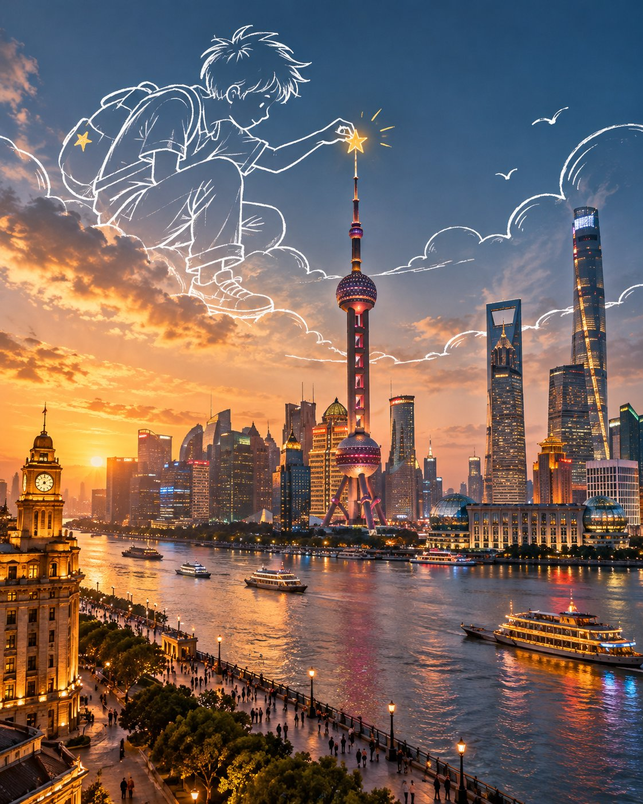

# Conceptual Travel Artwork Template

**中文标题：** 概念旅行艺术画模板  
**ID:** `gi25-x-727` · **Mode:** `generate`  
**Categories:** `poster-typography`  
**Tags:** `x-twitter`, `community`, `gpt-image-2.5`, `x-direct`, `en`



### Conceptual Travel Artwork Template

```text
Create a premium 4:5 vertical conceptual travel artwork for [COUNTRY / CITY / LOCATION / SUBJECT].

GENERATIVE IMAGE ONLY.
Create the complete artwork entirely from the written [COUNTRY / CITY / LOCATION / SUBJECT]. Do not use, request, require, inspect, modify, or reference any existing image. No source image is needed.

CORE CONCEPT:
Create a highly realistic cinematic travel scene combined with oversized white hand-drawn doodle illustrations. The destination itself forms the complete visual foundation, while imaginative white sketch figures interact with the real architecture, landscape, objects, and atmosphere.

DESTINATION:
Automatically determine the most recognizable architecture, landscape, streets, structures, transportation, natural features, and cultural details associated with [COUNTRY / CITY / LOCATION / SUBJECT]. Build one coherent scene with accurate perspective, believable materials, natural lighting, and authentic local character.

DOODLE INTERACTION:
Introduce only one strong visual idea. Create oversized white hand-drawn figures that actively interact with something naturally present in the scene. They may climb, hold, repair, paint, pull, carry, explore, play with, or transform a real environmental element. Their hands, feet, props, and gestures must connect naturally with the surrounding architecture or landscape.

DOODLE STYLE:
Loose white marker/chalk line drawings, simple expressive figures, minimal facial features, imperfect hand-drawn strokes, varied line thickness, playful proportions, natural gestures, subtle whimsical character. The drawings should feel like elegant hand-drawn lines existing within the scene, never like stickers, clip-art, comic characters, or 3D cartoons.

COMPOSITION:
Keep the realistic destination as the dominant visual layer. Place the white drawings mainly within natural open areas such as sky, water, roads, walls, or atmospheric space. Allow creative scale differences between the drawings and the environment while maintaining believable perspective and spatial relationships.

COLOR:
Use the authentic colors and lighting of the chosen destination as the main palette. White linework is the primary graphic accent. Add only a small amount of warm mustard-gold/yellow to selected doodle details such as a prop, light, ribbon, flower, clothing detail, or small object.

VISUAL LANGUAGE:
Cinematic realism × hand-drawn illustration × surreal scale play × visual metaphor × conceptual travel art × premium editorial advertising.

MOOD:
Clever, imaginative, minimal, warm, playful, sophisticated, cinematic, and visually memorable. The concept should be immediately understandable but reveal additional details on closer inspection.

AVOID:
Existing-image editing, image references, source images, copied photographs, image recreation, photo manipulation, collage, altered landmarks, unrelated architecture, excessive characters, full-screen doodles, thick black outlines, sticker effects, 3D cartoon characters, generic cartoon scenery, clutter, excessive effects, text, logos, watermarks, UI elements.

OUTPUT:
4:5 vertical composition, ultra-detailed realistic environment, seamless white hand-drawn interaction, premium conceptual travel artwork, polished editorial quality.
```

- **Recommended model:** `gpt-image-2.5-sunburst`
- **Settings:** _(defaults)_
- **Source:** [community](https://x.com/Goodmanprotocol/status/2108112844239892599) — @Goodmanprotocol
- **License note:** Original public X post; quoted with attribution — remix with attribution
- **Notes:** Collected directly from X; original post https://x.com/Goodmanprotocol/status/2108112844239892599; post text names GPT Image 2.5; discovered via Bin0754/gpt-image-gallery index, prompt re-verified against the original X post; verified=True
- **Preview:** `previews/gi25-x-727.jpg`
