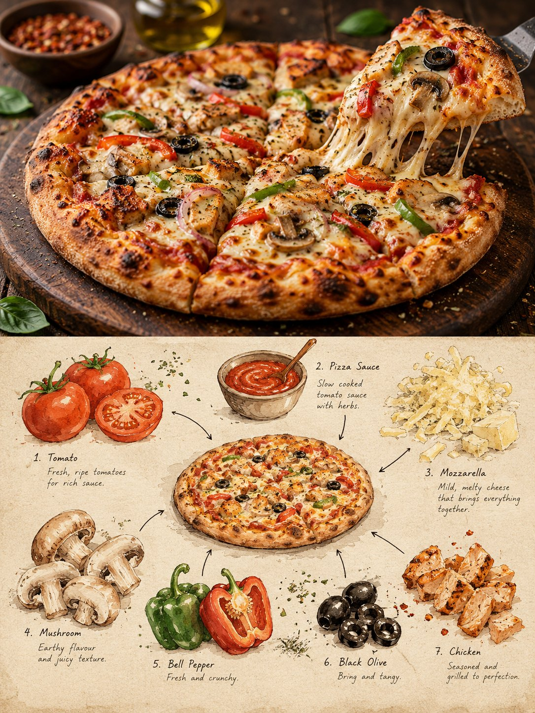

# Editorial Local-Food Art Poster Template

**中文标题：** 编辑风地方美食艺术海报模板  
**ID:** `gi25-x-728` · **Mode:** `generate`  
**Categories:** `poster-typography`  
**Tags:** `x-twitter`, `community`, `gpt-image-2.5`, `x-direct`, `en`



### Editorial Local-Food Art Poster Template

```text
Create a premium 3:4 vertical editorial food-art poster for [COUNTRY / CITY / LOCAL DISH / FOOD SUBJECT].

TEXT-TO-IMAGE ONLY.
Generate the entire composition from the written dish or food subject alone. Do not request, upload, use, or depend on any reference image or existing photograph. Automatically identify the dish’s authentic appearance, ingredients, textures, and cultural identity.

CORE CONCEPT:
Create one elegant travel-food editorial poster combining realistic food photography in the upper section with a handmade ingredient-observation sketchbook in the lower section. Feature ONE recognizable plate or bowl containing a single dish, with at least three visually distinct ingredients.

UPPER SECTION — REALISTIC FOOD PHOTOGRAPHY:
Occupy approximately 48% of the canvas height. Create a beautifully composed, authentic photographic view of the specified local dish, preserving believable ingredient textures, natural lighting, realistic proportions, and culturally accurate presentation. Use subtle food-magazine color grading and extremely light film grain. Keep the entire plate or bowl visible.

SECTION DIVIDER:
Separate both sections with a straight, clean horizontal boundary. A very thin warm-ivory paper strip is optional. No gradients, blending, or elements crossing the divider.

LOWER SECTION — INGREDIENT OBSERVATION SHEET:
Use warm ivory drawing paper with visible fibers, fine grain, faint smudges, and subtle handmade irregularities. Create a sparse, asymmetrical food-field-note composition rather than repeating the full photographic dish.

Place ONE small, simplified but recognizable illustration of the complete dish near the center. Keep it secondary and compact, occupying approximately one-third of the lower section’s width.

Around it, illustrate 3–6 individually selected ingredients inferred from the dish. Use small watercolor specimens, cut-surface studies, herb sketches, grain clusters, sauce swatches, or distinctive ingredient shapes. Arrange them at varied sizes and angles with generous breathing room.

DRAWING STYLE:
Matte gouache, delicate black-ink outlines, slightly hesitant hand-drawn strokes, dry-brush gaps, uneven pigment coverage, soft watercolor edges, visible paper texture, and restrained natural colors. Keep ingredients recognizable without excessive detail. Add a few fine arrows and small handwritten numbers connecting specimens to the miniature dish.

TYPOGRAPHY:
Use minimal, understated editorial annotations only when helpful. Short ingredient names or tiny handwritten notes are acceptable. Keep all text small and secondary; avoid unnecessary titles or decorative lettering.

COLOR PALETTE:
Derive the colors naturally from the dish, balanced by warm cream, muted earth tones, and subtle ink details.

FINAL AESTHETIC:
Authentic local food photography × handmade ingredient studies × refined travel-food editorial × collectible culinary field notebook.

AVOID:
Multiple dishes, duplicate plates, mixed meals, inaccurate ingredients, excessive garnish, crowded layouts, gradients, bleeding transitions, glossy digital painting, flat vector infographics, 3D rendering, commercial menu styling, excessive text, logos, watermarks, and interface elements.

FORMAT:
3:4 vertical portrait, approximately 48% photographic food scene above and 52% illustrated ingredient-observation sheet below, crisp horizontal separation, generous negative space, premium publication quality, ultra-high definition.
```

- **Recommended model:** `gpt-image-2.5-sunburst`
- **Settings:** _(defaults)_
- **Source:** [community](https://x.com/Goodmanprotocol/status/2108555814604812483) — @Goodmanprotocol
- **License note:** Original public X post; quoted with attribution — remix with attribution
- **Notes:** Collected directly from X; original post https://x.com/Goodmanprotocol/status/2108555814604812483; post text names GPT Image 2.5; discovered via Bin0754/gpt-image-gallery index, prompt re-verified against the original X post; verified=True
- **Preview:** `previews/gi25-x-728.jpg`
