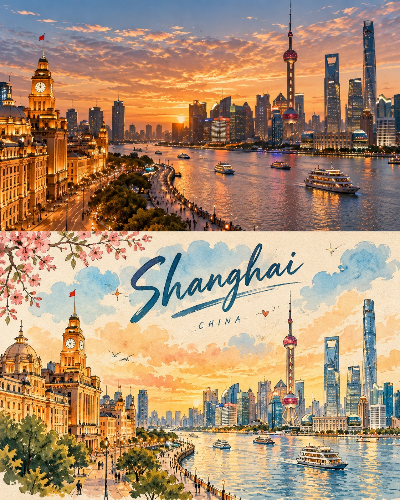

# Full-Frame Photo-to-Illustration Travel Poster

**中文标题：** 全幅照片转插画旅行海报  
**ID:** `gi25-x-729` · **Mode:** `generate`  
**Categories:** `poster-typography`  
**Tags:** `x-twitter`, `community`, `gpt-image-2.5`, `x-direct`, `en`



### Full-Frame Photo-to-Illustration Travel Poster

```text
Create a premium FULL-FRAME 4:5 vertical photo-to-illustration travel poster for [COUNTRY / CITY / LOCATION / SUBJECT].

TEXT-TO-IMAGE ONLY — generate everything from the written subject alone. No reference image required.

CORE CONCEPT:
Create a charming vintage travel-journal poster with a precise horizontal split: the upper 50% features a realistic photographic scene, while the lower 50% transforms the SAME scene into a beautiful hand-painted travel illustration.

COMPOSITION:
Keep the main subject consistent across both halves. The upper section features natural lighting, authentic textures, and realistic details. The lower section reimagines the scene using simplified shapes, soft watercolor and gouache, and a warm cream paper background.

STYLE:
Retro travel postcards, hand-painted architecture, delicate botanical details, playful handwritten lettering, tiny stars and hearts, and subtle paper texture. Add a short, creative English headline and a small destination label inspired by the scene.

COLORS:
Warm ivory, sky blue, muted teal, sunny yellow, coral, sage green, and terracotta. Use cheerful, harmonious colors with a nostalgic afternoon atmosphere.

FINAL AESTHETIC:
Real photography × illustrated travel memory × vintage editorial design × playful handwritten typography.

AVOID:
Combining unrelated scenes, changing the main subject between halves, clutter, excessive text, glossy digital art, 3D, logos, watermarks, and mockups.

FORMAT:
Exact 4:5 vertical ratio, full-bleed artwork, complete canvas coverage, clean 50/50 horizontal split, high resolution.
```

- **Recommended model:** `gpt-image-2.5-sunburst`
- **Settings:** _(defaults)_
- **Source:** [community](https://x.com/Goodmanprotocol/status/2109128907764977963) — @Goodmanprotocol
- **License note:** Original public X post; quoted with attribution — remix with attribution
- **Notes:** Collected directly from X; original post https://x.com/Goodmanprotocol/status/2109128907764977963; post text names GPT Image 2.5; discovered via Bin0754/gpt-image-gallery index, prompt re-verified against the original X post; verified=True
- **Preview:** `previews/gi25-x-729.jpg`
