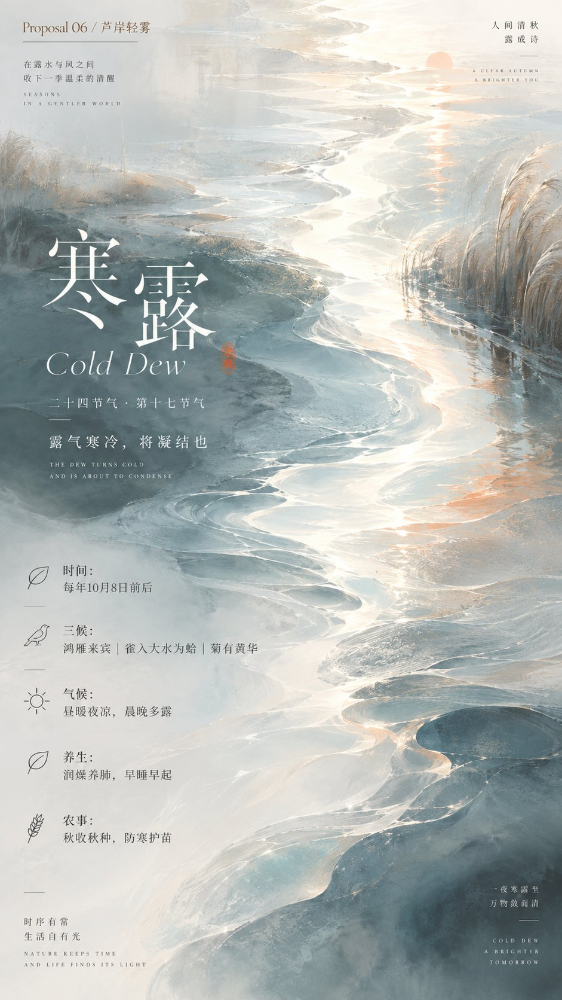

# Clear Water-Flow Abstract Poster Field (Solar-Terms Set)

**中文标题：** 清透水流感抽象场域海报（二十四节气组）  
**ID:** `gi25-x-732` · **Mode:** `generate`  
**Categories:** `poster-typography`  
**Tags:** `x-twitter`, `community`, `gpt-image-2.5`, `x-direct`, `zh`



### Clear Water-Flow Abstract Poster Field (Solar-Terms Set)

```text
围绕任意主题对象生成一张安静、清透、带有水面流动感的视觉画面：主题不以具象物堆叠出现，而是被转译为大面积可呼吸的抽象场域，主体形态由层层横向拖拽的柔软笔触、轻微波纹、半透明色块和边缘参差的负形光带共同塑造。画面第一眼应读到一条从上方缓慢游走到深处的明亮通道，它像光在介质中被折射后留下的空隙，左右两侧以深浅不同的主题色形成温和的图底张力；边界不要硬切，要有被水波拉长、晕开、再收住的节奏。色彩从主题自身的材质、季节、情绪或品牌语义中提取，映射为大面积清透高明度底色、较深的结构暗部、柔和的次级支撑色和少量干净强调色，保持明亮洁净、冷暖轻微牵引、饱和度受控、色阶清晰的关系，避免浑浊、陈旧或灰脏覆盖。文字如果出现，应作为轻量信息层悬停在画面中：主标题居于最安静的视觉停顿处，字距疏朗、笔画干净、白色或主题派生的浅色，辅助信息更小、更轻，整体像漂浮在水面上而不是压住背景。最终画面要有广告级的精确留白、丝滑但可见的手工涂抹纹理、透明层次和克制的仪式感，失败状态是把它做成普通风景、杂乱插画、固定色卡复刻或只剩文字排版。

——————
主题：节气海报，寒露
注意：至少8个不同层级的信息点

比例9:16
一共满足这个主题之下，8种类不同的设计竞标方案， 避免雷同的配色，避免雷同的创意
```

- **Recommended model:** `gpt-image-2.5-sunburst`
- **Settings:** _(defaults)_
- **Source:** [community](https://x.com/xiaoxiaodong/status/2108118877590680061) — @xiaoxiaodong
- **License note:** Original public X post; quoted with attribution — remix with attribution
- **Notes:** Collected directly from X; original post https://x.com/xiaoxiaodong/status/2108118877590680061; post text names GPT Image 2.5; discovered via Bin0754/gpt-image-gallery index, prompt re-verified against the original X post; verified=True
- **Preview:** `previews/gi25-x-732.jpg`
