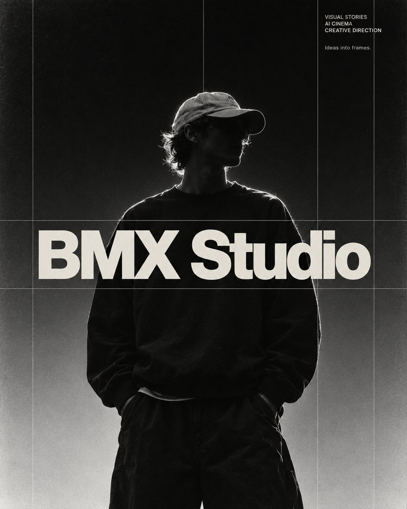

# Monochrome Streetwear Editorial Poster

**中文标题：** 黑白街头风编辑海报  
**ID:** `gi25-x-737` · **Mode:** `edit`  
**Categories:** `poster-typography`  
**Tags:** `x-twitter`, `community`, `gpt-image-2.5`, `x-direct`, `en`



### Monochrome Streetwear Editorial Poster

```text
Create a monochrome editorial poster inspired by the reference image, vertical 4:5 aspect ratio. A young man wearing a light baseball cap and an oversized black sweatshirt stands centrally, hands tucked into his pockets, head turned slightly to the right. His face remains obscured by deep shadow. Strong backlighting outlines his hair, cap, and shoulders. The background transitions from near-black at the top to soft silver-gray at the bottom. Rich blacks, pronounced analog film grain, subtle print texture, and a raw underground fashion aesthetic.
Place oversized, bold, off-white Helvetica-style typography across his chest, reading exactly “BMX Studio”. Keep the lettering crisp, tightly spaced, and visually dominant.
In the upper-right corner, add small, left-aligned text on three lines:
“VISUAL STORIES”
“AI CINEMA”
“CREATIVE DIRECTION”
Below it, add the smaller phrase:
“Ideas into frames.”
Include delicate gray vertical and horizontal grid lines framing the central title and dividing the composition into precise editorial columns. Preserve generous negative space above the subject. Restrained, confident art direction with realistic photography and clean typography. No original reference text, website address, additional words, or watermarks
```

- **Recommended model:** `gpt-image-2.5-sunburst`
- **Settings:** _(defaults)_
- **Source:** [community](https://x.com/bmx_ai13/status/2108799941569356086) — @bmx_ai13
- **License note:** Original public X post; quoted with attribution — remix with attribution
- **Notes:** Collected directly from X; original post https://x.com/bmx_ai13/status/2108799941569356086; post text names GPT Image 2.5; discovered via Bin0754/gpt-image-gallery index, prompt re-verified against the original X post; verified=True
- **Preview:** `previews/gi25-x-737.jpg`
