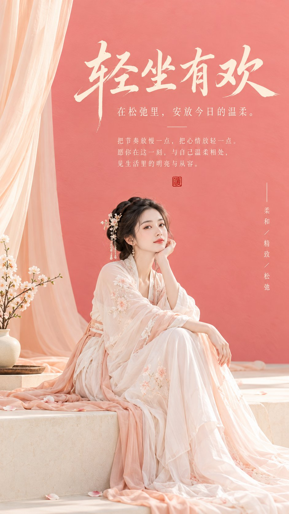

# Eastern Zen Minimalist Cover Poster in Coral Pink

**中文标题：** 东方禅意极简封面海报：珊瑚粉  
**ID:** `gi25-x-738` · **Mode:** `generate`  
**Categories:** `poster-typography`  
**Tags:** `x-twitter`, `community`, `gpt-image-2.5`, `x-direct`, `zh`



### Eastern Zen Minimalist Cover Poster in Coral Pink

```text
主题方向：东方禅意极简封面海报
风格分支：女性审美爆款型
主体内容：一位古风女子坐在低矮台面边缘，身体略侧，安静看向前方
情绪母题：柔和、精致、轻松松弛感
场景与意象：珊瑚粉大色块背景、浅色台面、女子、少量垂落布幔、干净留白
构图与空间：9:16竖版构图，珊瑚粉背景大色块位于中上部形成主视觉，人物位于下方偏中，顶部留出明显标题区
色彩控制：奶白作为整体高明度基底，珊瑚粉用于主背景色块，少量柔杏色用于台面或布幔，人物服装建议珍珠白或浅粉白；避免整图粉化发腻
光线与质感：明亮柔光，轮廓清楚，低灰度，干净平面封面感
画幅比例：9:16
补充要求：背景色块必须简洁有力，人物要精致耐看，整体要有小红书高颜值封面吸引力，画面留白处配上合适的文字
```

- **Recommended model:** `gpt-image-2.5-sunburst`
- **Settings:** _(defaults)_
- **Source:** [community](https://x.com/liyue_ai/status/2108812869907140960) — @liyue_ai
- **License note:** Original public X post; quoted with attribution — remix with attribution
- **Notes:** Collected directly from X; original post https://x.com/liyue_ai/status/2108812869907140960; post text names GPT Image 2.5; discovered via Bin0754/gpt-image-gallery index, prompt re-verified against the original X post; verified=True
- **Preview:** `previews/gi25-x-738.jpg`
