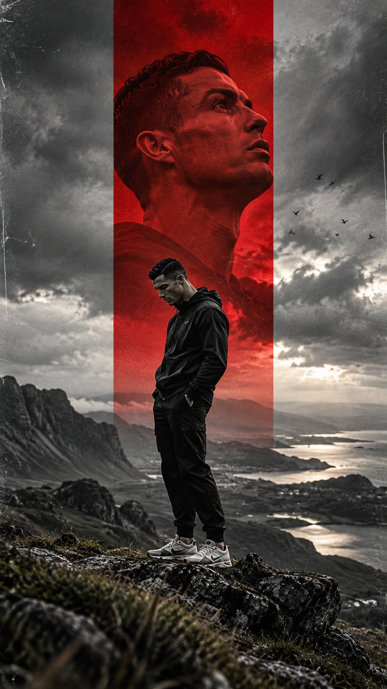

# Nordic Mountain Cinematic Athlete Poster Template

**中文标题：** 北欧雪山电影感球星海报模板  
**ID:** `gi25-x-743` · **Mode:** `generate`  
**Categories:** `poster-typography`  
**Tags:** `x-twitter`, `community`, `gpt-image-2.5`, `x-direct`, `en`



### Nordic Mountain Cinematic Athlete Poster Template

```text
Create an ultra-photorealistic cinematic editorial poster featuring [PLAYER NAME], with extremely accurate facial identity, natural skin texture, authentic facial anatomy, and recognizable hairstyle.

COMPOSITION — 9:16 Vertical

A breathtaking, desolate Nordic mountain landscape featuring dramatic rocky cliffs, distant fjords, mist-covered valleys, and an enormous stormy sky. Moody black-and-white 35mm film photography with deep shadows, rich contrast, realistic atmospheric depth, subtle grain, and vintage film scratches.

A bold, perfectly vertical [ACCENT COLOR] rectangular panel dominates the center of the composition, extending from the upper edge toward the lower landscape.

DOUBLE EXPOSURE PORTRAIT

Inside the upper portion of the colored panel, an enormous, hyper-realistic close-up portrait of [PLAYER NAME], looking upward toward the distant horizon with a serious, powerful, contemplative expression. Dramatic side lighting reveals realistic pores, facial structure, individual hair strands, and natural skin imperfections. The portrait blends seamlessly into the stormy atmosphere.

FULL-BODY SUBJECT

Below the giant portrait, the same player stands alone on a rugged, windswept rocky mountain ledge, wearing a premium black oversized hoodie, relaxed black athletic pants, and realistic white sneakers.

Side-profile composition, head slightly lowered, hands inside pockets, shoulders relaxed. A quiet, introspective posture.

The full-body figure must remain proportionally realistic and significantly smaller than the giant background portrait, emphasizing loneliness, scale, and emotional depth.

VISUAL STYLE

Premium Nike-style sports editorial photography, minimalist indie album cover aesthetic, cinematic double exposure, professional graphic design, authentic 35mm analog film texture, subtle distressed paper scratches, natural atmospheric haze, dramatic cloud formations, sophisticated monochrome grading with one striking accent color.

Photographic realism throughout. No CGI appearance, artificial skin smoothing, cartoon effects, distorted anatomy, incorrect facial features, extra limbs, excessive sharpening, typography, watermarks, or logos.

QUALITY: Ultra-detailed 8K photographic aesthetic, realistic 85mm portrait detail combined with wide-angle environmental photography, professional editorial retouching, physically accurate lighting, cinematic tonal depth.

ASPECT RATIO: 9:16
```

- **Recommended model:** `gpt-image-2.5-sunburst`
- **Settings:** _(defaults)_
- **Source:** [community](https://x.com/TheVirtualMuse/status/2108392068548821280) — @TheVirtualMuse
- **License note:** Original public X post; quoted with attribution — remix with attribution
- **Notes:** Collected directly from X; prompt posted as the author's reply https://x.com/TheVirtualMuse/status/2108392068548821280 to https://x.com/TheVirtualMuse/status/2108392018745630805, which carries the images and names GPT Image 2.5; discovered via Bin0754/gpt-image-gallery index, prompt re-verified against the original X post; verified=True
- **Preview:** `previews/gi25-x-743.jpg`
