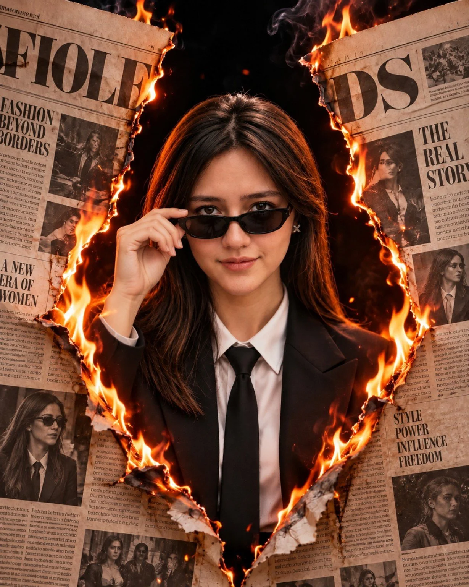

# Torn-Newspaper Fire Fashion Editorial (JSON Prompt)

**中文标题：** 撕裂报纸烈焰时装大片（JSON 提示词）  
**ID:** `gi25-x-746` · **Mode:** `generate`  
**Categories:** `poster-typography`  
**Tags:** `x-twitter`, `community`, `gpt-image-2.5`, `x-direct`, `en`



### Torn-Newspaper Fire Fashion Editorial (JSON Prompt)

```text
{
  "task": "image_generation",
  "style": "Ultra-photorealistic cinematic fashion editorial, luxury magazine cover, dramatic fire photography",
  "aspect_ratio": "4:5",
  "scene": {
    "environment": {
      "background": "Deep black background with subtle smoke and glowing embers",
      "main_elements": "Two oversized vintage newspaper pages torn apart to create a dramatic central opening",
      "atmosphere": "Bold, rebellious, powerful, mysterious and luxurious"
    },
    "main_subject": {
      "subject": "Young adult woman",
      "position": "Precisely centered inside the torn newspaper opening",
      "pose": "Standing upright with her shoulders relaxed, upper body facing forward",
      "hand_pose": "One hand raised to the upper corner of her sunglasses, gently holding the frame between her thumb and index finger as if adjusting them",
      "head_position": "Facing forward with a confident, slightly tilted head",
      "expression": "Calm, self-assured, composed with a subtle smile",
      "gaze": "Looking directly toward the camera through her sunglasses",
      "hair": {
        "color": "Dark brown",
        "style": "Long, straight hair with a natural center part, falling over both shoulders",
        "details": "Individual hair strands with warm orange highlights from the flames"
      },
      "accessories": [
        "Slim black rectangular sunglasses",
        "Small silver X-shaped earrings"
      ],
      "outfit": {
        "jacket": "Structured black tailored blazer with sharp lapels",
        "shirt": "Crisp white formal shirt",
        "tie": "Slim black necktie",
        "style": "Minimalist monochrome luxury fashion"
      }
    },
    "newspaper_effect": {
      "layout": "Large aged newspaper sheets covering the left and right sides of the frame",
      "opening": "Jagged irregular tear forming a large diamond-like opening around the woman",
      "paper_texture": "Vintage beige newsprint with bold black headlines, dense columns, editorial layouts and monochrome fashion photographs",
      "edges": "Rough, curled, charred paper edges with realistic burnt fibers",
      "fire": {
        "placement": "Bright flames running along the torn inner edges of both newspaper pages",
        "colors": [
          "Golden yellow",
          "Bright orange",
          "Deep amber"
        ],
        "behavior": "Natural irregular flames curling upward and around the central opening",
        "details": "Glowing embers, tiny sparks and delicate trails of dark smoke",
        "lighting_effect": "Warm firelight illuminating the woman's hair, cheeks and shoulders"
      }
    },
    "composition": {
      "framing": "Vertical waist-up portrait",
      "camera_angle": "Straight-on eye-level view",
      "subject_scale": "Woman occupies the central opening and remains the dominant focal point",
      "hand_visibility": "Raised hand clearly visible touching the sunglasses near the temple",
      "newspaper_placement": "Newspapers frame both sides of the woman",
      "foreground": "Burning paper edges and a few glowing embers",
      "background_depth": "Deep black negative space behind the subject",
      "focus": "Sharp focus on the woman's face, sunglasses and raised hand"
    },
    "lighting": {
      "key_light": "Soft frontal cinematic lighting",
      "rim_light": "Warm orange firelight outlining the hair and shoulders",
      "contrast": "Strong contrast between black clothing, pale newsprint and bright flames",
      "shadows": "Deep but detailed shadows",
      "skin_tone": "Natural realistic skin tones without excessive retouching"
    },
    "camera": {
      "type": "Professional full-frame camera",
      "lens": "50mm portrait lens",
      "aperture": "f/2.8",
      "focus": "Precise focus on the face and sunglasses",
      "depth_of_field": "Moderately shallow",
      "rendering": "Natural optical realism and cinematic color grading"
    },
    "quality": {
      "resolution": "4K",
      "realism": "Ultra-photorealistic",
      "textures": [
        "Natural skin texture",
        "Detailed individual hair strands",
        "Realistic black blazer fabric",
        "Aged newspaper fibers",
        "Charred curled paper edges",
        "Physically realistic flames and smoke"
      ],
      "finish": "Premium fashion campaign and dramatic editorial poster"
    },
    "negative_prompt": [
      "Cartoon",
      "Anime",
      "Illustration",
      "CGI appearance",
      "Plastic skin",
      "Over-smoothed face",
      "Distorted facial features",
      "Extra fingers",
      "Malformed hand",
      "Incorrect sunglasses grip",
      "Deformed sunglasses",
      "Fire covering the face",
      "Unrealistic flames",
      "Excessive smoke",
      "Floating newspaper pieces",
      "Blurry main subject",
      "Incorrect clothing",
      "Overexposed highlights",
      "Watermark",
      "Random logos",
      "Low resolution"
    ]
  }
}
```

- **Recommended model:** `gpt-image-2.5-sunburst`
- **Settings:** _(defaults)_
- **Source:** [community](https://x.com/AiwithLariab/status/2109503373955502304) — @AiwithLariab
- **License note:** Original public X post; quoted with attribution — remix with attribution
- **Notes:** Collected directly from X; original post https://x.com/AiwithLariab/status/2109503373955502304; post text names GPT Image 2.5; discovered via Bin0754/gpt-image-gallery index, prompt re-verified against the original X post via api.fxtwitter.com; verified=True; structured JSON prompt
- **Preview:** `previews/gi25-x-746.webp`
