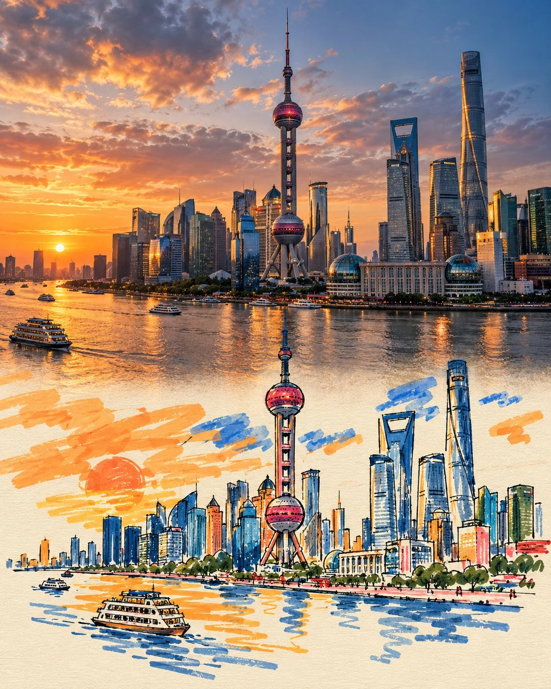

# Photo × Graffiti Art Split Travel Poster Template

**中文标题：** 实拍×涂鸦上下分割旅行海报模板  
**ID:** `gi25-x-748` · **Mode:** `generate`  
**Categories:** `poster-typography`  
**Tags:** `x-twitter`, `community`, `gpt-image-2.5`, `x-direct`, `en`



### Photo × Graffiti Art Split Travel Poster Template

```text
Create a premium FULL-FRAME 4:5 vertical Photo × Graffiti Art travel poster for [COUNTRY / CITY / LOCATION / SUBJECT].

TEXT-TO-IMAGE ONLY — generate everything creatively from the written subject alone. No reference image required.

CORE CONCEPT:
A cinematic realistic scene in the upper 50%, seamlessly transforming into minimalist, playful hand-drawn graffiti art on warm ivory paper in the lower 50%. One recognizable element naturally extends across the center, maintaining its original shape, perspective, colors, and direction.

ART STYLE:
Use chunky marker strokes and opaque paint pens, awkward rounded outlines, oversized simple shapes, tiny facial features where appropriate, and slightly wobbly hand-drawn lines. Preserve the subject’s identity while simplifying it into charming, naïve artwork.

COLOR & COMPOSITION:
Choose one dominant vivid color inspired by the scene, plus 1–2 accent colors. Keep secondary details mostly paper-white with sparse colored outlines. Use broad, imperfect paint strokes, subtle ink irregularities, and tiny handwritten English commentary. Remove unnecessary background details from the illustrated section and leave at least 70% of its area as clean negative space.

FINAL AESTHETIC:
Authentic photography × minimalist naïve graffiti × continuous visual transformation × contemporary travel editorial. Airy, playful, artistic, and collectible.

AVOID:
Visible seams, rigid dividing lines, gradients, shadows in the illustration, detailed background recreation, smooth vector curves, excessive lettering, borders, logos, watermarks, and interface elements.

FORMAT:
Full-bleed 4:5 vertical artwork. Exact 50/50 composition, with a natural, seamless transition and no external margins.
```

- **Recommended model:** `gpt-image-2.5-sunburst`
- **Settings:** _(defaults)_
- **Source:** [community](https://x.com/Goodmanprotocol/status/2109527714323452167) — @Goodmanprotocol
- **License note:** Original public X post; quoted with attribution — remix with attribution
- **Notes:** Collected directly from X; original post https://x.com/Goodmanprotocol/status/2109527714323452167; post text names GPT Image 2.5; discovered via Bin0754/gpt-image-gallery index, prompt re-verified against the original X post via api.fxtwitter.com; verified=True
- **Preview:** `previews/gi25-x-748.webp`
