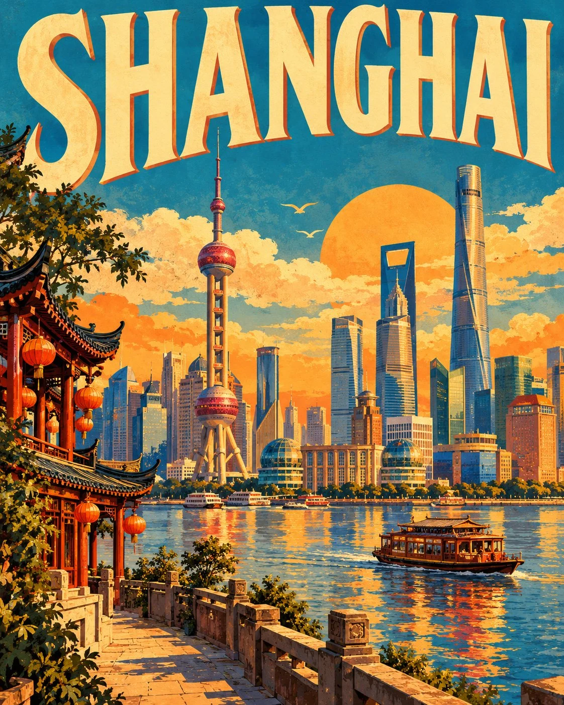

# Mid-Century Nubian-Style Vintage Travel Poster Template

**中文标题：** 中世纪努比亚风复古旅行海报模板  
**ID:** `gi25-x-756` · **Mode:** `generate`  
**Categories:** `poster-typography`  
**Tags:** `x-twitter`, `community`, `gpt-image-2.5`, `x-direct`, `en`



### Mid-Century Nubian-Style Vintage Travel Poster Template

```text
Create a premium FULL-FRAME 4:5 vertical vintage travel poster for [COUNTRY / CITY / LOCATION].

TEXT-TO-IMAGE ONLY — generate the entire artwork from the destination name alone. No reference image required.

CORE CONCEPT:
Transform the destination into a colorful 1950s–60s mid-century travel poster inspired by hand-painted Nubian village architecture. Feature iconic local landmarks, distinctive buildings, and a beautiful coastal, riverside, or natural landscape appropriate to the location.

COMPOSITION:
Place “[CITY NAME]” in large, bold retro typography across the top. Fill the central scene with simplified architectural forms, geometric wall patterns, local vegetation, and a few authentic transport or cultural details. Add a warm sun and a spacious, atmospheric background. Keep the composition balanced and uncluttered.

STYLE & COLORS:
Flat geometric shapes, hand-painted wall textures, sun-faded colors, and subtle vintage print character. Use turquoise, cobalt blue, terracotta, orange, butter yellow, and warm ivory, adapting the palette to the destination.

FINAL AESTHETIC:
Bright, optimistic, nostalgic, and collectible—classic mid-century tourism art with distinctive local identity.

AVOID:
Photorealism, 3D rendering, excessive detail, unrelated landmarks, crowded layouts, incorrect text, logos, watermarks, and mockup framing.

FORMAT:
Full-bleed 4:5 vertical poster. Artwork fills the entire canvas with no external borders or margins.
```

- **Recommended model:** `gpt-image-2.5-sunburst`
- **Settings:** _(defaults)_
- **Source:** [community](https://x.com/Goodmanprotocol/status/2109665636700057789) — @Goodmanprotocol
- **License note:** Original public X post; quoted with attribution — remix with attribution
- **Notes:** Collected directly from X; original post https://x.com/Goodmanprotocol/status/2109665636700057789; post text names GPT Image 2.5; discovered via Bin0754/gpt-image-gallery index, prompt re-verified against the original X post via api.fxtwitter.com; verified=True
- **Preview:** `previews/gi25-x-756.webp`
