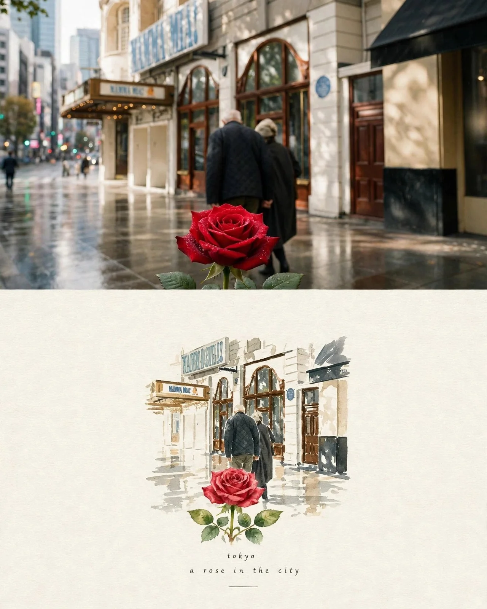

# Rain, Flowers & Love: European Street × Watercolor Travel Artwork

**中文标题：** 雨·花·爱：欧洲街拍×水彩旅行艺术画  
**ID:** `gi25-x-759` · **Mode:** `generate`  
**Categories:** `poster-typography`  
**Tags:** `x-twitter`, `community`, `gpt-image-2.5`, `x-direct`, `en`



### Rain, Flowers & Love: European Street × Watercolor Travel Artwork

```text
Create a premium 4:5 vertical travel-editorial artwork combining romantic European street photography, delicate watercolor illustration, and elegant botanical storytelling.

PURE GENERATION:
Generate the complete artwork from the written concept alone. Create a sophisticated, artistic composition that blends the romantic atmosphere of Paris, the timeless charm of Tokyo, and the historic beauty of Istanbul into one cohesive visual story.

MAIN COMPOSITION:
Design a luxurious fine-art travel poster on warm ivory handmade watercolor paper with subtle paper grain, natural pigment textures, soft edges, and delicate artistic imperfections.

At the top section, feature a cinematic, photorealistic European city street after gentle rain. Elegant cream-colored historic buildings, tall arched wooden windows, traditional storefronts, wet reflective pavement, and warm sunlight filtering through the trees create a nostalgic Parisian atmosphere.

In the middle section, transform the same street into a delicate watercolor illustration. An elderly couple, dressed in elegant dark coats, walks peacefully away from the viewer, holding hands. Their quiet companionship represents enduring love, memories, and a lifetime of shared moments. In the distance, reveal a subtle Eiffel Tower silhouette framed by beautiful Parisian architecture.

FLOWER STORY:
Place a single deep crimson-red rose in the foreground, its velvety petals covered with tiny raindrops. The rose should be sharply detailed, naturally illuminated, and emotionally expressive without looking artificial.

Blend this scene with a second botanical composition featuring a graceful white lily with delicate ivory petals, golden stamens, and fresh green leaves. Position the lily beside a softly painted panoramic view of Istanbul, with the magnificent Blue Mosque in the background, its elegant domes and slender minarets fading gently into the atmospheric distance.

Add subtle Japanese-inspired cherry blossom branches near the upper edges, with pale pink flowers and a few drifting petals, creating a poetic connection between Eastern and Western visual traditions.

ARTISTIC STYLE:
Combine realistic architectural photography with sophisticated watercolor painting, delicate ink outlines, botanical illustration, and premium travel-magazine art direction.

Use soft watercolor washes, fine pigment granulation, natural paint splashes, gentle bleeding edges, and graceful transitions between realistic and illustrated sections.

COLOR PALETTE:
Warm ivory, antique cream, muted beige, soft taupe, charcoal gray, dusty pink, crimson red, botanical green, pale blue, and subtle golden highlights.

LIGHTING AND ATMOSPHERE:
Soft natural daylight after rainfall, warm reflections on wet pavement, gentle cinematic depth, delicate atmospheric haze, and a peaceful romantic mood.

DESIGN AND LAYOUT:
Maintain generous negative space around the main artwork.
Use an elegant editorial composition with a balanced vertical flow.
Allow the photographic scene to transition organically into the watercolor illustration.
Keep the flowers as prominent foreground elements while the architecture provides a beautiful sense of place.
Add tiny artistic ink splashes and restrained botanical details around the edges.
The final result should resemble an exclusive fine-art travel poster created by a professional illustrator.

TYPOGRAPHY:
At the bottom, add a small, elegant, widely spaced serif title:

“WHERE LOVE BLOOMS”

Below it, add a delicate subtitle:

“PARIS • TOKYO • ISTANBUL”

Use refined editorial typography in dark charcoal with subtle spacing and excellent readability. Keep all text minimal and secondary to the artwork.

QUALITY:
Ultra-detailed architectural elements, realistic flower textures, refined watercolor brushwork, harmonious composition, professional art direction, premium print quality, high-resolution rendering, natural proportions, and museum-quality fine-art aesthetics.

ASPECT RATIO:
4:5 vertical poster.

NEGATIVE PROMPT:
Low resolution, blurry flowers, distorted architecture, malformed buildings, inaccurate mosque structures, artificial-looking petals, oversaturated colors, excessive visual clutter, harsh outlines, plastic textures, cartoon appearance, excessive contrast, poorly rendered people, deformed hands, duplicated flowers, messy typography, misspelled text, watermarks, logos, and unnecessary decorative elements.

FINAL RESULT:
A breathtaking, romantic, premium travel-editorial artwork where Parisian nostalgia, Japanese floral elegance, and Istanbul's historic beauty unite through rain, flowers, architecture, and the timeless language of love.
```

- **Recommended model:** `gpt-image-2.5-sunburst`
- **Settings:** _(defaults)_
- **Source:** [community](https://x.com/KrishnaBio1/status/2109460748996931697) — @KrishnaBio1
- **License note:** Original public X post; quoted with attribution — remix with attribution
- **Notes:** Collected directly from X; prompt posted as the author's reply https://x.com/KrishnaBio1/status/2109460748996931697 to https://x.com/KrishnaBio1/status/2109460736275866103, which carries the images and names GPT Image 2.5; discovered via Bin0754/gpt-image-gallery index, prompt re-verified against the original X post via api.fxtwitter.com; verified=True; preview is image 2 of the post
- **Preview:** `previews/gi25-x-759.webp`
