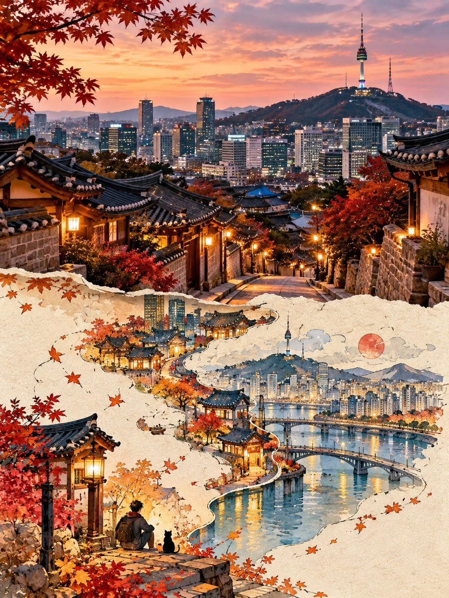

# 'Second World' Surreal Photo-Collage Template

**中文标题：** 「第二世界」超现实照片拼贴模板  
**ID:** `gi25-x-762` · **Mode:** `generate`  
**Categories:** `poster-typography`  
**Tags:** `x-twitter`, `community`, `gpt-image-2.5`, `x-direct`, `en`



### 'Second World' Surreal Photo-Collage Template

```text
Create a premium 3:4 vertical “SECOND WORLD” conceptual surreal photo-collage artwork for [COUNTRY / CITY / LOCATION / SUBJECT].

TEXT-TO-IMAGE ONLY.
Generate the entire composition creatively from the written subject alone. Do not request, upload, use, or depend on any reference image or existing photograph. Automatically invent an original scene with authentic photographic realism and a surprising visual concept.

CORE CONCEPT:
Create one imaginative “Second World” in which a realistic photographic scene naturally transforms into a delicate, surreal paper-collage world. Discover one unexpected, poetic visual idea inspired by the subject. Make every composition original rather than following a fixed template.

COMPOSITION:
Divide the vertical canvas into two connected visual zones.

UPPER 50% — PHOTOGRAPHIC REALITY:
Create a believable, high-quality photographic scene inspired by [COUNTRY / CITY / LOCATION / SUBJECT]. Preserve realistic lighting, natural colors, authentic textures, accurate perspective, and atmospheric depth. The scene should feel like a genuine photograph, not a digital painting.

LOWER 50% — THE SECOND WORLD:
Continue the upper scene onto soft ivory paper. Allow one identifiable element from the photographic scene to cross the center boundary and transform into something unexpected, playful, and visually poetic. The transition must feel physically connected, as though the second world is growing directly out of reality.

CREATIVE TRANSFORMATION:
Invent ONE distinctive surreal transformation that makes sense within the scene. Explore imaginative relationships between objects, nature, architecture, materials, scale, and physical space. Let the subject determine the concept naturally.

Avoid predictable fantasy structures, repetitive compositions, elaborate architecture, and unnecessary decorative elements. Favor one clever visual idea over multiple competing concepts.

HUMAN & BLACK CAT:
Include ONE tiny, clearly recognizable black cat and ONE small, delicately illustrated human figure within the lower world. Give them a meaningful interaction, expressive gesture, or subtle narrative connection to the main transformation. Their poses and relationship should emerge naturally from the scene.

Keep both characters small, charming, and secondary to the central concept. Use thin black-ink outlines with simple, elegant details.

ART DIRECTION:
Contemporary surreal editorial collage, authentic photographic realism, handmade paper textures, delicate ink illustration
```

- **Recommended model:** `gpt-image-2.5-sunburst`
- **Settings:** _(defaults)_
- **Source:** [community](https://x.com/Goodmanprotocol/status/2108488140201869772) — @Goodmanprotocol
- **License note:** Original public X post; quoted with attribution — remix with attribution
- **Notes:** Collected directly from X; original post https://x.com/Goodmanprotocol/status/2108488140201869772; post text names GPT Image 2.5; discovered via Bin0754/gpt-image-gallery index, prompt re-verified against the original X post via api.fxtwitter.com; verified=True; the original X post text ends abruptly — quoted verbatim as published
- **Preview:** `previews/gi25-x-762.webp`
