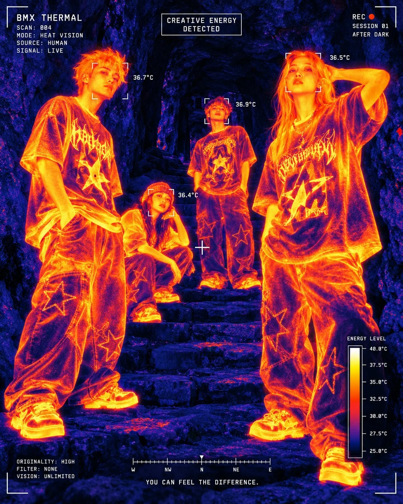

# Thermal-Imaging Streetwear Campaign Poster

**中文标题：** 热成像街头潮牌广告海报  
**ID:** `gi25-x-763` · **Mode:** `edit`  
**Categories:** `poster-typography`, `ecommerce`  
**Tags:** `x-twitter`, `community`, `gpt-image-2.5`, `x-direct`, `en`



### Thermal-Imaging Streetwear Campaign Poster

```text
Create an experimental streetwear campaign poster viewed through a fictional thermal-imaging camera, vertical 4:5 aspect ratio. Four young adult models pose on uneven stone steps inside a dark rocky passage. One stands in the left foreground with hands near his pockets; another crouches behind him at center-left; a third stands upright in the middle background; the fourth stands closest to the camera on the right, with one hand behind his head. All wear oversized graphic T-shirts, loose baggy trousers with outlined star patches, and chunky sneakers.
Render the entire scene in a striking thermal palette: cold surroundings in near-black, midnight blue, and deep indigo; bodies and clothing glowing red-orange, bright yellow, and near-white at the hottest points. Preserve recognizable faces, fabric folds, shirt graphics, and rough rock textures beneath the thermal treatment. Subtle sensor noise, luminous edges, and a gritty fashion editorial atmosphere.
Overlay a precise white camera interface using small monospaced typography, thin tracking brackets around each face, corner framing marks, a central crosshair, a compass scale along the bottom, and a vertical temperature legend at the lower-right. Keep the interface organized and readable without covering the models.
Use these exact text elements:
Upper-left brand label:
“BMX THERMAL”
Technical information beneath it:
“SCAN: 004”
“MODE: HEAT VISION”
“SOURCE: HUMAN”
“SIGNAL: LIVE”
Top-center boxed label:
“CREATIVE ENERGY”
“DETECTED”
Upper-right:
“REC ●”
“SESSION 01”
“AFTER DARK”
Small readings beside the four faces:
“36.7°C”
“36.4°C”
“36.9°C”
“36.5°C”
Lower-left:
“ORIGINALITY: HIGH”
“FILTER: NONE”
“VISION: UNLIMITED”
Bottom-center campaign line:
“YOU CAN FEEL THE DIFFERENCE.”
Temperature legend label:
“ENERGY LEVEL”
Maintain the appearance of a captured thermal-camera frame, with strong depth, distinct silhouettes, and believable infrared color transitions. No natural skin colors, original reference branding, additional people, or watermarks.
```

- **Recommended model:** `gpt-image-2.5-sunburst`
- **Settings:** _(defaults)_
- **Source:** [community](https://x.com/bmx_ai13/status/2108833915360481778) — @bmx_ai13
- **License note:** Original public X post; quoted with attribution — remix with attribution
- **Notes:** Collected directly from X; original post https://x.com/bmx_ai13/status/2108833915360481778; post text names GPT Image 2.5; discovered via Bin0754/gpt-image-gallery index, prompt re-verified against the original X post via api.fxtwitter.com; verified=True
- **Preview:** `previews/gi25-x-763.webp`
