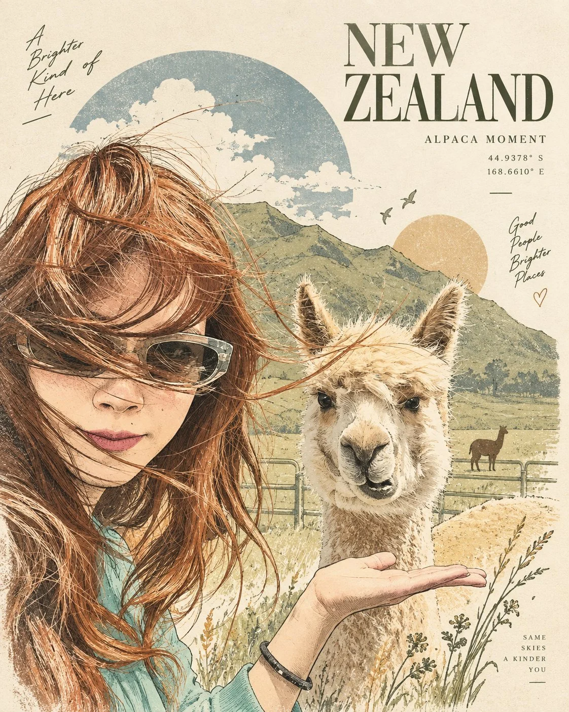

# Photo → Vintage Hand-Drawn Travel-Art Poster

**中文标题：** 照片→复古手绘旅行艺术海报  
**ID:** `gi25-x-766` · **Mode:** `edit`  
**Categories:** `poster-typography`, `edit-change-preserve`  
**Tags:** `x-twitter`, `community`, `gpt-image-2.5`, `x-direct`, `en`



### Photo → Vintage Hand-Drawn Travel-Art Poster

```text
Transform the uploaded photo into a sophisticated vintage travel-art poster while keeping the main subjects recognizable and preserving their original pose, expression, hairstyle, clothing, and overall composition.

Create a hand-drawn editorial illustration with delicate ink outlines, fine sketch details, subtle cross-hatching, vintage screen-print texture, soft watercolor washes, and realistic paper grain.

Keep the girl and alpaca as the main focal points. Simplify the surrounding mountains, green fields, clouds, fences, and sky into elegant illustrated shapes while maintaining the feeling of the original location.

Use a refined muted palette of warm beige, cream, dusty green, soft brown, terracotta, and faded blue on an ivory paper background. Add subtle halftone texture, slightly faded ink, imperfect printing, and handcrafted poster details.

Add tasteful minimalist travel typography around the composition, such as:
“NEW ZEALAND”
“ALPACA MOMENT”
“GOOD PEOPLE, BRIGHTER PLACES”

Include small decorative lines, circles, birds, botanical elements, and subtle geometric shapes for an artistic travel-magazine aesthetic.

The final image should feel premium, nostalgic, elegant, artistic, and collectible — like a vintage European travel poster mixed with a modern lifestyle editorial illustration.

4:5 vertical composition, balanced layout, generous negative space, sophisticated typography, detailed hand illustration, warm natural lighting, no photorealistic background, no excessive visual clutter.
```

- **Recommended model:** `gpt-image-2.5-sunburst`
- **Settings:** _(defaults)_
- **Source:** [community](https://x.com/MahnoorAi12/status/2101634984020750560) — @MahnoorAi12
- **License note:** Original public X post; quoted with attribution — remix with attribution
- **Notes:** Collected directly from X; prompt posted as the author's reply https://x.com/MahnoorAi12/status/2101634984020750560 to https://x.com/MahnoorAi12/status/2101634982728888507, which carries the images and names GPT Image 2.5; discovered via Bin0754/gpt-image-gallery index, prompt re-verified against the original X post via api.fxtwitter.com; verified=True; preview is image 2 (result; image 1 is the input photo)
- **Preview:** `previews/gi25-x-766.webp`
