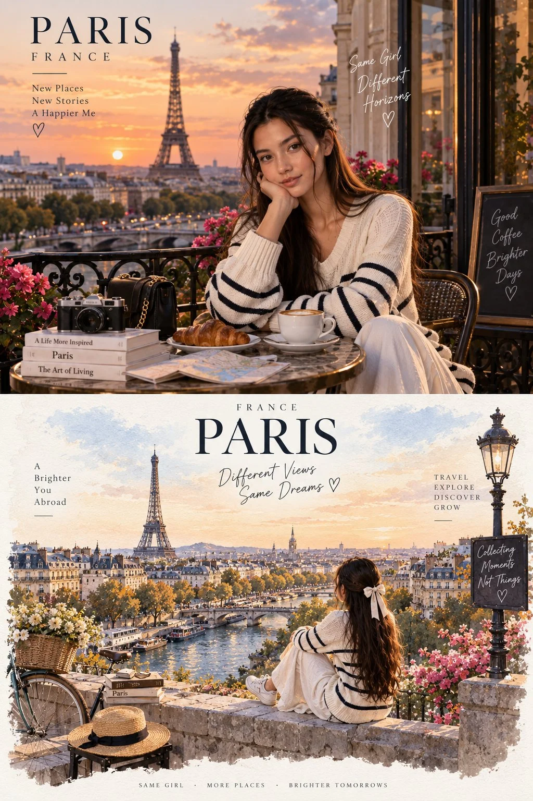

# Real Photo Above, Paris Travel-Illustration Below

**中文标题：** 上实拍下巴黎旅行插画  
**ID:** `gi25-x-767` · **Mode:** `edit`  
**Categories:** `poster-typography`, `character-consistency`  
**Tags:** `x-twitter`, `community`, `gpt-image-2.5`, `x-direct`, `en`



### Real Photo Above, Paris Travel-Illustration Below

```text
Use the same uploaded woman as the character reference and preserve her identity, hairstyle, and overall appearance.

Create a completely different artistic interpretation of Paris, France, inspired by a premium travel magazine illustration. Show the same woman from behind, sitting peacefully on a beautiful stone terrace overlooking Paris at sunset, with the Eiffel Tower, Seine River, bridges, classic Parisian rooftops, boats, trees, and warm evening light.

Transform the entire scene into a sophisticated hand-painted watercolor and editorial travel illustration while keeping the woman recognizable. Use delicate paper texture, soft watercolor washes, elegant architectural details, subtle brush strokes, dreamy pastel skies, and a refined luxury travel-poster aesthetic.

Add tasteful minimal typography such as:
“PARIS”
“FRANCE”
“Different Views, Same Dreams”
“Travel • Explore • Discover • Grow”

The lower scene should feel artistic and motivational rather than photorealistic, clearly different from the realistic photograph above. Premium editorial composition, balanced layout, beautiful visual storytelling, vertical poster format, no watermark.
```

- **Recommended model:** `gpt-image-2.5-sunburst`
- **Settings:** _(defaults)_
- **Source:** [community](https://x.com/Alina_with_Ai/status/2100057357376192992) — @Alina_with_Ai
- **License note:** Original public X post; quoted with attribution — remix with attribution
- **Notes:** Collected directly from X; prompt posted as the author's reply https://x.com/Alina_with_Ai/status/2100057357376192992 to https://x.com/Alina_with_Ai/status/2100057353249051067, which carries the images and names GPT Image 2.5; discovered via Bin0754/gpt-image-gallery index, prompt re-verified against the original X post via api.fxtwitter.com; verified=True; first of several prompts the author posted in the thread
- **Preview:** `previews/gi25-x-767.webp`
