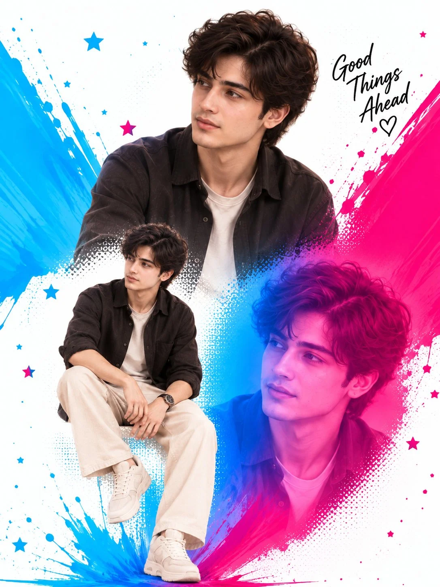

# Three-Pose Editorial Collage Poster from Reference

**中文标题：** 参考图→三姿态编辑拼贴海报  
**ID:** `gi25-x-769` · **Mode:** `edit`  
**Categories:** `poster-typography`, `character-consistency`  
**Tags:** `x-twitter`, `community`, `gpt-image-2.5`, `x-direct`, `en`



### Three-Pose Editorial Collage Poster from Reference

```text
Create a high-quality vertical editorial collage poster using the uploaded reference images as the exact visual inspiration. Create one cohesive composition featuring the same adult male subject in three different poses and framing styles:
A large upper-body close-up portrait as the main focal point, with the subject looking slightly to the side with a calm, confident expression.
A smaller full-body standing/seated fashion pose placed toward the lower-left area, maintaining natural body proportions and realistic clothing details.
A large artistic close-up portrait placed toward the lower-right area, with a vibrant blue-and-pink duotone lighting effect.
Keep the subject's facial features, hairstyle, hair texture, skin tone, and overall appearance consistent across all three versions. Outfit should remain consistent: dark charcoal/black overshirt worn over a plain white T-shirt, relaxed cream/off-white trousers, white sneakers, and a simple wristwatch.
Use a clean white background with dynamic electric blue and hot pink paint splashes, ink strokes, halftone textures, scattered stars, tiny paint droplets, and energetic graphic elements surrounding the portraits. Blend all three portraits naturally into the paint-splash composition with smooth transitions and subtle halftone fading around the edges.
Add elegant handwritten black typography in the upper-right corner reading exactly: “Good Things Ahead”, followed by a small outlined heart underneath. Keep the typography stylish, handwritten, and clearly readable.
Overall aesthetic: modern AI editorial poster, premium fashion campaign, vibrant pop-art collage, photorealistic subject, cinematic portrait photography, high detail, sharp facial features, realistic skin texture, professional graphic design, balanced composition, clean white negative space, blue and pink color contrast, 4K quality.
Important: Keep all three versions of the same person visually consistent. Do not change the face, hairstyle, clothing style, or identity between poses. Preserve realistic anatomy, natural hands, realistic eyes, and accurate proportions. No extra people, no duplicated limbs, no distorted face, no unwanted text, no watermark.
```

- **Recommended model:** `gpt-image-2.5-sunburst`
- **Settings:** _(defaults)_
- **Source:** [community](https://x.com/mehwishkiran07/status/2101870527879209255) — @mehwishkiran07
- **License note:** Original public X post; quoted with attribution — remix with attribution
- **Notes:** Collected directly from X; prompt posted as the author's reply https://x.com/mehwishkiran07/status/2101870527879209255 to https://x.com/mehwishkiran07/status/2101870523823345826, which carries the images and names GPT Image 2.5; discovered via Bin0754/gpt-image-gallery index, prompt re-verified against the original X post via api.fxtwitter.com; verified=True; prompt describes the male subject — preview is image 2
- **Preview:** `previews/gi25-x-769.webp`
