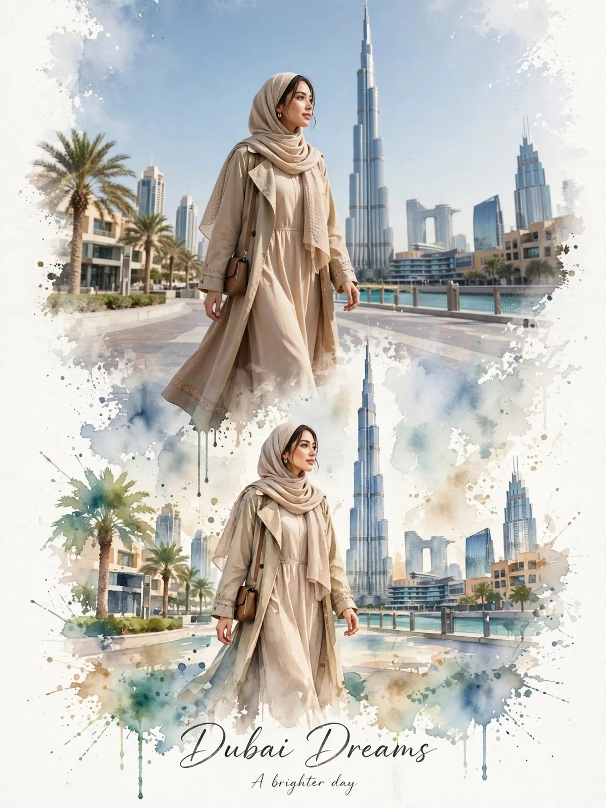

# Three-Destination Luxury Travel Story from Three References

**中文标题：** 三张参考图→三地奢华旅行故事  
**ID:** `gi25-x-772` · **Mode:** `multi_ref`  
**Categories:** `poster-typography`, `edit-change-preserve`  
**Tags:** `x-twitter`, `community`, `gpt-image-2.5`, `x-direct`, `en`



### Three-Destination Luxury Travel Story from Three References

```text
Create a premium vertical 9:16 luxury travel artwork by seamlessly combining all three uploaded reference images into one cohesive visual story.

Show the same stylish woman traveling through three iconic destinations:
1. Paris — elegant Parisian streets with the Eiffel Tower, beige sophisticated outfit, black sunglasses and luxury city-walk atmosphere.
2. Dubai — modern waterfront promenade with Burj Khalifa, soft neutral modest outfit with a flowing scarf, warm upscale atmosphere.
3. Sydney — Sydney Opera House beside the waterfront, casual white top, light blue jeans, sneakers and relaxed summer-travel mood.

Blend all three destinations together with elegant watercolor splash transitions, soft artistic paint textures, subtle paper details and realistic photographic elements. Keep the woman’s appearance, facial identity, proportions and styling natural and consistent throughout the three scenes.

Luxury travel editorial aesthetic, cinematic natural lighting, premium composition, soft pastel tones, realistic details mixed with artistic watercolor, clean elegant background, sophisticated lifestyle photography, high-end travel magazine design, ultra-detailed, sharp subject, balanced composition, 8K quality.

Add a tasteful handwritten-style title near the bottom:
“WANDER • DREAM • DISCOVER”

Make the final image feel like one beautiful international travel story rather than three unrelated pictures.
```

- **Recommended model:** `gpt-image-2.5-sunburst`
- **Settings:** _(defaults)_
- **Source:** [community](https://x.com/KrishnaBio1/status/2102691226902552591) — @KrishnaBio1
- **License note:** Original public X post; quoted with attribution — remix with attribution
- **Notes:** Collected directly from X; prompt posted as the author's reply https://x.com/KrishnaBio1/status/2102691226902552591 to https://x.com/KrishnaBio1/status/2102691221764477093, which carries the images and names GPT Image 2.5; discovered via Bin0754/gpt-image-gallery index, prompt re-verified against the original X post via api.fxtwitter.com; verified=True
- **Preview:** `previews/gi25-x-772.webp`
