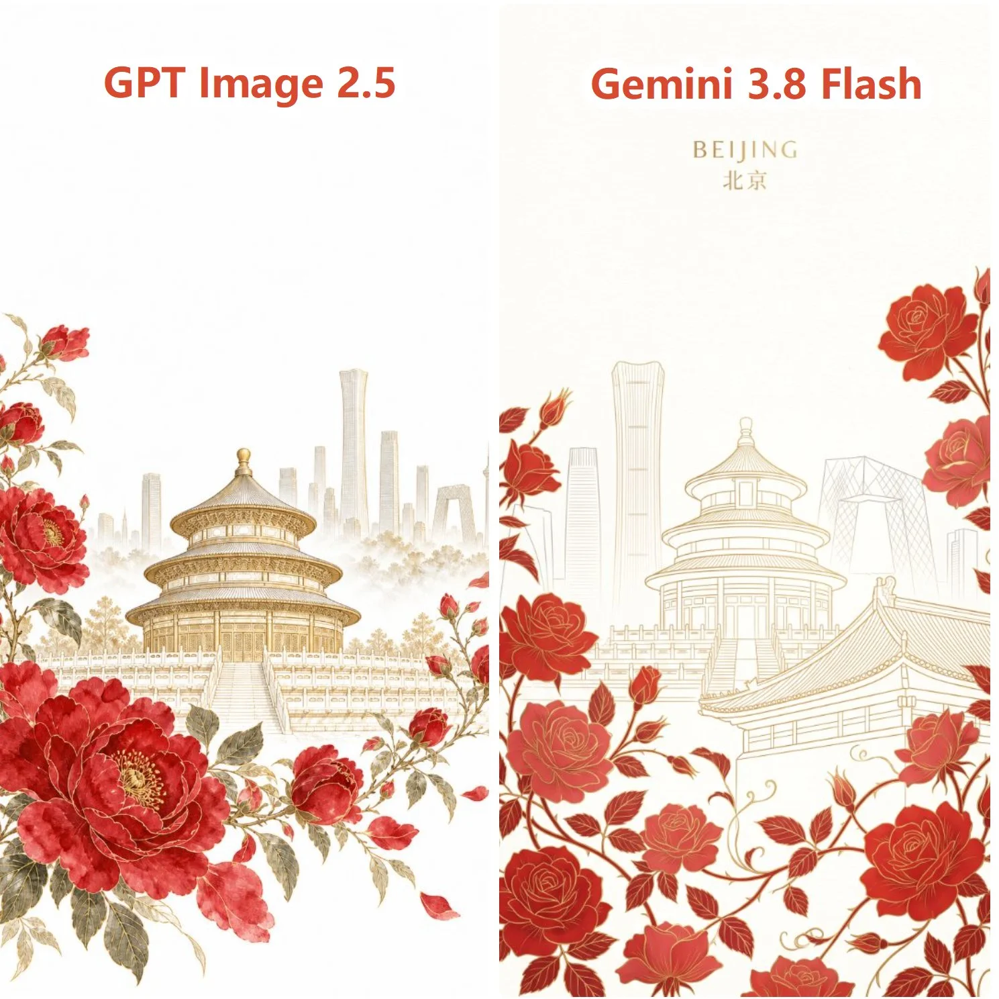

# Minimalist Red-Gold Rose City Poster (Beijing)

**中文标题：** 红金月季极简城市海报（北京）  
**ID:** `gi25-x-776` · **Mode:** `generate`  
**Categories:** `poster-typography`  
**Tags:** `x-twitter`, `community`, `gpt-image-2.5`, `x-direct`, `zh`



### Minimalist Red-Gold Rose City Poster (Beijing)

```text
创作一幅受【北京】启发的精致极简艺术海报。使用【北京】的标志性历史建筑作为中心视觉元素，但将其转化为优雅的当代编辑艺术作品，而非传统的地图，背景带有现代城市建筑的剪影轮廓。

动线周围开满了盛放的月季花，细节丰富细腻，灵感源自迪奥（Dior）花卉系列与 Pietro Ruffo 的艺术风格，手绘细腻的花卉在纯白背景板上梦幻般地自然交织缠绕。

画面采用手绘线条，红金相间，红色花瓣搭配金色勾边轮廓，建筑主体使用金色线条勾勒，线条简约纯粹，无杂乱繁复感。纯白色背景，顶部留出大面积空白，远景上方现代建筑若隐若现，虚实结合。色彩富有层次感而不显扁平，无杂乱、无照片级真实感、无过多文字、无国旗、无泛泛的旅游拼贴、无厚重边框。

垂直海报构图，9:16 纵横比，高细节但视觉极简。
```

- **Recommended model:** `gpt-image-2.5-sunburst`
- **Settings:** _(defaults)_
- **Source:** [community](https://x.com/xueyu1125/status/2098309753046991104) — @xueyu1125
- **License note:** Original public X post; quoted with attribution — remix with attribution
- **Notes:** Collected directly from X; prompt posted as the author's reply https://x.com/xueyu1125/status/2098309753046991104 to https://x.com/xueyu1125/status/2098309691877241146, which carries the images and names GPT Image 2.5; discovered via Bin0754/gpt-image-gallery index, prompt re-verified against the original X post via api.fxtwitter.com; verified=True; GPT Image 2.5 vs Gemini 3.8 Flash comparison — post image shows GPT Image 2.5 on the left
- **Preview:** `previews/gi25-x-776.webp`
