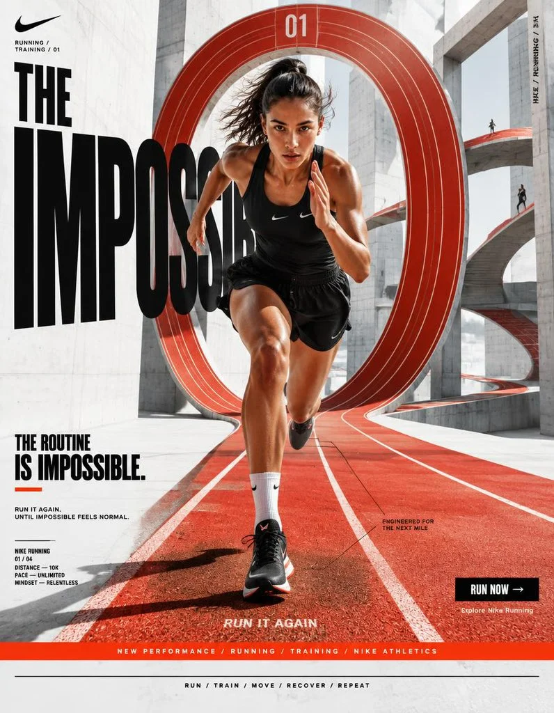

# Nike “The Impossible Routine” Surreal Sport Poster

**中文标题：** Nike「不可能的例行」超现实运动海报  
**ID:** `gi25-x-778` · **Mode:** `generate`  
**Categories:** `poster-typography`, `ecommerce`  
**Tags:** `x-twitter`, `community`, `gpt-image-2.5`, `x-direct`, `en`



### Nike “The Impossible Routine” Surreal Sport Poster

```text
NIKE — “THE IMPOSSIBLE ROUTINE”
━━━━━━━━━━━━━━━━━━━━━━━━━━━━━━━━━━━━
PROMPT — NIKE “THE IMPOSSIBLE ROUTINE”
FORMAT
Ultra-Premium Nike Fashion × Sport SMM Promotional Poster
Vertical 4:5 Instagram Hero Creative
Global Sportswear Campaign
Contemporary Nike Advertising
Commercial Fashion Photography × Surrealist Art Direction
Agency-Level Art Direction
Behance Front Page Quality
8K UHD
Hyper-Realistic Surrealism × Performance × Graphic Design
High-Impact Visual Communication
Zero AI Slop
Zero Generic Sports Advertising
Zero Catalogue Aesthetic
Zero Generic Sneaker Advertisement
Zero Luxury-Copycat Aesthetic
━━━━━━━━━━━━━━━━━━━━━━━━━━━━━━━━━━━━
CORE STRATEGY
This is not simply a Nike product advertisement.
This is Nike turned into a surreal visual statement.
The campaign should communicate:
Discipline does not look normal.
Nike should feel:
fearless + kinetic + youthful + disruptive + athletic + culturally relevant + relentlessly ambitious
The visual language should combine:
Nike performance campaign × contemporary fashion editorial × surrealist photography × conceptual art × graphic poster design × digital-first social advertising
The surrealism must feel physically believable, not like random AI fantasy.
Every impossible element should communicate something about movement, discipline, repetition or athletic ambition.
The result should feel like a real global Nike campaign photographed inside an impossible world.
━━━━━━━━━━━━━━━━━━━━━━━━━━━━━━━━━━━━
CAMPAIGN IDEA
“THE IMPOSSIBLE ROUTINE”
Athletes repeat the same movements every day.
Run.
Jump.
Train.
Recover.
Repeat.
So what happens when the world itself begins repeating with them?
A running track loops vertically into the sky.
A staircase curves impossibly around the athlete.
Shoes leave physical trails of architecture behind every step.
The campaign visualizes the mindset:
THE ROUTINE IS IMPOSSIBLE.
THAT’S THE POINT.
Nike becomes the brand that makes impossible effort feel inevitable.
━━━━━━━━━━━━━━━━━━━━━━━━━━━━━━━━━━━━
MASTER VISUAL
Create one enormous surreal architectural environment.
A monumental red running track begins beneath the athlete’s feet and extends forward into the distance.
Instead of ending normally, the track rises vertically into the sky, bends at a mathematically impossible angle and returns behind the athlete, creating a continuous infinite loop.
The environment resembles:
Olympic training facility × brutalist architecture × surrealist dreamscape × Nike campaign set
The athlete stands at the exact visual center.
Around them, multiple versions of the same running track appear at different scales.
One track passes horizontally behind the subject.
Another rises vertically.
Another disappears into a gigantic architectural doorway.
Another curves overhead like a suspended ribbon.
The impossible geometry should still obey believable:
perspective + lighting + shadows + material physics.
No floating random objects.
No fantasy clouds.
No psychedelic effects.
The surrealism must be architectural, physical and intentional.
━━━━━━━━━━━━━━━━━━━━━━━━━━━━━━━━━━━━
HERO SUBJECT
Young female athlete.
Contemporary global athletic appearance.
Natural skin texture.
Realistic facial proportions.
Strong athletic physique.
Confident expression.
Minimal makeup.
Hair naturally affected by movement.
No influencer aesthetic.
No exaggerated bodybuilding.
No fashion-model stiffness.
She should look like a real Nike athlete photographed during an intense training session.
Direct eye contact with the camera.
Calm expression.
The world around her is impossible.
She remains completely composed.
That contrast creates the visual tension.
━━━━━━━━━━━━━━━━━━━━━━━━━━━━━━━━━━━━
HERO PRODUCT
Nike performance running shoe.
Contemporary aerodynamic silhouette.
Black / white base with a controlled Nike orange-red accent.
Highly realistic engineered mesh.
Visible stitching.
Realistic rubber outsole.
Subtle material variation.
Accurate proportions.
The Nike Swoosh clearly visible but naturally integrated into the footwear.
No oversized logo.
No fake product design.
No distorted branding.
The shoe must look like a real commercially manufactured Nike performance product.
━━━━━━━━━━━━━━━━━━━━━━━━━━━━━━━━━━━━
WARDROBE
Contemporary Nike performance styling.
Black fitted technical running top.
Relaxed lightweight performance shorts.
White technical socks.
Nike running shoes.
Subtle red-orange accent details.
Minimal accessories.
No excessive logos.
No futuristic costume.
No couture.
No unnecessary straps or technological gadgets.
The clothing should feel available, wearable and genuinely athletic, elevated through exceptional art direction.
Realistic fabric tension.
Visible technical textile construction.
Natural folds.
Sweat and subtle skin texture.
━━━━━━━━━━━━━━━━━━━━━━━━━━━━━━━━━━━━
POSE / MOVEMENT
Capture the athlete immediately after a sprint.
One foot planted aggressively.
The opposite leg slightly lifted.
Torso leaning forward.
One arm naturally pulled backward.
Other arm forward.
Hair and clothing reacting to momentum.
Tiny particles of track dust suspended in the air.
The athlete appears frozen for one fraction of a second.
Behind her, the impossible track continues moving through the environment.
The photograph should feel like a genuine action photograph captured at the exact right moment.
Not a fashion pose.
Not a CGI character standing still.
━━━━━━━━━━━━━━━━━━━━━━━━━━━━━━━━━━━━
COMPOSITION
VISUAL HIERARCHY
NIKE / SWOOSH
↓
IMPOSSIBLE ENVIRONMENT
↓
ATHLETE
↓
PRODUCT
↓
CAMPAIGN MESSAGE
↓
CTA
Use extreme negative space around selected areas.
The surreal architecture should frame the athlete rather than compete with her.
The eye should travel naturally:
typography → face → body → shoes → looping track → typography.
Create a visual loop.
The composition itself should behave like the campaign concept.
━━━━━━━━━━━━━━━━━━━━━━━━━━━━━━━━━━━━
NIKE COLOR SYSTEM
PRIMARY BLACK
#000000
Used for:
Typography
Athletic wardrobe
Architectural shadows
Graphic blocks
WHITE
#FFFFFF
Used for:
Negative space
Typography
Highlights
Technical details
NIKE-STYLE RED / ORANGE ACCENT
A highly saturated warm Nike campaign accent.
Used strategically for:
Running track
Graphic blocks
Small typography
Product detailing
Directional arrows
The accent color should function as a visual trigger, not dominate the entire poster.
━━━━━━━━━━━━━━━━━━━━━━━━━━━━━━━━━━━━
COLOR RATIO
55% white / warm architectural neutral
25% black
15% red-orange
5% natural skin / environmental tones
The image should remain recognizably Nike through the controlled black-white-red visual relationship without becoming a simple red-and-black advertisement.
━━━━━━━━━━━━━━━━━━━━━━━━━━━━━━━━━━━━
BACKGROUND
Create an enormous white brutalist athletic facility.
Monumental concrete walls.
Seamless white floor.
Massive geometric openings.
Hard architectural edges.
Large empty surfaces.
No recognizable city.
No stadium crowd.
No conventional gym.
No advertisements.
No distracting scenery.
The environment should feel like a Nike training facility that exists outside normal physics.
One massive red-orange running track cuts through the architecture.
━━━━━━━━━━━━━━━━━━━━━━━━━━━━━━━━━━━━
SURREALISM SYSTEM
The surrealism must follow one central rule:
MOVEMENT CHANGES ARCHITECTURE.
Where the athlete runs, the environment bends.
The track becomes a wall.
The wall becomes a staircase.
The staircase becomes another track.
The track becomes a circular loop.
The loop becomes the horizon.
Use subtle impossible geometry rather than random surreal objects.
Secondary surreal details:
* A shadow running in a slightly different direction than the athlete.
* Multiple identical starting lines extending into different architectural dimensions.
* A giant stopwatch embedded into the concrete wall.
* Floating lane numbers physically attached to architectural surfaces.
* Repeated track markings disappearing into infinity.
* A distant version of the athlete barely visible on another loop.
Every surreal element must have conceptual purpose.
━━━━━━━━━━━━━━━━━━━━━━━━━━━━━━━━━━━━
GRAPHIC DESIGN SYSTEM
Create a sophisticated contemporary sports-editorial grid.
Use:
bold condensed typography
thin technical rules
lane numbers
distance measurements
training codes
micro typography
cropped numerals
directional arrows
registration marks
small technical coordinates
vertical labels
red graphic blocks
The graphic system should feel inspired by:
Nike campaign design × sports science interface × contemporary editorial typography × athletic wayfinding.
Do not turn the poster into a UI.
The photography remains dominant.
━━━━━━━━━━━━━━━━━━━━━━━━━━━━━━━━━━━━
TYPOGRAPHY SYSTEM
PRIMARY HEADLINE
Massive bold condensed uppercase typography.
High-impact sports campaign character.
Extremely large scale.
Tight leading.
Minimal tracking.
Strong vertical presence.
The typography can be partially cropped beyond the canvas.
It should feel physically integrated into the architecture.
Some letters can appear printed directly onto the running track.
Others can exist as oversized architectural signage.
PRIMARY MESSAGE
THE IMPOSSIBLE ROUTINE
Stack the words vertically.
Make:
IMPOSSIBLE
the dominant word.
Allow the athlete to partially obscure the typography.
━━━━━━━━━━━━━━━━━━━━━━━━━━━━━━━━━━━━
TOP LEFT
Small Nike logo / Swoosh.
Clean placement.
Generous clear space.
No distortion.
No unnecessary effects.
Underneath:
RUNNING / TRAINING / 01
Very small technical typography.
━━━━━━━━━━━━━━━━━━━━━━━━━━━━━━━━━━━━
GIANT CENTER TYPOGRAPHY
Massive:
IMPOSSIBLE
running vertically through the composition.
Some letters disappear behind architectural structures.
Some extend outside the canvas.
The athlete interrupts the word.
The track physically intersects the typography.
The typography should feel like part of the environment rather than something placed over a photograph.
━━━━━━━━━━━━━━━━━━━━━━━━━━━━━━━━━━━━
CAMPAIGN TITLE
Lower-left:
THE ROUTINE
with:
IS IMPOSSIBLE.
The second line substantially larger.
Add a small red-orange underline.
━━━━━━━━━━━━━━━━━━━━━━━━━━━━━━━━━━━━
SUPPORTING COPY
RUN IT AGAIN.
Secondary line:
UNTIL IMPOSSIBLE FEELS NORMAL.
Keep the copy extremely concise.
No paragraph.
No generic motivational copy.
━━━━━━━━━━━━━━━━━━━━━━━━━━━━━━━━━━━━
PERFORMANCE INFORMATION
Small structured block:
NIKE RUNNING
01 / 04
DISTANCE — 10K
PACE — UNLIMITED
MINDSET — RELENTLESS
Use micro typography.
Make it feel like an authentic campaign production detail rather than fake technical data overload.
━━━━━━━━━━━━━━━━━━━━━━━━━━━━━━━━━━━━
PROMOTIONAL STRIP
Create a thin red-orange horizontal strip.
Inside:
NEW PERFORMANCE / RUNNING / TRAINING / NIKE ATHLETICS
White uppercase typography.
The strip should operate as part of the graphic grid.
Not a sale banner.
━━━━━━━━━━━━━━━━━━━━━━━━━━━━━━━━━━━━
CTA
Bottom-right:
RUN NOW →
Black rectangular button.
White uppercase typography.
Underneath:
Explore Nike Running
Compact.
Commercially clear.
━━━━━━━━━━━━━━━━━━━━━━━━━━━━━━━━━━━━
PRODUCT CALLOUT
Near the lower portion of the composition:
ENGINEERED FOR THE NEXT MILE
Small typography connected to the shoe through a thin technical line.
Do not create a traditional product specification panel.
The product remains part of the story.
━━━━━━━━━━━━━━━━━━━━━━━━━━━━━━━━━━━━
BOTTOM FEATURE STRIP
Thin black rule.
Then:
RUN / TRAIN / MOVE / RECOVER / REPEAT
Centered beneath.
Use small uppercase typography.
━━━━━━━━━━━━━━━━━━━━━━━━━━━━━━━━━━━━
VERTICAL EDGE TEXT
Right edge:
NIKE / RUNNING / 01
Rotated vertically.
Small.
Precise.
Technical.
━━━━━━━━━━━━━━━━━━━━━━━━━━━━━━━━━━━━
SIGNATURE SURREAL DEVICE
Create one enormous red-orange circular running track behind the athlete.
It forms an impossible vertical loop.
At the top of the loop:
01
At the bottom:
RUN IT AGAIN
The loop should appear physically constructed from real rubber running-track material.
Visible lane texture.
Subtle dirt.
Tiny imperfections.
Realistic edge wear.
Hard sunlight creating believable shadows.
This becomes the campaign’s visual signature.
━━━━━━━━━━━━━━━━━━━━━━━━━━━━━━━━━━━━
PHOTOGRAPHIC STYLE
High-energy contemporary Nike sports photography.
Dramatic contrast.
Frozen action.
Real physical momentum.
Natural athletic movement.
Sharp facial detail.
Visible pores.
Real sweat.
Real fabric texture.
Real shoe construction.
Subtle motion blur only where physically appropriate.
The image should feel captured by a professional sports photographer, not rendered by a 3D artist.
Surrealism comes from the environment, not from making the athlete look artificial.
━━━━━━━━━━━━━━━━━━━━━━━━━━━━━━━━━━━━
LIGHTING
Large directional sunlight entering from the upper-left.
Hard architectural shadows.
Bright white concrete.
Deep black clothing separation.
Rich red-orange track surfaces.
Natural skin exposure.
Subtle reflected light from the white environment.
No neon.
No colored fog.
No artificial rim lighting.
No excessive bloom.
No beauty-dish glamour.
No dreamy fashion haze.
The impossible environment must still obey a single coherent lighting system.
━━━━━━━━━━━━━━━━━━━━━━━━━━━━━━━━━━━━
CAMERA
ARRI Alexa Mini LF
50mm high-end sports/editorial lens
Slightly low camera position.
Full-body composition.
Fast shutter speed.
Extremely sharp athlete.
Moderate depth of field.
Natural perspective.
High dynamic range.
Realistic lens compression.
Subtle cinematic motion character.
Premium global sports campaign photography.
━━━━━━━━━━━━━━━━━━━━━━━━━━━━━━━━━━━━
POST-PRODUCTION
Contemporary global Nike campaign grading.
Clean whites.
Deep blacks.
Controlled saturated red-orange.
Natural skin tones.
High micro-contrast.
Visible textile texture.
Crisp architectural edges.
Subtle film grain.
Realistic photographic imperfections.
Controlled highlights.
No plastic skin.
No artificial HDR.
No teal-orange grading.
No excessive sharpening.
No fake CGI gloss.
No excessive grain.
No surreal color manipulation.
━━━━━━━━━━━━━━━━━━━━━━━━━━━━━━━━━━━━
BRAND SAFETY / CONSISTENCY
The final visual must immediately communicate Nike without depending entirely on the logo.
Brand recognition should come from:
athletic energy
performance culture
bold typography
black / white / red-orange visual language
movement
youthful confidence
graphic simplicity
conceptual advertising
cultural relevance
relentless ambition
Do not make it resemble:
ZARA’s restrained editorial minimalism.
Adidas’ traditional sports graphics.
Puma’s conventional performance advertising.
Under Armour’s dark tactical aesthetic.
New Balance’s retro-running identity.
Luxury fashion advertising.
Generic fitness advertising.
AI-generated surrealism.
The visual identity must remain Nike.
━━━━━━━━━━━━━━━━━━━━━━━━━━━━━━━━━━━━
FINAL FEEL
If:
Nike × a contemporary fashion magazine × a surrealist artist × an elite sports photographer × a world-class graphic design studio
created one campaign together—
the result should feel like THE IMPOSSIBLE ROUTINE.
Not a sneaker advertisement.
Not a motivational poster.
Not a conventional sports campaign.
Not random surrealism.
Not an AI fantasy image.
A high-impact Nike campaign where athletic movement literally bends reality.
Vertical 4:5 — 8K UHD — hyper-realistic — surreal architectural environment — dramatic action photography — black/white/red-orange palette — oversized condensed typography — precise editorial grid — realistic human anatomy — natural skin — detailed performance fabrics — physically believable surrealism — realistic Nike footwear — crisp readable typography — premium commercial photography — agency-level art direction — Instagram hero creative — Behance front-page quality — print-ready.
```

- **Recommended model:** `gpt-image-2.5-sunburst`
- **Settings:** _(defaults)_
- **Source:** [community](https://x.com/Diplomeme/status/2099417664863228204) — @Diplomeme
- **License note:** Original public X post; quoted with attribution — remix with attribution
- **Notes:** Collected directly from X; prompt posted as the author's reply https://x.com/Diplomeme/status/2099417664863228204 to https://x.com/Diplomeme/status/2099417551411494936, which carries the images and names GPT Image 2.5; discovered via Bin0754/gpt-image-gallery index, prompt re-verified against the original X post via api.fxtwitter.com; verified=True; long agency-style campaign prompt
- **Preview:** `previews/gi25-x-778.webp`
