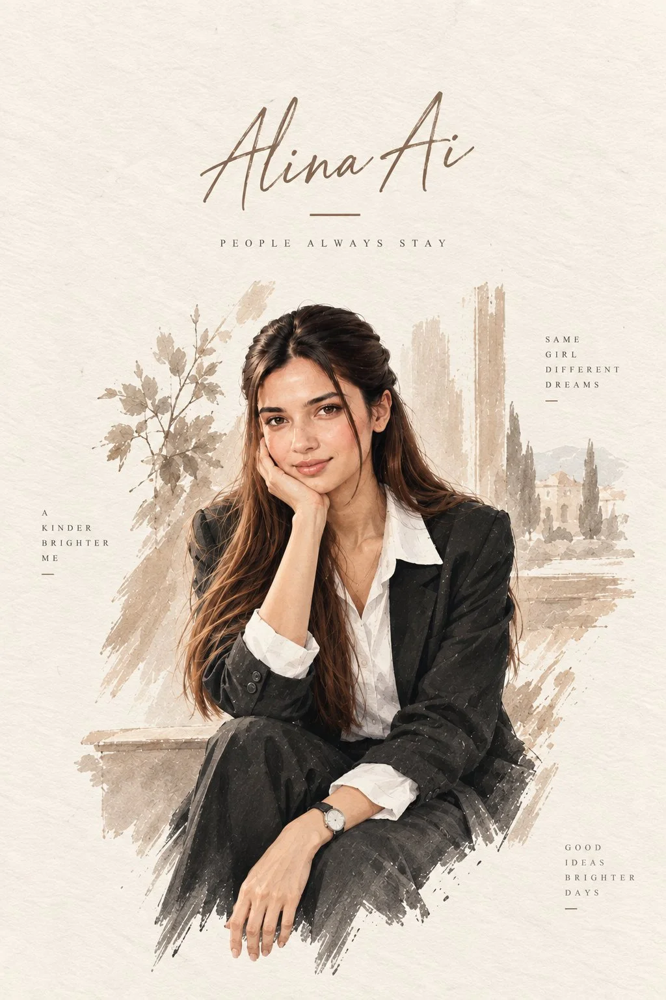

# Editorial Watercolor Travel Poster from Reference

**中文标题：** 参考图→编辑水彩旅行海报  
**ID:** `gi25-x-781` · **Mode:** `edit`  
**Categories:** `poster-typography`, `character-consistency`  
**Tags:** `x-twitter`, `community`, `gpt-image-2.5`, `x-direct`, `en`



### Editorial Watercolor Travel Poster from Reference

```text
Create a sophisticated vertical editorial watercolor poster using the uploaded reference photo as the exact visual reference for the woman’s facial features, identity, hairstyle, skin tone, and overall appearance.

IMPORTANT: This must be visually different from the first poster. Do NOT use a waving pose. Do NOT place the subject standing in the same pose. Create a completely different composition and body position.

Show the woman seated elegantly on a low stone terrace or architectural ledge, wearing a tailored black blazer with matching wide-leg trousers and a crisp white collared shirt. One elbow is resting naturally on her knee, with her hand gently supporting her cheek in a relaxed, thoughtful pose. Her other hand rests naturally on her lap. A simple elegant wristwatch is visible.

Her expression should be soft, confident, calm, and slightly smiling. Keep her facial identity and recognizable features consistent with the reference image.

STYLE:
Luxury hand-painted watercolor and fine-ink editorial illustration, realistic but artistic facial rendering, delicate brush strokes, subtle ink outlines, natural skin tones, soft watercolor bleeding, sophisticated muted beige, warm brown, ivory and charcoal palette, visible handmade watercolor paper texture, premium fashion magazine aesthetic.

COMPOSITION:
Vertical poster layout.
Place the woman in the lower-middle portion of the composition.
Leave generous clean negative space around the subject.
Create a different visual balance from the first poster by using a seated pose and a slightly asymmetrical composition.

BACKGROUND:
Warm ivory handmade textured paper.
Behind the woman, add very subtle watercolor sketches of elegant Mediterranean-style architecture, distant trees, delicate branches and soft beige architectural brush marks.
Keep the background extremely light and artistic so the woman remains the main focus.
No photographic background.

TYPOGRAPHY:
At the upper center, add elegant handwritten/script-style text:

“Alina Ai”

Directly underneath, add a thin minimal horizontal line.

Below the line, add small widely spaced uppercase typography:

“PEOPLE ALWAYS STAY”

Add very subtle small editorial text elements around the composition:

“SAME GIRL DIFFERENT DREAMS”

“A KINDER BRIGHTER ME”

“GOOD IDEAS BRIGHTER DAYS”

Keep all typography refined, minimal, balanced, and premium.

OVERALL LOOK:
Luxury editorial watercolor poster, sophisticated fashion illustration, handmade art print, soft cinematic lighting translated into watercolor, realistic proportions, elegant feminine aesthetic, premium magazine cover composition, clean negative space, highly detailed face and hair, natural hands and anatomy.

NEGATIVE PROMPT:
Do not copy the first poster’s pose, no waving hand, no standing pose, no raised arm, no photorealistic background, no 3D CGI, no cartoon appearance, no excessive colors, no clutter, no extra people, no distorted face, no extra fingers, no malformed hands, no duplicated limbs, no unnatural anatomy, no harsh outlines, no plastic skin, no AI-looking facial features, no incorrect text, no random logos.
```

- **Recommended model:** `gpt-image-2.5-sunburst`
- **Settings:** _(defaults)_
- **Source:** [community](https://x.com/Alina_with_Ai/status/2101255289333031047) — @Alina_with_Ai
- **License note:** Original public X post; quoted with attribution — remix with attribution
- **Notes:** Collected directly from X; prompt posted as the author's reply https://x.com/Alina_with_Ai/status/2101255289333031047 to https://x.com/Alina_with_Ai/status/2101255283897139628, which carries the images and names GPT Image 2.5; discovered via Bin0754/gpt-image-gallery index, prompt re-verified against the original X post via api.fxtwitter.com; verified=True
- **Preview:** `previews/gi25-x-781.webp`
