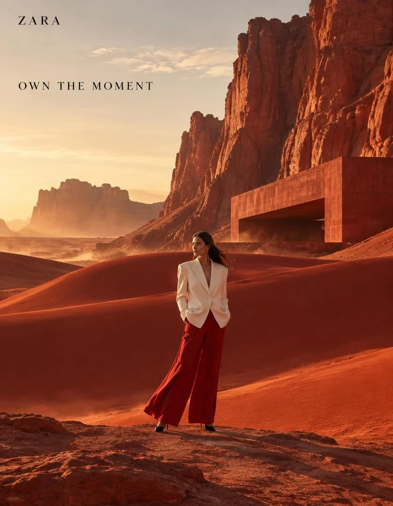

# ZARA × Red Desert High-Fashion Environmental Campaign

**中文标题：** ZARA×红沙漠高定环境大片  
**ID:** `gi25-x-784` · **Mode:** `generate`  
**Categories:** `poster-typography`, `ecommerce`  
**Tags:** `x-twitter`, `community`, `gpt-image-2.5`, `x-direct`, `en`



### ZARA × Red Desert High-Fashion Environmental Campaign

```text
01 — ZARA × RED DESERT

ZARA high-fashion environmental campaign, 4:5 vertical, 8K ultra-photorealistic editorial photography.

A confident adult female fashion model wearing a sophisticated contemporary Zara outfit: sculptural cream oversized blazer, flowing red trousers, minimalist black heels and subtle accessories.

She stands alone in a vast surreal RED DESERT landscape at golden hour. Monumental vermilion rock formations rise around her, enormous smooth red dunes create sweeping curves across the landscape, and a minimalist brutalist red concrete structure emerges naturally from the terrain.

The entire environment is built around a controlled palette of crimson red, vermilion, burnt orange, warm cream and natural skin tones.

Strong golden sunlight creates dramatic long shadows. Wind gently moves the fabric of the outfit. Fine desert dust is visible in the distance. The clothing remains perfectly realistic with detailed fabric fibers, stitching, natural folds and believable movement.

Wide environmental composition, model relatively small within the enormous landscape, powerful sense of scale, sophisticated fashion editorial composition, medium-format camera, 50mm lens, realistic atmospheric perspective, premium commercial retouching.

Small restrained ZARA wordmark in the upper-left.

Headline:
“OWN THE MOMENT”

Minimal editorial typography.

No product-grid layout, no sale messaging, no excessive logo, no CGI appearance, no fantasy effects, no plastic skin, no distorted anatomy, no excessive HDR, no generic fashion photography.

ZARA × contemporary art × desert architecture × bold environmental fashion photography.

PROMPT 02 — ZARA × TROPICAL BLUE

ZARA high-fashion environmental campaign, 4:5 vertical, 8K ultra-photorealistic photography.

An adult male fashion model wearing a contemporary Zara outfit: vivid cobalt-blue oversized shirt, relaxed ivory trousers, sculptural black shoes and minimal accessories.

The model stands inside an extraordinary tropical botanical environment after rainfall.

Huge emerald-green leaves surround a vivid cobalt-blue modernist pavilion. Bright turquoise water runs through the environment, tropical flowers introduce controlled coral and magenta accents, and wet stone surfaces create beautiful natural reflections.

The environment is intentionally bold and colorful but sophisticated.

Color palette:
COBALT BLUE × EMERALD GREEN × TURQUOISE × CORAL × IVORY.

The model walks naturally through shallow reflective water while the oversized shirt moves gently in the humid breeze.

Wet vegetation contains realistic water droplets. Sunlight breaks through the foliage, creating natural highlights and shadows across the model and environment.

High-fashion editorial photography, medium-format camera, 35mm environmental lens, realistic skin texture, authentic fabric behavior, natural anatomy, physically accurate reflections, realistic tropical vegetation, premium commercial retouching.

The environment must feel like a real architectural location photographed in a tropical landscape, not a CGI fantasy world.

Minimal ZARA wordmark in the upper-right.

Small headline:
“COLOUR IN MOTION”

No giant typography, no ecommerce layout, no fake neon, no floating objects, no fantasy plants, no artificial glow, no excessive saturation, no AI-looking skin.

ZARA × tropical architecture × contemporary color theory × environmental fashion editorial.

PROMPT 03 — ZARA × ORANGE CITY

ZARA high-fashion environmental campaign, 4:5 vertical, 8K ultra-photorealistic fashion photography.

An adult female fashion model wearing a striking contemporary Zara look: deep-black structured blazer, vivid orange flowing skirt, black leather boots and minimal jewelry.

She stands in the middle of a monumental contemporary city completely dominated by ELECTRIC ORANGE architecture.

Massive orange buildings, geometric staircases, curved concrete walls, sculptural bridges and enormous orange columns surround the model.

The sky is an intense deep cobalt blue during early evening, creating a dramatic complementary color relationship.

Color palette:
ELECTRIC ORANGE × COBALT BLUE × BLACK × OFF-WHITE.

The model is the only person in the immediate environment.

A strong architectural perspective creates enormous depth. Long shadows fall across the orange pavement. The flowing orange garment catches a subtle breeze and visually connects with the surrounding architecture.

The environment should feel like a real contemporary city installation photographed at the perfect moment.

Natural human skin texture, realistic hair, authentic textile fibers, precise tailoring, realistic garment folds, accurate shadows, realistic architectural materials, subtle atmospheric depth.

Camera: medium-format fashion camera, 50mm lens, high dynamic range, professional editorial lighting, natural highlight roll-off, premium fashion retouching.

Small ZARA wordmark positioned in the upper-left.

Minimal headline:
“MAKE AN ENTRANCE”

Tiny secondary text:
“NEW COLLECTION”

Typography must remain secondary to the photograph.

No cyberpunk aesthetic, no neon signs, no CGI architecture, no fantasy city, no excessive lens flare, no distorted anatomy, no plastic skin, no generic streetwear aesthetic, no clutter, no oversized branding.

ZARA × bold color blocking × monumental urban environment × contemporary fashion photography.
```

- **Recommended model:** `gpt-image-2.5-sunburst`
- **Settings:** _(defaults)_
- **Source:** [community](https://x.com/Diplomeme/status/2104159506460811390) — @Diplomeme
- **License note:** Original public X post; quoted with attribution — remix with attribution
- **Notes:** Collected directly from X; prompt posted as the author's reply https://x.com/Diplomeme/status/2104159506460811390 to https://x.com/Diplomeme/status/2104159264185127226, which carries the images and names GPT Image 2.5; discovered via Bin0754/gpt-image-gallery index, prompt re-verified against the original X post via api.fxtwitter.com; verified=True; first prompt in a multi-prompt brand thread
- **Preview:** `previews/gi25-x-784.webp`
