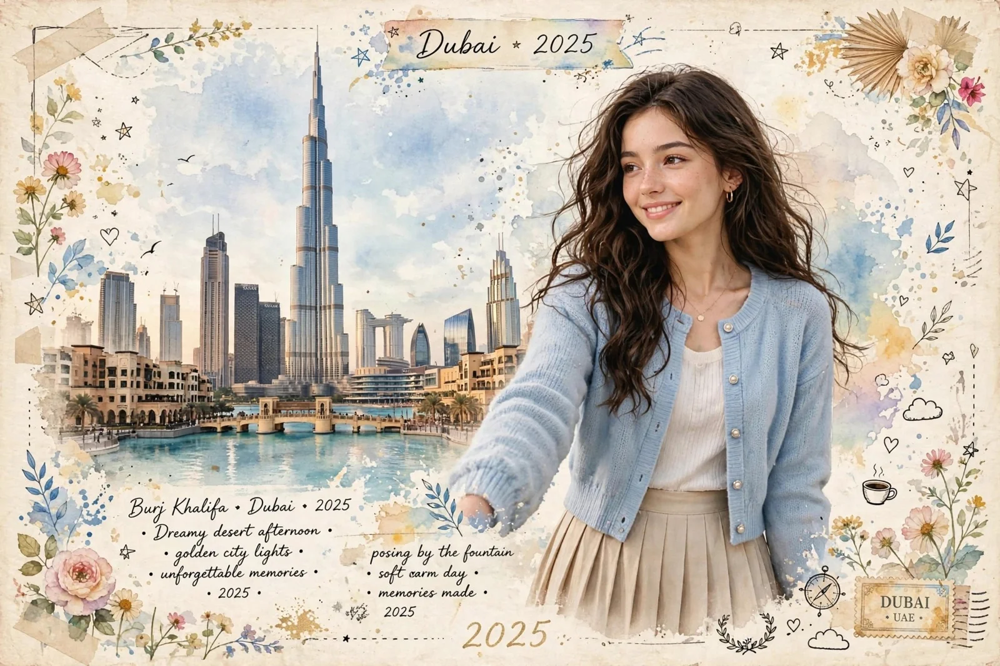

# Dubai Vintage Watercolor Travel Scrapbook Poster

**中文标题：** 迪拜复古水彩旅行手账海报  
**ID:** `gi25-x-786` · **Mode:** `generate`  
**Categories:** `poster-typography`  
**Tags:** `x-twitter`, `community`, `gpt-image-2.5`, `x-direct`, `en`



### Dubai Vintage Watercolor Travel Scrapbook Poster

```text
Image Prompt 1 — Dubai 🇦🇪
Prompt:
Create a high-quality vintage watercolor travel scrapbook poster for Dubai, UAE, 2025, in a soft dreamy luxury travel-journal aesthetic. On the left side, show a beautiful detailed Dubai skyline featuring the Burj Khalifa, surrounding modern skyscrapers, Dubai Mall area, elegant architecture, turquoise fountain/water canal and palm trees, painted with realistic yet artistic watercolor textures. On the right side, place a beautiful young woman with long, thick, naturally wavy dark-brown hair, wearing a light powder-blue knitted cardigan over a cream/white top and a flowing beige pleated skirt. She has a soft natural smile, delicate facial features, minimal elegant makeup and a relaxed travel-photo pose, looking slightly toward the left. Keep her realistic and naturally integrated with the watercolor artwork.
Use an aged cream paper background with subtle paper texture, pastel blue and warm beige watercolor washes, hand-painted flowers, leaves, tiny stars, hearts, birds, clouds, paper-tape elements, compass and small travel scrapbook decorations around the borders. At the top center write “Dubai • 2025” in elegant handwritten calligraphy. At the bottom include tasteful travel-journal text such as “Burj Khalifa • Dubai • 2025”, “Dreamy desert afternoon”, “golden city lights”, “unforgettable memories”, and “posing by the fountain”. Add a small vintage postage-stamp style label reading “DUBAI • UAE • 2025” in the bottom-right corner. Balanced composition, premium travel postcard, soft pastel colors, detailed watercolor illustration mixed with realistic portrait photography, elegant feminine aesthetic, nostalgic handmade scrapbook look, high detail, clean typography, 16:9 landscape.
```

- **Recommended model:** `gpt-image-2.5-sunburst`
- **Settings:** _(defaults)_
- **Source:** [community](https://x.com/KrishnaBio1/status/2101465893293392100) — @KrishnaBio1
- **License note:** Original public X post; quoted with attribution — remix with attribution
- **Notes:** Collected directly from X; prompt posted as the author's reply https://x.com/KrishnaBio1/status/2101465893293392100 to https://x.com/KrishnaBio1/status/2101465886213484588, which carries the images and names GPT Image 2.5; discovered via Bin0754/gpt-image-gallery index, prompt re-verified against the original X post via api.fxtwitter.com; verified=True; Prompt 1 (Dubai) from author thread — verified reply text
- **Preview:** `previews/gi25-x-786.webp`
