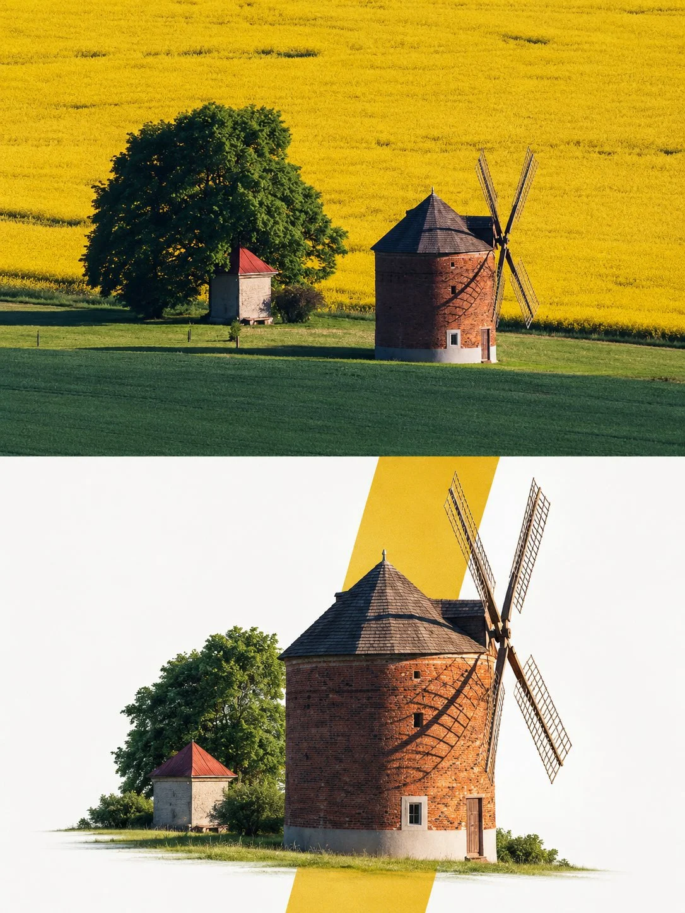

# Premium Editorial Poster Pack from Uploaded Photos

**中文标题：** 上传照片→高端编辑海报套装  
**ID:** `gi25-x-788` · **Mode:** `edit`  
**Categories:** `poster-typography`, `character-consistency`  
**Tags:** `x-twitter`, `community`, `gpt-image-2.5`, `x-direct`, `en`



### Premium Editorial Poster Pack from Uploaded Photos

```text
Premium Editorial Poster Instructions
Each uploaded photo must be transformed into a separate, independent premium editorial poster. Never combine multiple photos into one design. Use a strict 3:4 vertical canvas divided horizontally at the exact center into two equal halves, each occupying 50% of the total height and full width, without altering proportions.

The upper half must use the original photo directly without regeneration. Preserve the main subject's identity, human anatomy or architectural structure, proportions, perspective, spatial relationships, textures, natural lighting, shadows, colors, and environment exactly as shown. Only slight cropping and restrained premium color grading are permitted. Do not redraw the main subject, introduce artificial lighting, apply excessive HDR or saturation, create plastic textures, or add fictional elements. If necessary, extend only environmental areas such as the sky, water, ground, walls, plants, or background.

The lower half must reconstruct the photo's central narrative, whether it is a single primary subject or a connected group of elements representing the image's identity, scale, action, or story. Preserve realistic appearance, recognizable identity, proportions, internal structure, texture, and relative positioning. Do not remove important related elements or use a rectangular photo cutout. The reconstructed subject should occupy approximately 55%–80% of the lower half's width. Extend the subject naturally according to the scene's direction, maintaining believable ground contact, waterlines, realistic shadows, or softly fading edges. Integrate it seamlessly into the background without a sticker-like or floating appearance.

Place one narrow, low-saturation geometric color field behind or partially through the subject, creating a subtle transition between photographic realism and editorial abstraction. Extract the color from the original photo and choose a horizontal, vertical, or diagonal orientation according to the scene's narrative direction. The subject must visibly cross the color field's boundary, with part overlapping the colored area and another part extending into the open negative space. Create natural occlusion, overlap, and spatial depth. The color field must not act as a frame or card and must never completely enclose the subject. Use only one primary geometric window. Do not add multiple color blocks, thick borders, rounded corners, strong gradients, or drop shadows.

Use a white, cool-white, very light gray, or near-white background in the lower half, coordinated with the original photograph. Maintain a restrained asymmetrical composition with generous negative space and a clear visual hierarchy: the reconstructed subject as the primary focus, the low-saturation geometric window as the secondary element, and the clean background as supporting space.

The final poster must look premium, refined, realistic, and editorial while preserving the original photo's visual identity, exact two-half composition, original proportions, and overall artistic direction.
```

- **Recommended model:** `gpt-image-2.5-sunburst`
- **Settings:** _(defaults)_
- **Source:** [community](https://x.com/AiwithLariab/status/2109302875629478374) — @AiwithLariab
- **License note:** Original public X post; quoted with attribution — remix with attribution
- **Notes:** Collected directly from X; original post https://x.com/AiwithLariab/status/2109302875629478374; post text names GPT Image 2.5; discovered via Bin0754/gpt-image-gallery index, prompt re-verified against the original X post via api.fxtwitter.com; verified=True
- **Preview:** `previews/gi25-x-788.webp`
