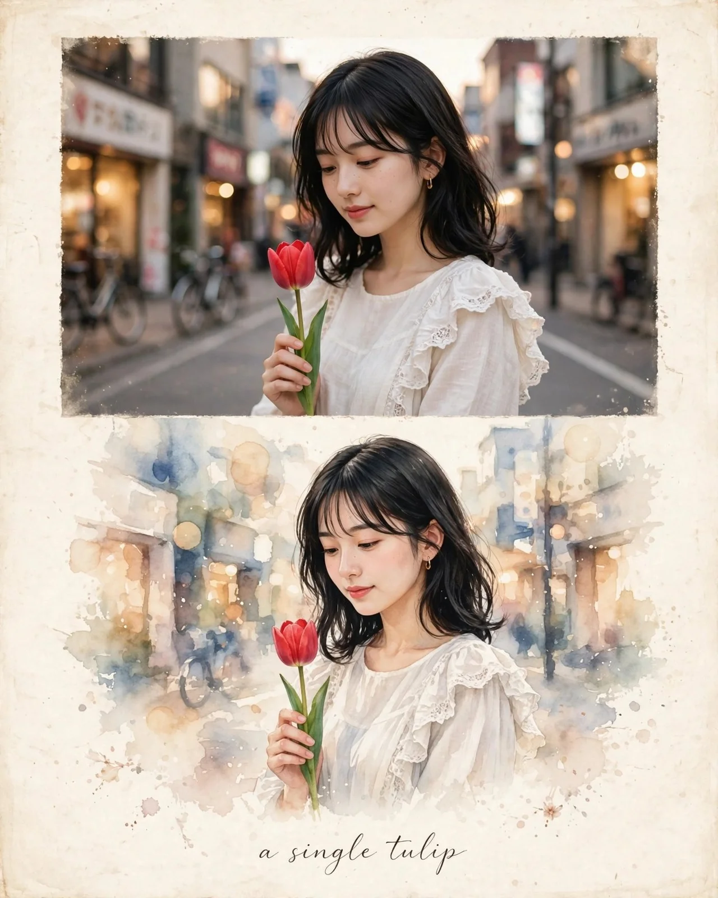

# TOKYO SKYLINE Travel-Editorial Artwork

**中文标题：** 东京天际线旅行编辑艺术海报  
**ID:** `gi25-x-792` · **Mode:** `generate`  
**Categories:** `poster-typography`  
**Tags:** `x-twitter`, `community`, `gpt-image-2.5`, `x-direct`, `en`



### TOKYO SKYLINE Travel-Editorial Artwork

```text
Create a premium 4:5 vertical travel-editorial artwork titled “TOKYO SOFT TULIP GLOW,” combining all three visual concepts into one cohesive, elegant, artistic composition.

MAIN CONCEPT:
Blend the magical nighttime atmosphere of Tokyo's illuminated streets, delicate white lilies, and a graceful young Japanese woman holding a tulip into a single sophisticated editorial poster. The artwork should combine photorealistic photography with delicate watercolor illustration on warm ivory handmade paper.

TOP SECTION — CINEMATIC PHOTOGRAPHY:
Show a stunning white lily in the foreground, its delicate petals illuminated by warm golden streetlights, with tiny water droplets adding realistic detail. Behind the flower, create a softly blurred Tokyo street at night, filled with glowing shop windows, colorful city lights, and beautiful golden bokeh. Use cinematic depth of field, realistic textures, and a peaceful Japanese urban atmosphere.

CENTER SECTION — JAPANESE BEAUTY:
Feature a graceful young Japanese woman with natural East Asian facial features, delicate skin texture, expressive dark eyes, and long, softly wavy black hair. She wears an elegant cream-white knitted sweater or a refined white blouse with subtle lace details. She gently holds a soft pink tulip close to her face, looking at it with a peaceful, thoughtful expression.

Her pose should feel candid, natural, and emotionally subtle rather than overly posed. Warm golden city lights illuminate her face while the background remains softly blurred. Maintain realistic hands, natural proportions, delicate makeup, and authentic photographic details.

LOWER SECTION — WATERCOLOR TRANSFORMATION:
Gradually transform the photographic scene into a beautiful hand-painted watercolor illustration. Recreate the same woman holding the tulip, surrounded by flowing watercolor washes in soft ivory, dusty blue, blush pink, lavender, and warm golden tones.

Blend delicate floral details, translucent watercolor layers, subtle ink outlines, and scattered pigment splashes into the composition. Add a few elegant white lilies and tiny floral accents around the main illustration without overcrowding the design.

ARTISTIC BACKGROUND:
Use textured cream-colored handmade paper with subtle grain, softly aged edges, delicate imperfections, and a premium fine-art print appearance. The transition between realistic photography and watercolor painting should feel seamless and artistic.

COLOR PALETTE:
Warm ivory, pearl white, soft blush pink, muted lavender, midnight blue, champagne gold, and gentle amber. Maintain a harmonious balance between the glowing nighttime city and the soft romantic floral atmosphere.

LIGHTING AND MOOD:
Cinematic nighttime lighting, warm golden bokeh, soft facial illumination, delicate highlights on flower petals, realistic shadows, and a peaceful Tokyo evening atmosphere. The overall feeling should be elegant, dreamy, romantic, calm, and sophisticated.

COMPOSITION:
Create a visually balanced vertical poster with a strong central focal point, carefully layered photographic and watercolor elements, generous negative space, refined editorial spacing, and premium art-book aesthetics.

TYPOGRAPHY:
At the bottom, elegantly write:
“TOKYO SOFT TULIP GLOW”

Use refined, delicate, handwritten-style lettering in muted dark brown or soft charcoal. Keep the typography minimal, readable, and beautifully integrated into the paper texture.

QUALITY:
Ultra-detailed, premium editorial artwork, photorealistic floral photography, sophisticated watercolor illustration, realistic human anatomy, natural facial features, delicate botanical details, cinematic depth of field, professional art direction, museum-quality paper texture, and exceptional visual harmony.

ASPECT RATIO:
4:5 vertical composition.

NEGATIVE PROMPT:
Low resolution, blurry main subject, distorted face, unnatural eyes, deformed hands, extra fingers, duplicate flowers, malformed petals, plastic skin, oversaturated colors, harsh lighting, cluttered composition, excessive decorative elements, illegible typography, misspelled title, artificial-looking watercolor effects, cartoonish facial features, and poor-quality textures.

FINAL RESULT:
A luxurious Tokyo-inspired editorial poster that seamlessly combines a glowing white lily, a graceful Japanese woman holding a tulip, magical nighttime city lights, and delicate watercolor artistry into one unified masterpiece.
```

- **Recommended model:** `gpt-image-2.5-sunburst`
- **Settings:** _(defaults)_
- **Source:** [community](https://x.com/KrishnaBio1/status/2110042193646026942) — @KrishnaBio1
- **License note:** Original public X post; quoted with attribution — remix with attribution
- **Notes:** Collected directly from X; prompt posted as the author's reply https://x.com/KrishnaBio1/status/2110042193646026942 to https://x.com/KrishnaBio1/status/2110042171890184485, which carries the images and names GPT Image 2.5; discovered via Bin0754/gpt-image-gallery index, prompt re-verified against the original X post via api.fxtwitter.com; verified=True
- **Preview:** `previews/gi25-x-792.webp`
