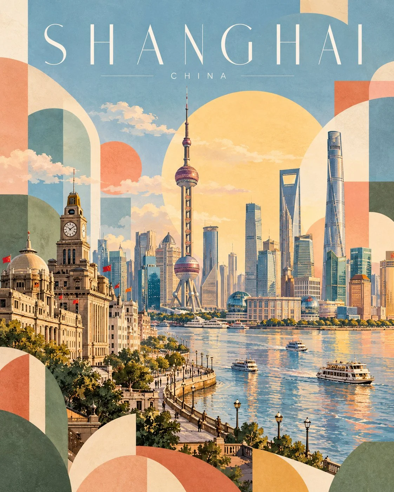

# Geometric Travel-Art Poster for [LOCATION]

**中文标题：** 几何旅行艺术海报（地点可填）  
**ID:** `gi25-x-797` · **Mode:** `generate`  
**Categories:** `poster-typography`  
**Tags:** `x-twitter`, `community`, `gpt-image-2.5`, `x-direct`, `en`



### Geometric Travel-Art Poster for [LOCATION]

```text
Create a premium 4:5 vertical geometric travel-art poster for [COUNTRY / CITY / LOCATION / SUBJECT].

TEXT-TO-IMAGE ONLY — generate the entire artwork from the written destination or subject alone. Do not request, upload, use, or depend on any reference image. Automatically identify the destination’s iconic landmarks, distinctive architecture, landscape, and cultural identity.

CORE CONCEPT:
Create an elegant travel poster combining approximately 70% recognizable destination illustration with 30% abstract geometric shapes. The landmark and surrounding scenery remain the main focus, while geometric forms add a playful, modern editorial character.

COMPOSITION:
Feature one iconic landmark prominently, surrounded by authentic local architecture, rooftops, hills, mountains, trees, or coastal scenery as appropriate. Arrange the scene in layered depth with simplified architectural details and a clear visual focal point.

Integrate abstract geometric forms into the landscape: overlapping circles, arches, triangles, semicircles, curved blocks, and soft rectangular shapes. Let these forms complement the architecture and scenery rather than obscure the landmark.

TYPOGRAPHY:
Place the destination name prominently across the top in thin, elegant, widely spaced uppercase lettering.

Main title: [LOCATION NAME]
Subtitle: [COUNTRY NAME]

Use refined minimalist typography, generous letter spacing, and a small understated subtitle. Ensure accurate spelling and balanced alignment.

COLOR PALETTE:
Powder blue, muted sage green, soft apricot, dusty blush pink, butter yellow, warm ivory, and light terracotta. Adapt the balance naturally to the destination while maintaining a harmonious, low-saturation palette.

ART STYLE:
Contemporary Scandinavian editorial travel illustration, soft gouache texture, matte painted surfaces, delicate watercolor grain, simplified geometric architecture, clean silhouettes, gentle shadows, and subtle handcrafted imperfections.

LIGHTING & ATMOSPHERE:
Bright, airy daylight with soft atmospheric depth, a pale open sky, warm sunlight, and a calm, optimistic mood. Keep the overall composition light and spacious.

NEGATIVE SPACE:
Preserve generous breathing room around the landmark and title. Avoid excessive detail, dense compositions, harsh outlines, oversaturated colors, glossy effects, photorealism, 3D rendering, unnecessary text, logos, and watermarks.

FINAL AESTHETIC:
Recognizable destination landmarks × modern geometric abstraction × pastel gouache illustration × Scandinavian design × premium collectible travel poster.

FORMAT:
4:5 vertical portrait, landmark-led composition, approximately 70% destination illustration and 30% geometric abstraction, elegant typography, soft matte texture, ultra-high definition.
```

- **Recommended model:** `gpt-image-2.5-sunburst`
- **Settings:** _(defaults)_
- **Source:** [community](https://x.com/Goodmanprotocol/status/2108770810743996501) — @Goodmanprotocol
- **License note:** Original public X post; quoted with attribution — remix with attribution
- **Notes:** Collected directly from X; original post https://x.com/Goodmanprotocol/status/2108770810743996501; post text names GPT Image 2.5; discovered via Bin0754/gpt-image-gallery index, prompt re-verified against the original X post via api.fxtwitter.com; verified=True; template with [COUNTRY / CITY / LOCATION] placeholders
- **Preview:** `previews/gi25-x-797.webp`
