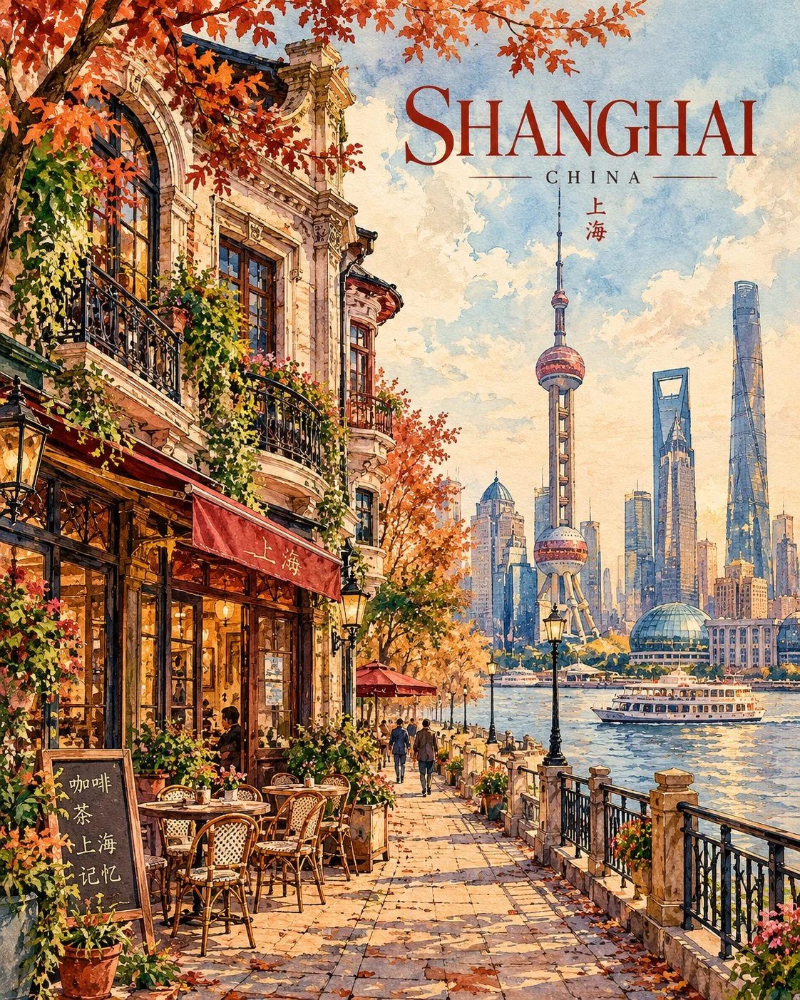

# Vintage Watercolor Travel-Art Poster (Full-Frame)

**中文标题：** 复古水彩旅行艺术海报（满版）  
**ID:** `gi25-x-799` · **Mode:** `generate`  
**Categories:** `poster-typography`  
**Tags:** `x-twitter`, `community`, `gpt-image-2.5`, `x-direct`, `en`



### Vintage Watercolor Travel-Art Poster (Full-Frame)

```text
Create a premium FULL-FRAME 4:5 vertical vintage watercolor travel-art poster for [COUNTRY / CITY / LOCATION / SUBJECT].

TEXT-TO-IMAGE ONLY — generate the entire artwork from the written destination or subject alone. Do not request, upload, use, or depend on any reference image. Automatically identify the destination’s distinctive architecture, iconic landmarks, local streets, vegetation, and cultural atmosphere.

CORE CONCEPT:
Illustrate one charming local street, historic café, distinctive building, or recognizable destination landmark as a collectible vintage travel-art print. Capture the warmth and nostalgia of an old travel memory, combining architectural watercolor illustration with delicate ink details.

COMPOSITION:
Fill the entire 4:5 portrait canvas with the artwork from edge to edge. The illustration must occupy the COMPLETE FRAME, with no mockup, no surrounding wall, no framed-print presentation, and no blank margins outside the artwork.

Feature one prominent architectural subject, such as a historic corner café, pastel-colored townhouse, traditional storefront, or iconic local building. Include authentic windows, balconies, decorative façades, street details, and lush climbing plants or sidewalk trees where appropriate. Add subtle surrounding architecture to create natural depth without distracting from the main subject.

ART STYLE:
Hand-painted architectural watercolor with fine brown ink outlines, delicate pen-and-ink details, transparent watercolor washes, soft gouache accents, visible paper grain, natural pigment variation, and slightly imperfect handmade lines.

COLOR PALETTE:
Dusty rose, warm terracotta, muted sage green, soft olive, pale sky blue, warm cream, and gentle ochre. Automatically adapt the palette to the destination while maintaining a harmonious, nostalgic atmosphere.

LIGHTING & MOOD:
Soft natural daylight, gentle shadows, warm afternoon light, delicate foliage, and a peaceful lived-in atmosphere. Preserve the character of ordinary local life, creating the feeling of discovering a beautiful little street while travelling.

TYPOGRAPHY:
Integrate a small, elegant destination title directly into the artwork, using refined vintage editorial lettering. Add a discreet subtitle only when appropriate. Keep text minimal, legible, and secondary to the illustration.

TEXTURE & FINISH:
Premium archival art-print aesthetic, matte watercolor surfaces, subtle paper fibers, restrained ink details, organic brushwork, and sophisticated independent travel-poster design.

AVOID:
Photorealism, 3D rendering, glossy digital effects, generic architecture, oversaturated colors, excessive detail, cluttered typography, borders, picture frames, interior room mockups, white walls, product photography, logos, and watermarks.

FINAL AESTHETIC:
Vintage architectural watercolor × nostalgic travel illustration × charming local streets × delicate botanical details × premium collectible art print.

FORMAT:
FULL 4:5 vertical portrait composition, edge-to-edge artwork, complete canvas coverage, high resolution, no external margins, no mockup, no frame.
```

- **Recommended model:** `gpt-image-2.5-sunburst`
- **Settings:** _(defaults)_
- **Source:** [community](https://x.com/Goodmanprotocol/status/2108824401701752899) — @Goodmanprotocol
- **License note:** Original public X post; quoted with attribution — remix with attribution
- **Notes:** Collected directly from X; original post https://x.com/Goodmanprotocol/status/2108824401701752899; post text names GPT Image 2.5; discovered via Bin0754/gpt-image-gallery index, prompt re-verified against the original X post via api.fxtwitter.com; verified=True; template with location placeholders
- **Preview:** `previews/gi25-x-799.webp`
