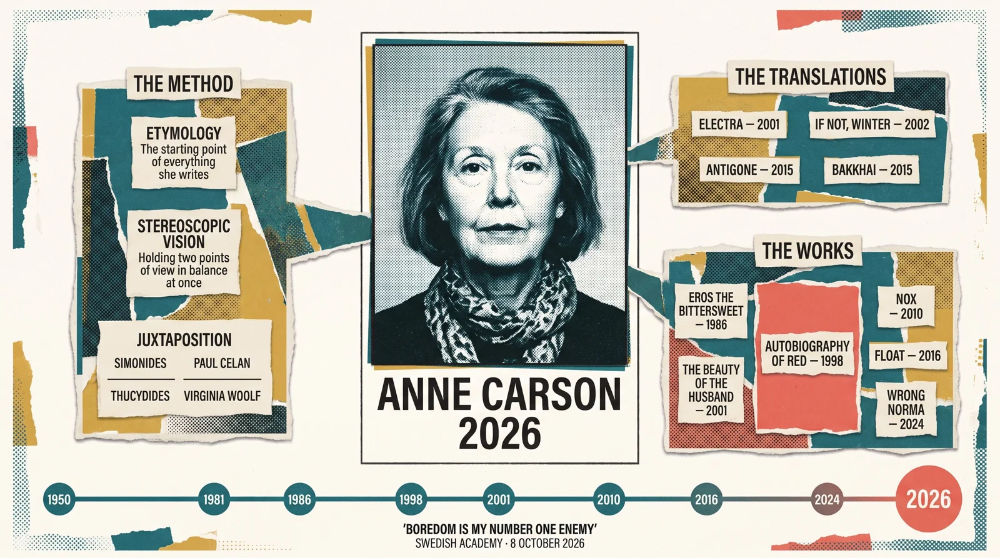

# Nobel Literature Prize Editorial Portrait Infographic

**中文标题：** 诺贝尔文学奖编辑肖像信息海报  
**ID:** `gi25-x-810` · **Mode:** `generate`  
**Categories:** `poster-typography`  
**Tags:** `x-twitter`, `community`, `gpt-image-2.5`, `x-direct`, `en`



### Nobel Literature Prize Editorial Portrait Infographic

```text
## Role

You are an editorial art director producing a single-plate infographic poster for a literary news feature. You have produced prize-announcement broadsheets for major literary awards. You understand that a portrait poster lives or dies on whether the face dominates, and you never let a layout's symmetry flatten a person into one tile among many.

## Topic

On 8 October 2026 the Swedish Academy awarded the **Nobel Prize in Literature** to the Canadian poet and classicist **Anne Carson**, "for her bold and creative works that, in playful dialogue with the classical tradition, have created new forms for contemporary literature."

The plate introduces her: who she is, how she works, what she wrote, what she translated, and the forty-year span from her birth to the prize.

## Learning Objectives

1. **Recognise the subject instantly.** Who is Anne Carson? A Canadian poet and classicist, and the 2026 Nobel laureate. *(Objective #1 — this is what the H1 must answer.)*
2. **Understand why she won.** She joins the philologist's obsession with words to the poet's hunger for new meaning, and uses unexpected cross-era juxtaposition to break out of the lyric paradigm.
3. **Grasp the depth of the body of work.** Four decades of writing and translation, in which she keeps crossing genre boundaries.
4. **Sense a specific person, not an institution.** There is humour here (she called boredom her number one enemy) and there is grief (a book written for her lost brother).

---

## Layout — `hub-spoke`

One hub. Spokes that read outward from it. Annotations after.

**Focal zone: the hub, unambiguously.** The hub is not an abstract concept, a pie chart or a central keyword — **the hub is her face.** The spokes are facets of the work. Every spoke must be visibly lighter than the hub in size, contrast and surrounding space.

**Reading order follows the hub outward, then clockwise.**

### ⛔ Read this before drawing — the trap this layout sets

`hub-spoke` is the layout most likely to fail here. A model that knows only "hub with spokes" produces a **mind map**: a small circle in the middle with evenly weighted satellite bubbles. That is the exact failure this plate must avoid.

- The hub is a **face**, not a node.
- The spokes are **not** the same size as each other. The works spoke is the largest of the three; the translations spoke is the smallest.
- No spoke may have a border, fill or saturation that competes with the portrait.

---

## Style — `risograph-halftone-collage`

A layered risograph collage: spot-colour inks, visible halftone dot screens, torn and cut paper edges, and deliberate slight misregistration between colour plates — the authentic look of a small-run two- or three-colour print shop.

### Palette — use these values, no others

| Role | Colour | Hex |
|---|---|---|
| Deep teal — primary ink | teal | `#007A87` |
| Cadmium red-coral — **the single accent** | red-coral | `#E63946` |
| Mustard — secondary warm ink | mustard | `#F4A261` |
| Paper ground | off-white | `#F4F1EA` |
| Ink black — all typography | carbon black | `#1A1A1A` |

### Surface treatment

- **Halftone dot screens** are the defining texture: dots visible at normal viewing distance on the portrait and on the large colour fields.
- **Misregistration**: colour plates sit 1–2px off their intended register, so teal and coral edges show a thin offset fringe.
- **Torn and cut paper edges** on the collage layers.
- **Typography is printed clean.** The misregistration, the dot screen and the torn edges apply ONLY to the image layers. Every letterform is sharp, solid, correctly spelled and fully legible. Text is never halftoned, never textured, never distressed, never misregistered.

### Figure colours, specified

- Her face is a **duotone risograph portrait**: carbon black halftone for the modelling and shadow, deep teal for the mid-tones, on the off-white paper ground.
- **The dot screen over the face is the finest on the plate.** Her features, the shape of the eyes and the set of the mouth must survive. Do not use the coarse posterised dots used on the background fields.
- Her skin is a natural mid-tone — this is a living woman, not a silhouette, not a single-colour mask, not a statue.

### Style adaptation — read this before drawing the figure

This style's collage habit is to layer **cut-out photographs and printed ephemera**, which very often means cut-out photographs of *people*. On this plate that is forbidden: the collage layers may contain paper, colour fields, dot screens, torn edges and halftone texture — **they may not contain any other human face, portrait, photograph of a person, or figure, in whole or in part.**

---

## Content

Four sections. Tiers are assigned and final.

### SECTION 1 — THE PORTRAIT — **Tier H1**

The hub. Her face and her name are **one fused visual unit** — the name is locked to the portrait, immediately at or against its lower edge, reading as a single object with it.

Verbatim strings:
- `ANNE CARSON`
- `2026`

The name is the largest **typography** on the plate. The face is the largest **element** on the plate — larger than the name.

### SECTION 2 — THE METHOD — **Tier H2** (left spoke)

Her working method, in three short units.

- `ETYMOLOGY` — subtitle: `The starting point of everything she writes`
- `STEREOSCOPIC VISION` — subtitle: `Holding two points of view in balance at once`
- `JUXTAPOSITION` — two paired lines beneath it:
  - `SIMONIDES` / `PAUL CELAN`
  - `THUCYDIDES` / `VIRGINIA WOOLF`

The two pairs are rendered as two parallel rules with a name at each end — **not** as icons, not as portraits, not as book covers.

### SECTION 3 — THE TRANSLATIONS — **Tier H2** (right spoke — the smallest spoke)

Four translated works. Translations from the Greek stand as independent art.

- `ELECTRA` — `2001`
- `IF NOT, WINTER` — `2002`
- `ANTIGONE` — `2015`
- `BAKKHAI` — `2015`

### SECTION 4 — THE WORKS — **Tier H2** (lower spoke — the largest spoke)

Six major works, chronologically. `AUTOBIOGRAPHY OF RED` is the **hero card** of this cluster — drawn at roughly 2× the linear scale of the others, and it is the one card permitted to use the red-coral accent as a fill.

- `EROS THE BITTERSWEET` — `1986`
- `AUTOBIOGRAPHY OF RED` — `1998`  ← **hero card, largest**
- `THE BEAUTY OF THE HUSBAND` — `2001`
- `NOX` — `2010`
- `FLOAT` — `2016`
- `WRONG NORMA` — `2024`

### SECTION 5 — THE FOOTER TIMELINE — **Tier H2\*** (see the R2 note)

⚠️ **This footer is not a legend.** It is a real chronology and it must be drawn at **H2 contrast**, not at caption weight. If it is rendered as a legend, the sequence disappears.

A single horizontal rule spanning the full width of the plate, at the very bottom, with dated nodes:

`1950` · `1981` · `1986` · `1998` · `2001` · `2010` · `2016` · `2024` · **`2026`**

**Traversal is left to right, 1950 → 2026. State it visually: the rule must read as advancing rightward.**

**The terminal node `2026` is the largest node and is filled with the red-coral accent.** Every other node is a small carbon-black dot. The timeline's nodes carry **years only** — never a book title.

### SECTION 6 — ATTRIBUTION — **Tier H3**

Small, low contrast, bottom edge:
- `"BOREDOM IS MY NUMBER ONE ENEMY"`
- `SWEDISH ACADEMY · 8 OCTOBER 2026`

---

## Text Accuracy

**Every string below is rendered exactly as written, once, with no variation.**

| String | Count on plate | Note |
|---|---|---|
| `ANNE CARSON` | 1 | Locked to the portrait. H1. |
| `2026` | 2 | Once as the award year beside the portrait; once as the timeline's terminal node. These are the only permitted duplicate. |
| `ETYMOLOGY` | 1 | |
| `The starting point of everything she writes` | 1 | Sentence case. Lowercase "The". |
| `STEREOSCOPIC VISION` | 1 | |
| `Holding two points of view in balance at once` | 1 | Sentence case. |
| `JUXTAPOSITION` | 1 | |
| `SIMONIDES` | 1 | |
| `PAUL CELAN` | 1 | Two words. |
| `THUCYDIDES` | 1 | T-H-U-C-Y-D-I-D-E-S. |
| `VIRGINIA WOOLF` | 1 | WOOLF — two O's, one F at the end. |
| `ELECTRA` | 1 | |
| `IF NOT, WINTER` | 1 | Comma after NOT. |
| `ANTIGONE` | 1 | A-N-T-I-G-O-N-E. |
| `BAKKHAI` | 1 | B-A-K-K-H-A-I. Double K, then H. |
| `EROS THE BITTERSWEET` | 1 | BITTERSWEET is one word. |
| `AUTOBIOGRAPHY OF RED` | 1 | ⚠️ **Highest-risk string on the plate** (13-letter word). Set it large, alone, on bare paper inside its card. Do not let any texture or ink field touch these letters. |
| `THE BEAUTY OF THE HUSBAND` | 1 | |
| `NOX` | 1 | |
| `FLOAT` | 1 | |
| `WRONG NORMA` | 1 | |
| `1950` `1981` `1986` `1998` `2001` `2010` `2016` `2024` | 1 each | Timeline nodes. Digits only, no "AD", no apostrophes. |
| `"BOREDOM IS MY NUMBER ONE ENEMY"` | 1 | Straight double quotation marks. |
| `SWEDISH ACADEMY · 8 OCTOBER 2026` | 1 | Middle dot separator. |

**Rules for all text:**
- Each string appears exactly **once** (the sole exception is `2026`, noted above).
- Every label sits on **bare, unpainted paper** — never on top of an illustration, ink field, halftone screen or torn edge.
- Labels sit **outside** the thing they label and are connected to it by proximity, never laid over it.
- **No English word on this plate may be invented, abbreviated, hyphenated, split across lines, or respelled.**
- No mirrored, reversed, rotated or vertically-set letterforms. All text is horizontal.

---

## The Portrait

**Depicted: Anne Carson — Canadian poet and classicist, born 1950, Nobel laureate 2026.**

An individuated, realistic likeness of a specific living woman in her mid-seventies: short grey hair, an alert and level gaze directed straight at the viewer, a composed, faintly ironic expression. She reads as a scholar and a poet — intelligent, unadorned, unsentimental.

- **Angle: frontal, 0°. Straight on, facing the viewer.** Both eyes visible, level, unobscured.
- **Framed, not bled.** The portrait sits inside a visible border — a medallion, an oval or a rectangle. It does not touch or cross any edge of the plate.
- **Rendered as a risograph halftone portrait**: carbon-black dots for modelling, deep teal mid-tones, off-white paper. The dot screen is finest here, so the likeness survives.
- **The name `ANNE CARSON` is fused to the portrait**, sitting immediately against its lower edge as part of the same visual object.
- **Nothing is drawn over the face.** No text, no rule, no torn paper, no colour field, no halftone band crosses it.
- **The ground behind her is a flat abstract plane** of teal and off-white — not a room, not a library, not a landscape, not a city, not a sky.

### ⛔ NO OTHER FIGURE ON THIS PLATE

This plate shows **exactly one person, once.** Forbid all of the following absolutely:

- Any second human face, head, silhouette, bust or body, at any size, anywhere — including in the margin, in the collage layers, inside a spoke, or as a background texture.
- **Any cut-out photograph or printed fragment of a person.** The risograph collage idiom invites this; refuse it.
- **Any depiction of the classical world's people**: no Sappho, no Simonides, no Stesichoros, no Thucydides, no Catullus, no Euripides, no Sophocles. They exist on this plate **as names only**.
- **No mythological creature**: no Geryon, no red winged monster, no Herakles, no cattle, no wings.
- **No classical statue, marble bust, plaster cast or sculpted head.** A statue would read as a generic stand-in for a living woman, which is forbidden.
- No Emily Brontë, no John Keats, no Paul Celan, no Virginia Woolf as a figure — `PAUL CELAN` and `VIRGINIA WOOLF` are **text labels only**.

### ⛔ NO UNREQUESTED ILLUSTRATIONS

Do not add: book covers, open books, quills, inkwells, typewriters, laurel wreaths, medals, laureate medallions, Greek columns, temples, olive branches, lyres, owls, or any decorative icon that was not requested above. The only images on this plate are **the portrait** and the geometric/typographic apparatus described in the Content and Composition sections.

---

## Composition & Visual Hierarchy

The plate must read as a **ranked composition**, not as a uniform field of equally weighted tiles.

### Reading order — the eye must travel in this sequence

1. **Her face.** The eye lands on the portrait first, before anything else on the plate — before the name, before the masthead, before any spoke.
2. **`ANNE CARSON`**, fused to the portrait's lower edge.
3. **The left spoke** — `ETYMOLOGY` / `STEREOSCOPIC VISION` / `JUXTAPOSITION`.
4. **The right spoke** — the four translations.
5. **The lower spoke** — the six works, with `AUTOBIOGRAPHY OF RED` as the hero card.
6. **The footer timeline**, travelling left to right, ending at the enlarged `2026` node.
7. Ornament and margin texture — last, and never competing.

### Proportional ladder — share of the plate

| Zone | Share |
|---|---|
| Masthead band (top) | ~5% |
| **The portrait + name (H1)** | **~56%** |
| The three spokes (H2, all together) | ~26% |
| Footer timeline (H2 contrast, edge to edge) | ~8% |
| Margin ring | ~5% |

**Never invert this ranking.** No spoke may approach the portrait's size. The works spoke is the largest spoke; the translations spoke is the smallest.

### Type scale — every level, largest first

1. **`ANNE CARSON`** — the H1 name, fused to the portrait. Largest type on the plate.
2. **Spoke headers** — `ETYMOLOGY`, `STEREOSCOPIC VISION`, `JUXTAPOSITION`, and the works/translations cluster headers.
3. **Work and translation titles** — `AUTOBIOGRAPHY OF RED`, `NOX`, `FLOAT`, `ELECTRA`, …
4. **Subtitles and secondary labels** — `The starting point of everything she writes`, the paired names, the years beside works.
5. **Timeline years and the attribution line** — smallest.

**Each level must be at least 20% larger than the level below it.**

### Contrast and value

- Only the **portrait** may use maximum contrast — it carries the deepest carbon black and the strongest modelling on the plate.
- Spoke headers sit at medium contrast. Work titles sit below them.
- Everything else — subtitles, years, timeline nodes, attribution — stays low and recedes when the plate is squinted at.
- The red-coral accent appears in **exactly two places, both small**: the `AUTOBIOGRAPHY OF RED` hero card fill, and the `2026` terminal timeline node. Nowhere else. No other element may be red-coral.

### Whitespace

- The gutter between spokes is at least **1.5×** the padding inside a single spoke.
- **The portrait gets the most surrounding space on the plate, not the least.** Nothing crowds it.

### Whitespace ownership — every empty region must have an owner

There is no unowned empty space on this plate. Assign each region explicitly:

| Region | Owner |
|---|---|
| Space directly around the portrait | the portrait (its breathing room) |
| The band above the portrait | the masthead |
| Gutters between the three spokes | separation between clusters |
| The strip directly above the timeline rule | the works spoke's lower margin |
| The bottom band, edge to edge | **the footer timeline** — it occupies the full width, so the bottom of the plate is never empty |
| The margin ring | ornament and halftone texture only |

**In particular: the bottom third of the plate is fully occupied by the works spoke and the timeline. Do not leave it blank.**

### Exclusion zones

- Ornament, torn paper and dot texture live **only in the margin ring**.
- **No ornament may be larger than the smallest label on the plate.**
- No ornament may overlap the portrait, the name, or any spoke.

### The single accent

**Exactly one element on the plate may break the grid: the `2026` node on the footer timeline.** It is drawn larger than the other nodes and it is the only element permitted to rise above the timeline rule and cross into the space above it.

That node is the accent. Nothing else tilts, overlaps a boundary, crosses an edge or sits off-baseline.

(The style's own misregistration fringes and torn paper edges are the **surface**, not the accent — they repeat across the whole plate and are not a compositional event.)

### Anti-flattening test

Shrink the plate to 200px wide and squint.

**Her face must still read as the dominant form.** The type may vanish, the labels may vanish, the timeline may vanish — the face must not. If the plate reads as a field of equally weighted tiles, it has failed.

**Correct this by re-weighting scale, contrast and whitespace — never by adding more decoration.** Decoration is what made it flat.

---

## Language

**English throughout.** Every string on the plate is English or Latin script, as listed in the Content section. No Chinese characters, no transliteration, no bilingual labels.

---

## Aspect Ratio

**16:9 landscape.** Compose for a wide plate: portrait hub at centre, spokes flanking left and right, works band below, single timeline rule along the bottom edge.

---

## Quality Rules

- **The plate must read as a ranked hierarchy, not a uniform field.** Apply the Composition section literally: the declared reading order, the proportional ladder, the type scale with ≥20% separation between adjacent levels, and the contrast rule that only the portrait may carry maximum contrast.
- The portrait is the largest element on the plate and nothing approaches it.
- Exactly one human figure; exactly one face.
- Every string is spelled exactly as given in the Text Accuracy table, and appears exactly once.
- Every label sits on bare paper, outside the thing it labels.
- Typography is always clean and sharp — never halftoned, distressed or misregistered.

## Negative Constraints

**Portrait**
- No profile view. No three-quarter view. No rear view. No downward or upward head tilt that hides the eyes.
- No sunglasses, no hat brim, no hair or shadow across the eyes.
- No caricature, no cartoon, no exaggerated features, no comic distortion.
- No classical statue, marble bust, plaster cast or sculpted likeness.
- No generic or anonymous woman — the likeness must be individuated and specific.
- No bleeding the portrait off any edge; it is framed.
- No text, rule, texture or colour field over the face.

**Other figures**
- No second person, face, head, bust, silhouette or body anywhere on the plate, at any size.
- No cut-out photographs or printed fragments of people in the collage layers.
- No depictions of Sappho, Simonides, Stesichoros, Thucydides, Catullus, Sophocles, Euripides, Paul Celan, Virginia Woolf, Emily Brontë or John Keats.
- No Geryon, no winged monster, no Herakles, no mythological scene.
- No crowd, no audience, no hands, no arms.

**Illustration**
- No book covers, open books, quills, inkwells, typewriters, laurel wreaths, medals, columns, temples, olive branches, lyres, owls, globes or maps.
- No decorative icons beyond the geometric apparatus described above.
- No flag, no national emblem, no institutional logo.

**Composition**
- No uniform grid of equally sized cards.
- No mind-map of equally weighted satellite bubbles around a small central circle.
- No second element competing with the portrait for the eye.
- No empty bottom third.
- No ornament outside the margin ring; no ornament overlapping the portrait or a spoke.
- No accent colour anywhere except the two declared places.

**Text defects — explicitly forbidden**
- Misspelled, invented or garbled words.
- Mirrored, reversed or rotated letterforms.
- Words broken across lines or split by a torn edge.
- Duplicated strings.
- Text rendered as halftone dots, distressed, blurred, or partially obscured.
- Any letterform placed over the portrait, over an ink field, or over a torn paper edge.
- Decorative or pseudo-text used to fill space — if a word is not in the Text Accuracy table, it does not appear on the plate.
```

- **Recommended model:** `gpt-image-2.5-sunburst`
- **Settings:** _(defaults)_
- **Source:** [community](https://x.com/Alex_allinai/status/2108204361835065587) — @Alex_allinai
- **License note:** Original public X post; quoted with attribution — remix with attribution
- **Notes:** Collected directly from X; prompt posted as the author's reply https://x.com/Alex_allinai/status/2108204361835065587 to https://x.com/Alex_allinai/status/2108204125439881380, which carries the images and names GPT Image 2.5; discovered via Bin0754/gpt-image-gallery index, prompt re-verified against the original X post via api.fxtwitter.com; verified=True; long art-director role prompt for Anne Carson 2026 feature
- **Preview:** `previews/gi25-x-810.webp`
