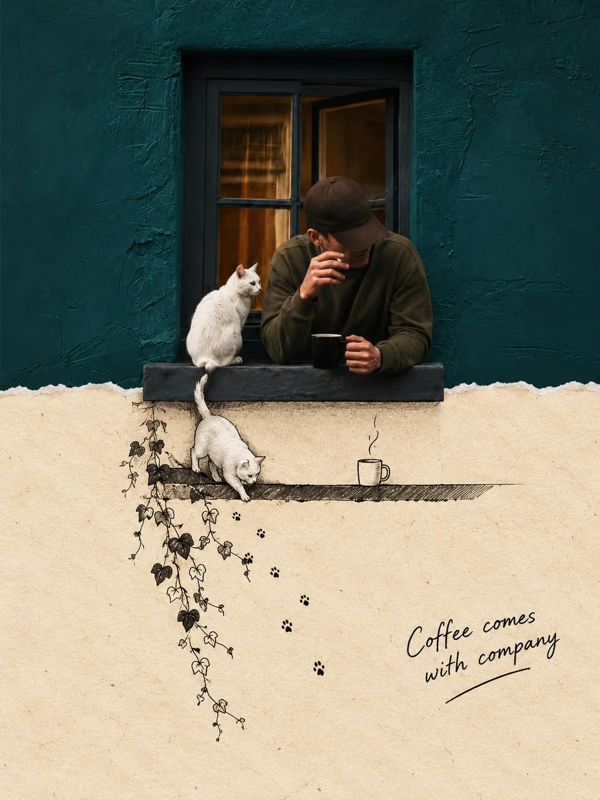

# Photo × Minimalist Ink-Wash Split Canvas

**中文标题：** 实拍×极简水墨上下分割画布  
**ID:** `gi25-x-811` · **Mode:** `edit`  
**Categories:** `poster-typography`, `edit-change-preserve`  
**Tags:** `x-twitter`, `community`, `gpt-image-2.5`, `x-direct`, `en`



### Photo × Minimalist Ink-Wash Split Canvas

```text
Vertical 3:4 canvas split into two strictly equal horizontal halves: top 50% and bottom 50%. The upper half stays photographic; the lower half becomes the continued Second World. Together they must read as one scene.

the

UPPER HALF

Keep the photo faithful. Preserve the subject, pose, spatial relationships, color atmosphere, and natural light. Do not redesign, repaint, replace, or restage it. Only necessary proportional

cropping is allowed.

CONTINUITY (highest priority)

Identify one source structure that naturally reaches the center split: a road, shoreline, water, reflection, branch, beam of light, piece of architecture, or body movement. This structure must cross the boundary and continue into the lower half. The Second World begins from the photograph itself, so the same scene passes through the seam and simply changes its physical rules.

TRANSITION EDGE

The center may use an irregular torn-paper edge, but the tear must follow the source structure, never act as decoration. Source elements may touch, follow, break through, or extend beyond edge. Never force the same tear shape onto every image.

The Second World

LOWER HALF

Ivory paper with subtle fibers and abundant negative space. Continue the chosen structure downward from the exact point where it meets the split, then reinterpret it with restrained photo fragments, cut-paper forms, and minimal black hand-drawn lines. The lower world must stay visibly attached Never isolate it as a separate portal, window, stage, platform, or floating vignette unless it clearly comes from the photo.

SECOND WORLD LOGIC

Ask: if this structure became touchable, usable, enterable, or changeable, what would it naturally become? Create one image-specific interaction. For example, water may stay attached while being pulled, a road may continue as a drawn path, or light may become something held. Do not repeat actions mechanically.

FIGURES

Add 0-3 tiny black line figures only when useful. They must physically interact with the continued structure. If the photo already contains strong human action, add none. Never use figures as decoration.

World

CAPTION

One

short handwritten English caption (2-6 words) based on the action. Natural, light, slightly witty. Spell it correctly. No inspirational quotes and no fixed "Same..., different..." phrasing.

STYLE

Real photography above, warm paper below, minimal black line doodles, subtle handmade collage texture, independent-magazine mood. Bright, airy, restrained. It should feel as if the Second already hidden inside the photo and simply continued downward.

was

NEGATIVE

No detached lower-half illustration, no generic torn-paper template, no isolated portal, no unrelated vignette, no broken continuity, no dense illustration, no random decoration, no crowd, altered photo colors, no redesign of the upper image, no glossy 3D, no scrapbook clutter, no gibberish text, no watermark, no logo, no UI.
```

- **Recommended model:** `gpt-image-2.5-sunburst`
- **Settings:** _(defaults)_
- **Source:** [community](https://x.com/harboriis/status/2110328832352010584) — @harboriis
- **License note:** Original public X post; quoted with attribution — remix with attribution
- **Notes:** Collected directly from X; original post https://x.com/harboriis/status/2110328832352010584; post text names GPT Image 2.5; discovered via Bin0754/gpt-image-gallery index, prompt re-verified against the original X post via api.fxtwitter.com; verified=True
- **Preview:** `previews/gi25-x-811.webp`
