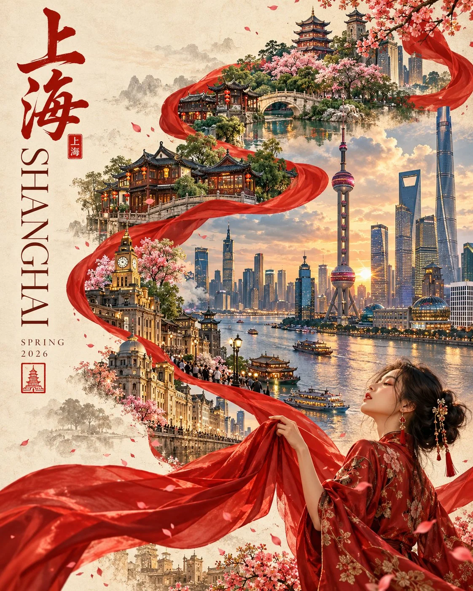

# Premium Editorial Travel Poster Template

**中文标题：** 高端编辑旅行海报模板  
**ID:** `gi25-x-812` · **Mode:** `generate`  
**Categories:** `poster-typography`  
**Tags:** `x-twitter`, `community`, `gpt-image-2.5`, `x-direct`, `en`



### Premium Editorial Travel Poster Template

```text
Create a premium 4:5 vertical editorial travel poster for [COUNTRY / CITY / LOCATION], blending contemporary digital illustration, traditional cultural elegance, and refined Asian-inspired design.

CORE CONCEPT: A flowing scarlet silk ribbon forms an elegant S-curve, connecting the destination’s most iconic landmarks, authentic architecture, natural scenery, and distinctive local culture into one seamless visual journey. An elegant woman in a culturally inspired modern outfit occupies the lower-right corner, gracefully interacting with the ribbon.

COMPOSITION: Warm ivory textured-paper background with generous negative space. Arrange recognizable landmarks along the ribbon, creating rich foreground, middle-ground, and background depth. Place the destination name vertically along the left edge, accompanied by “SPRING 2026” and a small red seal featuring the local name.

VISUAL STYLE: Sophisticated travel-poster illustration with realistic architectural details, delicate silk textures, atmospheric landscapes, soft cinematic lighting, and polished editorial composition.

COLOR PALETTE: Scarlet red, warm ivory, muted jade green, soft sky blue, and subtle antique gold. Keep the artwork luminous, balanced, and elegant.

CUSTOMIZATION: Automatically select authentic landmarks, architecture, cultural motifs, and a distinctive atmosphere for the specified destination. Preserve accurate landmark proportions and avoid generic collages.

AVOID: Distorted architecture, overcrowding, excessive ornamentation, inaccurate cultural details, illegible typography, logos, and watermarks.

FORMAT: Full-frame 4:5 vertical composition, high-resolution, collectible contemporary travel-art aesthetic.
```

- **Recommended model:** `gpt-image-2.5-sunburst`
- **Settings:** _(defaults)_
- **Source:** [community](https://x.com/Goodmanprotocol/status/2110221546056806567) — @Goodmanprotocol
- **License note:** Original public X post; quoted with attribution — remix with attribution
- **Notes:** Collected directly from X; original post https://x.com/Goodmanprotocol/status/2110221546056806567; post text names GPT Image 2.5; discovered via Bin0754/gpt-image-gallery index, prompt re-verified against the original X post via api.fxtwitter.com; verified=True
- **Preview:** `previews/gi25-x-812.webp`
