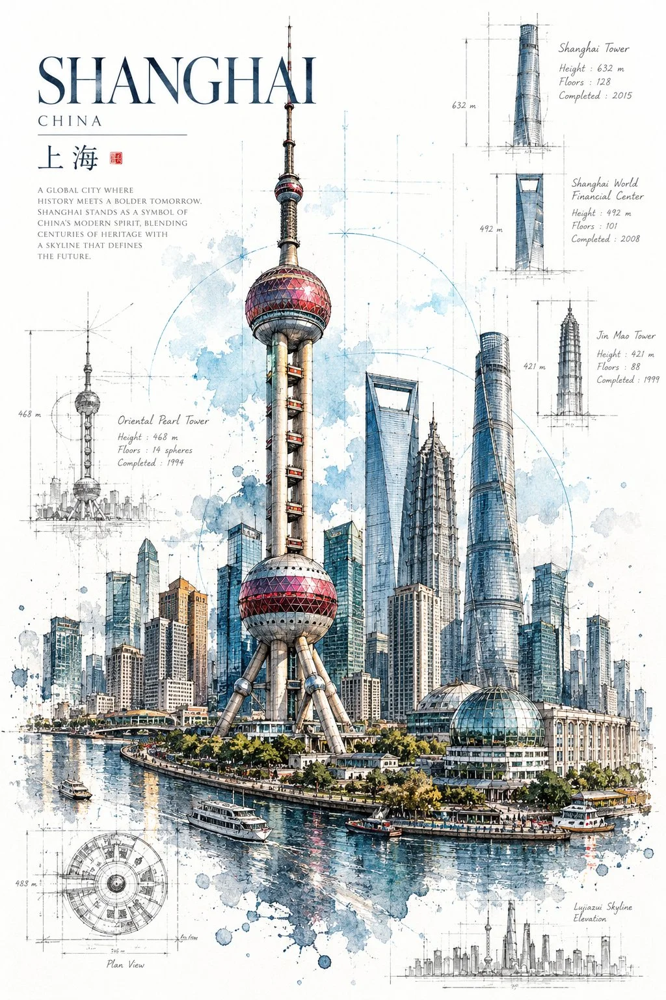

# Architectural Art Poster of a Landmark

**中文标题：** 地标建筑艺术海报  
**ID:** `gi25-x-813` · **Mode:** `generate`  
**Categories:** `poster-typography`  
**Tags:** `x-twitter`, `community`, `gpt-image-2.5`, `x-direct`, `en`



### Architectural Art Poster of a Landmark

```text
Create a premium 2:3 vertical architectural art poster of [BUILDING / LANDMARK], combining precise architectural sketching with expressive ink and watercolor.

COMPOSITION: Feature one architecturally accurate building in a dynamic three-quarter perspective, occupying 60–70% of the composition. Preserve its recognizable silhouette, proportions, structural details, and authentic architectural character.

ART STYLE: Intricate hand-drawn ink lines, graphite sketching, delicate crosshatching, translucent watercolor washes, organic imperfections, and expressive ink splashes concentrated around the building’s base.

TECHNICAL DETAILS: Integrate fine cyan and muted-teal construction lines, perspective guides, measurement arrows, geometric diagrams, and a few subtle handwritten annotations that relate to the building’s actual structure.

COLOR & BACKGROUND: Pure white background, charcoal and graphite linework, pale cyan drafting marks, muted blue-gray watercolor, and restrained indigo accents. Keep the composition airy with generous negative space.

TYPOGRAPHY: Add a small, elegant museum-archive label containing the building name, location, architectural style, and a short, factual 2–3-line English curatorial note. Keep typography refined and secondary.

FINAL AESTHETIC: A collectible museum-quality architectural study blending technical precision, expressive handmade artistry, and sophisticated editorial design.

AVOID: Photorealism, 3D rendering, vector-perfect outlines, inaccurate architecture, unrelated buildings, clutter, colored backgrounds, excessive annotations, logos, and watermarks.

FORMAT: Full-bleed 2:3 portrait, high resolution, exceptionally detailed, authentic ink-and-watercolor craftsmanship. Generate for new york
```

- **Recommended model:** `gpt-image-2.5-sunburst`
- **Settings:** _(defaults)_
- **Source:** [community](https://x.com/Goodmanprotocol/status/2110281050576519533) — @Goodmanprotocol
- **License note:** Original public X post; quoted with attribution — remix with attribution
- **Notes:** Collected directly from X; original post https://x.com/Goodmanprotocol/status/2110281050576519533; post text names GPT Image 2.5; discovered via Bin0754/gpt-image-gallery index, prompt re-verified against the original X post via api.fxtwitter.com; verified=True
- **Preview:** `previews/gi25-x-813.webp`
