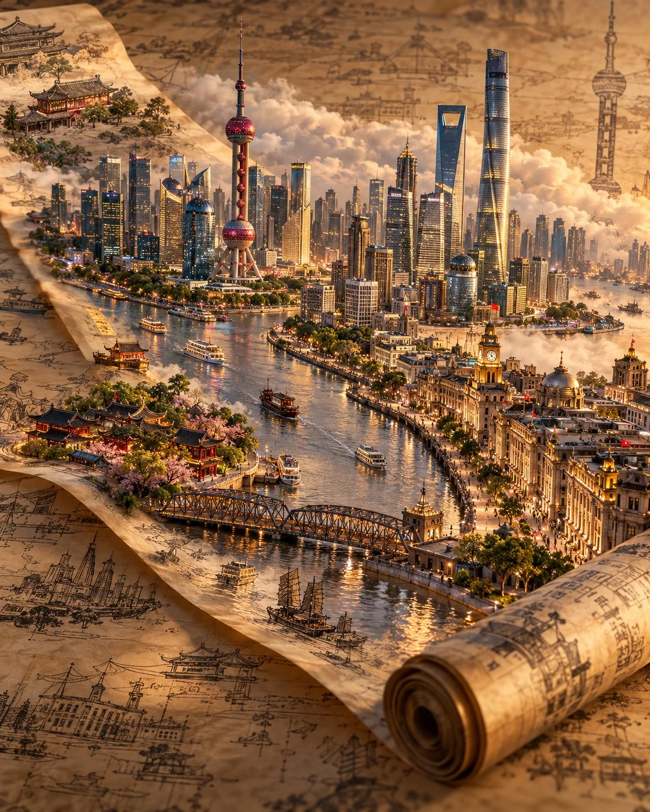

# Cinematic 3D Travel Artwork Full-Frame

**中文标题：** 电影感 3D 旅行全幅作品  
**ID:** `gi25-x-814` · **Mode:** `generate`  
**Categories:** `poster-typography`  
**Tags:** `x-twitter`, `community`, `gpt-image-2.5`, `x-direct`, `en`



### Cinematic 3D Travel Artwork Full-Frame

```text
Create a premium FULL-FRAME 4:5 vertical cinematic 3D travel artwork for [COUNTRY / CITY / LOCATION].

TEXT-TO-IMAGE ONLY — generate the entire scene from the location name alone. No reference image required.

CORE CONCEPT:
A monumental photorealistic 3D miniature world rises from a translucent parchment scroll laid diagonally across a seamless, weathered antique blueprint surface. Feature the location’s most iconic architecture, authentic landmarks, local vegetation, and distinctive natural scenery as one cohesive sculptural diorama.

COMPOSITION:
The parchment scroll runs diagonally from the upper-left toward the lower-right, ending in a tightly rolled cylinder. Fill the frame with aged paper texture, delicate historical ink drawings, architectural sketches, and cultural motifs associated with the destination. The raised miniature world dominates approximately 80% of the composition, with soft clouds drifting around distant structures. Use a low, location-level cinematic viewpoint, never a bird’s-eye view.

STYLE & LIGHTING:
Hyper-realistic 3D miniature diorama, intricate architectural detail, translucent parchment, expressive black ink brushwork, warm antique textures, epic golden-hour illumination, cinematic shadows, ambient occlusion, atmospheric depth, and shallow depth of field.

FINAL AESTHETIC:
A grand historical travel illustration combining ancient cartography, cultural heritage, and monumental miniature architecture.

AVOID:
Generic landmarks, inaccurate architecture, unrelated cultural symbols, flat illustrations, excessive ornamentation, visible outer paper edges, text overlays, logos, and watermarks.

FORMAT:
Full-bleed 4:5 vertical composition, 8K-quality detail, Unreal Engine 5 rendering aesthetic.
```

- **Recommended model:** `gpt-image-2.5-sunburst`
- **Settings:** _(defaults)_
- **Source:** [community](https://x.com/Goodmanprotocol/status/2109953193170145441) — @Goodmanprotocol
- **License note:** Original public X post; quoted with attribution — remix with attribution
- **Notes:** Collected directly from X; original post https://x.com/Goodmanprotocol/status/2109953193170145441; post text names GPT Image 2.5; discovered via Bin0754/gpt-image-gallery index, prompt re-verified against the original X post via api.fxtwitter.com; verified=True
- **Preview:** `previews/gi25-x-814.webp`
