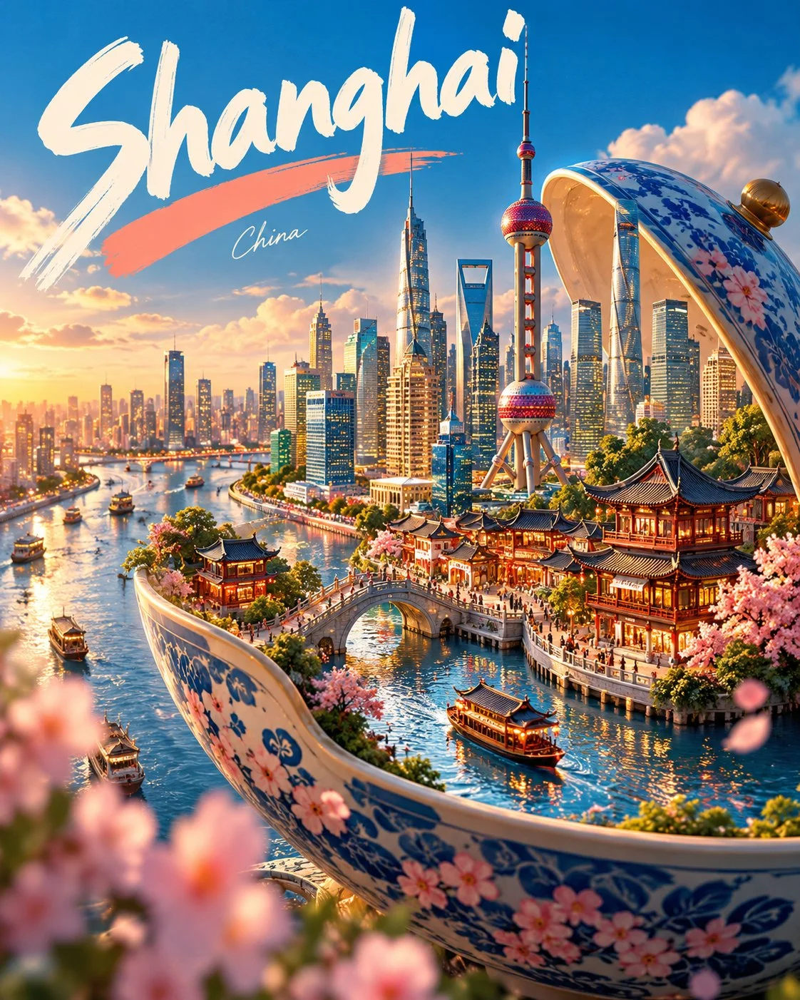

# “Tiny Worlds” Destination Travel Poster

**中文标题：** 「微观世界」目的地旅行海报  
**ID:** `gi25-x-815` · **Mode:** `generate`  
**Categories:** `poster-typography`  
**Tags:** `x-twitter`, `community`, `gpt-image-2.5`, `x-direct`, `en`



### “Tiny Worlds” Destination Travel Poster

```text
Create a premium FULL-FRAME 4:5 vertical “Tiny Worlds” travel poster for [DESTINATION], featuring [ICONIC OBJECT ASSOCIATED WITH DESTINATION].

TEXT-TO-IMAGE ONLY — generate the entire artwork from the written inputs alone. No reference image required.

CORE CONCEPT:
Transform the iconic object into a whimsical 3D miniature world, seamlessly incorporating authentic local architecture, landscape, vegetation, and cultural details. Make the object the single dominant focal point, with imaginative sculptural storytelling rather than a generic landmark collage.

COMPOSITION:
Use a strong foreground, middle ground, and background, with diagonal visual flow, atmospheric depth, soft foreground bokeh, and generous space for the headline.

SIGNATURE STYLE:
Highly detailed handcrafted miniature diorama, rounded sculptural forms, tactile materials, glossy water, realistic ambient occlusion, cinematic sunlight, and polished commercial illustration.

BRAND IDENTITY:
Cobalt blue and turquoise foundation, warm cream highlights, and a distinctive coral-pink accent. Place oversized white hand-painted destination lettering in the upper-left, with a recurring coral brushstroke and a small handwritten subtitle.

CREATIVE RULE:
Adapt the miniature world, cultural details, and accent colors to the destination. Maintain consistent lighting, typography, rendering quality, and layout across the collection while ensuring every concept feels original.

AVOID:
Generic landmark collages, clutter, flat vector art, photorealistic-only scenes, excessive text, logos, watermarks, and external framing.

FORMAT:
Full-bleed 4:5 vertical composition. Entire artwork fills the canvas.
```

- **Recommended model:** `gpt-image-2.5-sunburst`
- **Settings:** _(defaults)_
- **Source:** [community](https://x.com/Goodmanprotocol/status/2109879320550490347) — @Goodmanprotocol
- **License note:** Original public X post; quoted with attribution — remix with attribution
- **Notes:** Collected directly from X; original post https://x.com/Goodmanprotocol/status/2109879320550490347; post text names GPT Image 2.5; discovered via Bin0754/gpt-image-gallery index, prompt re-verified against the original X post via api.fxtwitter.com; verified=True
- **Preview:** `previews/gi25-x-815.webp`
