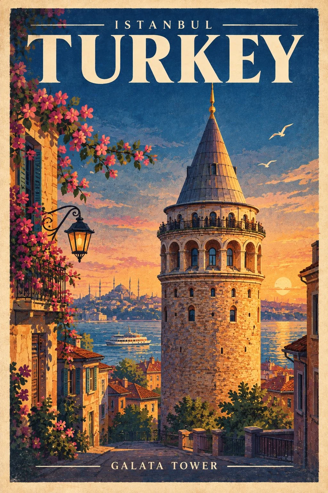

# Vintage Landmark Travel Poster Template

**中文标题：** 复古地标旅行海报模板  
**ID:** `gi25-x-821` · **Mode:** `generate`  
**Categories:** `poster-typography`  
**Tags:** `x-twitter`, `community`, `gpt-image-2.5`, `x-direct`, `en`



### Vintage Landmark Travel Poster Template

```text
Create a stunning vintage-style travel poster featuring [LANDMARK] in [CITY, COUNTRY] as the main focal point, beautifully illuminated against a dramatic twilight sky. Incorporate iconic local architectural details, cultural elements, and subtle decorative motifs that reflect the destination’s unique identity.

Use bold, elegant retro typography at the top and bottom featuring ”[CITY OR COUNTRY NAME]” and ”[LANDMARK NAME]”. Blend minimalist vector illustration with rich gouache textures, deep indigo and navy skies, soft pastel accents, and warm golden gradients along the horizon. Add delicate local flowers, foliage, or atmospheric elements framing the corners, inspired by the destination’s natural beauty and culture.

Maintain accurate landmark architecture, recognizable proportions, authentic colors, and distinctive details. Use clean lines, balanced composition, sophisticated vintage color palettes, subtle paper grain, and a refined screen-print aesthetic. The final artwork should feel like a timeless, collectible travel poster—visually striking, culturally authentic, elegant, and artistic.
```

- **Recommended model:** `gpt-image-2.5-sunburst`
- **Settings:** _(defaults)_
- **Source:** [community](https://x.com/Naiknelofar788/status/2110245562973049248) — @Naiknelofar788
- **License note:** Original public X post; quoted with attribution — remix with attribution
- **Notes:** Collected directly from X; original post https://x.com/Naiknelofar788/status/2110245562973049248; post text names GPT Image 2.5; discovered via Bin0754/gpt-image-gallery index, prompt re-verified against the original X post via api.fxtwitter.com; verified=True
- **Preview:** `previews/gi25-x-821.webp`
