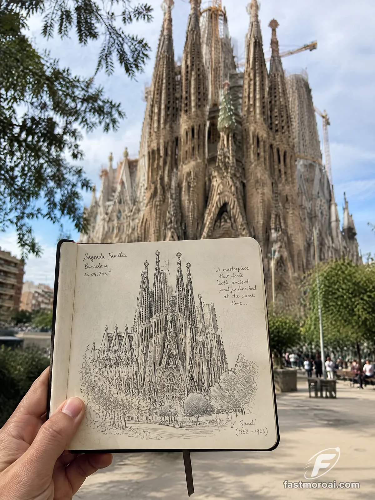

# Sketchbook Landmark Alignment Travel Photo

**中文标题：** 速写本与地标对齐的旅行照片  
**ID:** `gi25-x-831` · **Mode:** `generate`  
**Categories:** `poster-typography`, `general`  
**Tags:** `x-twitter`, `community`, `gpt-image-2.5`, `x-direct`, `en`



### Sketchbook Landmark Alignment Travel Photo

```text
"The real landmark stands directly behind the sketchbook, perfectly aligned with its hand-drawn version."

the rest is set dressing. swap [LANDMARK] and you get a new trip every time. I wrote the city after the name ("Tower Bridge in London") for all three.

ran it on GPT Image 2.5 in FastMoro. didn't ask for French, but the Paris page wrote its notes in French anyway.

template by @Naiknelofar788, copy it from here:

Create a stunning, photorealistic travel photograph of a person standing at the exact real-world location of [LANDMARK], holding an open pocket-sized sketchbook in the foreground. The sketchbook contains a beautiful, hand-drawn black-ink architectural sketch of that exact landmark, with fine pen strokes, intricate details, natural imperfections, and handwritten travel-journal notes.

The magic is in the composition: The real landmark stands directly behind the sketchbook, perfectly aligned with its hand-drawn version, creating a beautiful visual connection between the real world and the artist’s drawing. The sketch should look like someone visited the place, sat nearby, and carefully drew the architecture by hand.

Capture the person’s hand naturally holding the sketchbook, with the landmark clearly visible in the background. Use shallow depth of field, soft natural daylight, realistic shadows, subtle film grain, and an authentic travel-photography aesthetic.

The sketchbook should have slightly textured cream-colored pages, a simple binding, and a delicate ribbon bookmark. The drawing must remain monochrome, using only black ink and fine pencil lines.

Important details:

Keep the actual landmark architecturally accurate and instantly recognizable.
Match the sketch to the real building’s exact structure, proportions, windows, towers, and distinctive features.
Make the background location feel authentic, including its surrounding streets and buildings.
Keep the hand and sketchbook sharp, with the real landmark slightly softened but still recognizable.
Natural human hand anatomy, realistic perspective, professional travel photography.
No cartoon effects, no 3D render, no artificial-looking architecture, no excessive filters.

Overall mood: Artistic, nostalgic, authentic, and travel-journal inspired — like a beautiful moment captured during a real trip.

Aspect ratio: 4:5, vertical composition.
```

- **Recommended model:** `gpt-image-2.5-sunburst`
- **Settings:** _(defaults)_
- **Source:** [community](https://x.com/FastMoroAI/status/2110031356382052629) — @FastMoroAI
- **License note:** Original public X post; quoted with attribution — remix with attribution
- **Notes:** Collected directly from X; original post https://x.com/FastMoroAI/status/2110031356382052629; post text names GPT Image 2.5; discovered via Bin0754/gpt-image-gallery index, prompt re-verified against the original X post via api.fxtwitter.com; verified=True
- **Preview:** `previews/gi25-x-831.webp`
