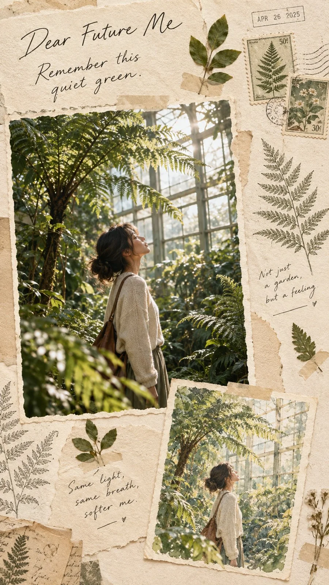

# “Dear Future Me” Botanical Memory-Journal Poster

**中文标题：** 「致未来的我」植物记忆手账海报  
**ID:** `gi25-x-833` · **Mode:** `generate`  
**Categories:** `poster-typography`  
**Tags:** `x-twitter`, `community`, `gpt-image-2.5`, `x-direct`, `en`



### “Dear Future Me” Botanical Memory-Journal Poster

```text
Create a premium vertical memory-journal scrapbook poster with a “Dear Future Me” concept focused on a botanical garden morning — not a city skyline or landmark tourism layout.

Use a cinematic photograph of a young adult woman standing among tall greenhouse ferns and soft morning glass light as the main focal point, layered on warm cream textured paper with torn-paper edges, vintage postage stamps, handwritten notes, a tiny date stamp, botanical sketches of fern fronds, pressed-leaf accents, and masking tape details.

Add a smaller hand-drawn watercolor version of the same greenhouse photograph as a secondary memory card. Elegant handwritten typography: “Dear Future Me  Remember this quiet green.” Add small personal-style notes like “Not just a garden, but a feeling.” and “Same light, same breath, softer me.”

Sophisticated editorial lifestyle magazine aesthetic, nostalgic, artistic, realistic photography, soft natural tones, balanced composition, premium paper texture, vertical 9:16, no city skylines, no landmark tourism posters, no logos, no watermark.

—

Inspired by @MissDelulu9
```

- **Recommended model:** `gpt-image-2.5-sunburst`
- **Settings:** _(defaults)_
- **Source:** [community](https://x.com/Alyssa4aicreate/status/2110478755194110073) — @Alyssa4aicreate
- **License note:** Original public X post; quoted with attribution — remix with attribution
- **Notes:** Collected directly from X; original post https://x.com/Alyssa4aicreate/status/2110478755194110073; post text names GPT Image 2.5; discovered via Bin0754/gpt-image-gallery index, prompt re-verified against the original X post via api.fxtwitter.com; verified=True
- **Preview:** `previews/gi25-x-833.webp`
