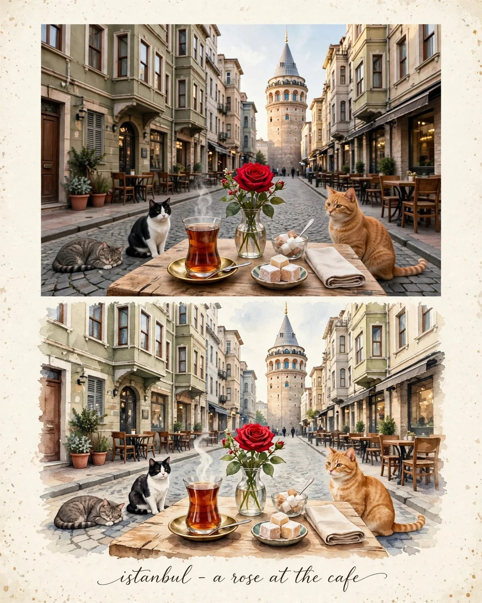

# Charming Coastal Town Travel-Editorial Artwork

**中文标题：** 迷人海滨小镇旅行编辑艺术画  
**ID:** `gi25-x-838` · **Mode:** `generate`  
**Categories:** `poster-typography`  
**Tags:** `x-twitter`, `community`, `gpt-image-2.5`, `x-direct`, `en`



### Charming Coastal Town Travel-Editorial Artwork

```text
Create a premium 4:5 vertical travel-editorial artwork inspired by the charming streets of Istanbul, Turkey, combining all three reference images into one cohesive, elegant, and highly detailed composition.

PURE GENERATION WITH REFERENCE-INSPIRED VISUALS.

Main Scene:
A picturesque old Istanbul street featuring the iconic Galata Tower in the center background, surrounded by historic Ottoman-era and European-style buildings, charming cafés, traditional shopfronts, cobblestone streets, outdoor wooden tables, flower pots, and warm café lights. Preserve the distinctive architectural character, authentic Istanbul atmosphere, and beautiful street perspective shown in the references.

Foreground Composition:
Place a rustic wooden café table in the foreground with a traditional Turkish tea glass filled with rich amber tea on a small saucer, a ceramic coffee cup, a small plate of Turkish delight, a neatly folded linen napkin, and a transparent glass vase holding a single fresh red rose. Arrange every object naturally with realistic proportions, beautiful textures, and subtle
```

- **Recommended model:** `gpt-image-2.5-sunburst`
- **Settings:** _(defaults)_
- **Source:** [community](https://x.com/KrishnaBio1/status/2110403551834906654) — @KrishnaBio1
- **License note:** Original public X post; quoted with attribution — remix with attribution
- **Notes:** Collected directly from X; prompt posted as the author's reply https://x.com/KrishnaBio1/status/2110403551834906654 to https://x.com/KrishnaBio1/status/2110403546093089010, which carries the images and names GPT Image 2.5; discovered via Bin0754/gpt-image-gallery index, prompt re-verified against the original X post via api.fxtwitter.com; verified=True
- **Preview:** `previews/gi25-x-838.webp`
