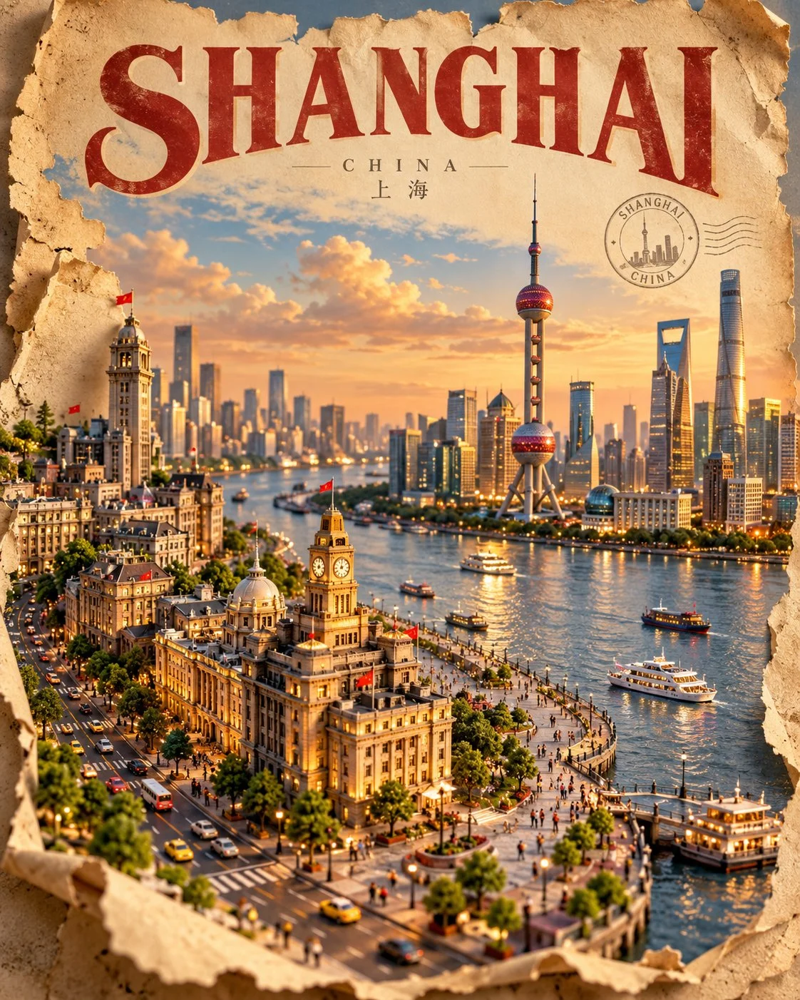

# Miniature 3D Torn-Paper Travel Poster

**中文标题：** 微型 3D 撕纸旅行海报  
**ID:** `gi25-x-845` · **Mode:** `generate`  
**Categories:** `poster-typography`  
**Tags:** `x-twitter`, `community`, `gpt-image-2.5`, `x-direct`, `en`



### Miniature 3D Torn-Paper Travel Poster

```text
Create a premium FULL-FRAME 4:5 vertical miniature 3D travel-poster illustration for [COUNTRY / CITY / LOCATION].

TEXT-TO-IMAGE ONLY — generate the entire artwork from the destination name alone. No reference image required.

CORE CONCEPT:
A vintage travel poster transformed into a breathtaking miniature world emerging from an aged, torn-paper sheet. The upper portion features a large destination title and a warm, cinematic skyline; the lower portion becomes a highly detailed 3D miniature landscape with iconic landmarks, local architecture, streets, and authentic transportation.

COMPOSITION:
Create one coherent miniature scene featuring the destination’s most recognizable landmarks, realistic architectural proportions, tiny vehicles, street details, and subtle local-life elements. The paper edges curl and tear organically, revealing the miniature world beneath. Use dramatic depth, a slightly elevated perspective, and warm afternoon sunlight.

STYLE:
Photorealistic miniature diorama, handcrafted architectural models, intricate textures, vintage travel advertising, aged cream paper, softly weathered edges, cinematic shadows, and premium collectible-poster design.

TYPOGRAPHY:
Place the destination name prominently at the top in bold vintage editorial lettering. Add a small geographic subtitle and a subtle circular travel-stamp emblem. Keep all text destination-specific, correctly spelled, and minimal.

COLOR PALETTE:
Warm parchment, muted terracotta, sandstone, olive green, dusty blue, and natural architectural colors inspired by the location.

AVOID:
Flat illustrations, unrelated landmarks, oversized buildings, distorted vehicles, excessive text, logos, watermarks, and mockup framing.

FORMAT:
Full-bleed 4:5 vertical composition. Fill the entire canvas with the finished artwork, no external borders or empty margins.
```

- **Recommended model:** `gpt-image-2.5-sunburst`
- **Settings:** _(defaults)_
- **Source:** [community](https://x.com/Goodmanprotocol/status/2109215948901331160) — @Goodmanprotocol
- **License note:** Original public X post; quoted with attribution — remix with attribution
- **Notes:** Collected directly from X; original post https://x.com/Goodmanprotocol/status/2109215948901331160; post text names GPT Image 2.5; discovered via Bin0754/gpt-image-gallery index, prompt re-verified against the original X post via api.fxtwitter.com; verified=True
- **Preview:** `previews/gi25-x-845.webp`
