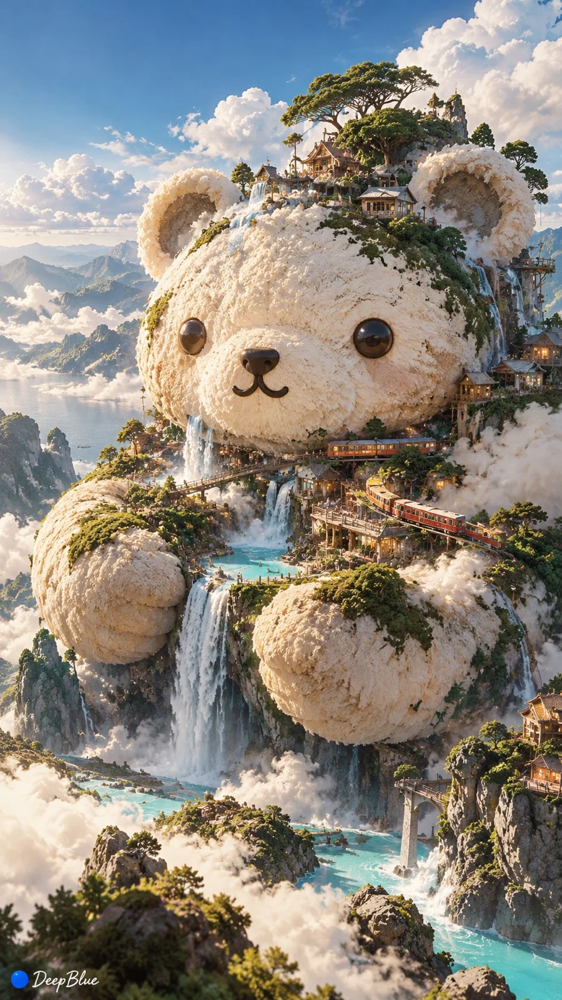

# Japanese Kaomoji Surreal Poster Generator

**中文标题：** 日系颜文字超现实海报生成器  
**ID:** `gi25-x-849` · **Mode:** `generate`  
**Categories:** `poster-typography`  
**Tags:** `x-twitter`, `community`, `gpt-image-2.5`, `x-direct`, `ja`



### Japanese Kaomoji Surreal Poster Generator

```text
日系颜文字 × 超现实视觉重构 × 实验性平面设计 × 自由创意海报

以指定颜文字为唯一核心创意种子，将字符结构、表情特征与情绪隐喻转化为夸张奇特的视觉作品。自由探索尺度反差、形态变异、空间错位、材质转译与意外构图，每张采用不同的视觉机制，形成完整且具有独特识别度的设计作品。

日系颜文字种子：每次任选一个
(◕ᴗ◕✿) / (╯°□°)╯︵ ┻━┻ / ʕ•ᴥ•ʔ / (⁄ ⁄•⁄ω⁄•⁄ ⁄) / ಠ_ಠ / ༼ つ ◕_◕ ༽つ

每次只使用一个种子，独立构思，单张成图，不拼图，不继承前次的具体视觉元素。

n=4
```

- **Recommended model:** `gpt-image-2.5-sunburst`
- **Settings:** _(defaults)_
- **Source:** [community](https://x.com/DeepBlueX0/status/2110596265675550805) — @DeepBlueX0
- **License note:** Original public X post; quoted with attribution — remix with attribution
- **Notes:** Collected directly from X; original post https://x.com/DeepBlueX0/status/2110596265675550805; post text names GPT Image 2.5; discovered via Bin0754/gpt-image-gallery index, prompt re-verified against the original X post via api.fxtwitter.com; verified=True
- **Preview:** `previews/gi25-x-849.webp`
