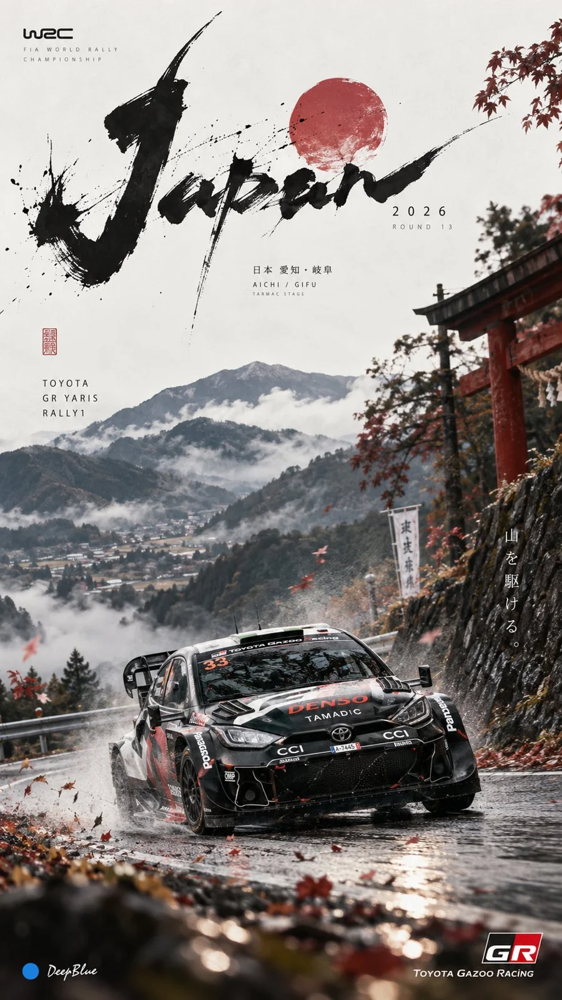

# WRC Editorial Race-Art Poster Template

**中文标题：** WRC 编辑赛车艺术海报模板  
**ID:** `gi25-x-852` · **Mode:** `generate`  
**Categories:** `poster-typography`  
**Tags:** `x-twitter`, `community`, `gpt-image-2.5`, `x-direct`, `zh`



### WRC Editorial Race-Art Poster Template

```text
独立艺术赛事海报 × [赛车品牌与车型] × [举办国家及对应赛段] × WRC Editorial 摄影 × 东方美学留白 × 实验性字体设计

赛车为核心主体，赛车动态与赛事环境须符合指定车型、国家及赛段特征。实验性赛事字标与赛车形成视觉张力，赛事名称、赛段、年份与编号精简排布。非对称构图，克制用色，疏密有致，大面积留白，避免信息与装饰过载。
```

- **Recommended model:** `gpt-image-2.5-sunburst`
- **Settings:** _(defaults)_
- **Source:** [community](https://x.com/DeepBlueX0/status/2110700661868499219) — @DeepBlueX0
- **License note:** Original public X post; quoted with attribution — remix with attribution
- **Notes:** Collected directly from X; original post https://x.com/DeepBlueX0/status/2110700661868499219; post text names GPT Image 2.5; discovered via Bin0754/gpt-image-gallery index, prompt re-verified against the original X post via api.fxtwitter.com; verified=True
- **Preview:** `previews/gi25-x-852.webp`
