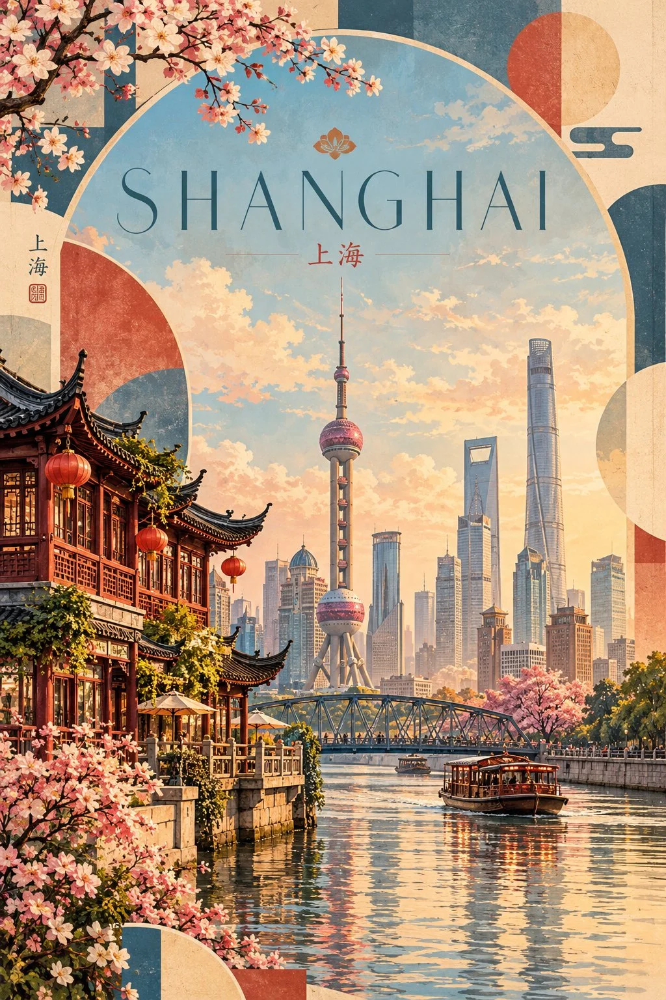

# Vintage-Modern Travel Poster Template

**中文标题：** 复古现代旅行海报模板  
**ID:** `gi25-x-853` · **Mode:** `generate`  
**Categories:** `poster-typography`  
**Tags:** `x-twitter`, `community`, `gpt-image-2.5`, `x-direct`, `en`



### Vintage-Modern Travel Poster Template

```text
Create a premium 2:3 vertical vintage-modern travel poster of [COUNTRY / CITY / LOCATION], combining painterly realism, elegant geometric framing, and sophisticated editorial design.

CORE CONCEPT: Celebrate the unique identity of the destination through one beautifully composed architectural landscape, blending vintage travel-poster charm with contemporary graphic design.

COMPOSITION: Place the main scene inside a large, elegant geometric arch occupying most of the poster. Surround it with overlapping circles, curved shapes, and abstract color blocks that frame the landscape without overwhelming it. Create a balanced composition with generous negative space and a clear visual hierarchy.

LANDMARKS & SCENERY: Automatically identify the destination’s most recognizable landmark, authentic architecture, characteristic skyline, and two or three complementary local details. Preserve distinctive architectural silhouettes and believable proportions. Integrate foreground, middle ground, and background naturally into one cohesive panoramic scene rather than creating a collage of unrelated attractions.

ART STYLE: Painterly realism with the warmth of traditional travel illustrations. Render buildings, landscapes, and landmarks with refined detail, soft brushwork, atmospheric depth, and gently simplified forms. Combine realistic architectural character with clean geometric shapes and a polished modern editorial finish.

COLOR PALETTE: Develop a destination-specific palette using harmonious pastels, warm ivory, muted coral, dusty rose, soft turquoise, sage green, or powder blue wherever appropriate. Let the selected colors reflect the location’s architecture, landscape, and atmosphere rather than forcing every destination into an identical palette.

LIGHTING & TEXTURE: Use warm, diffused sunlight, a luminous pastel sky, delicate atmospheric haze, and subtle natural shadows. Add fine paper grain and a restrained printed-art texture to create the tactile quality of a premium collectible poster.

TYPOGRAPHY: Place [DESTINATION NAME] prominently near the upper center, using elegant, thin uppercase lettering with generous tracking. Keep the title refined and legible. Add a small, understated emblem inspired by the destination’s cultural identity, positioned harmoniously within the geometric layout.

DESIGN BALANCE: Maintain a clear distinction between the illustrated landscape and the surrounding abstract shapes. Use overlapping geometry to guide the eye toward the landmark, while preserving breathing room, balanced proportions, and an uncluttered editorial composition.

FINAL AESTHETIC: Vintage-modern travel art, painterly architectural realism, Japanese-inspired pastel elegance, sophisticated geometric framing, warm sunlight, and premium art-print craftsmanship.

AVOID: Photographic images, generic landmark collages, inaccurate architecture, distorted buildings, excessive decorative elements, harsh colors, heavy digital effects, cluttered typography, illegible lettering, logos, and watermarks.

FORMAT: Full-bleed 2:3 vertical composition, high resolution, crisp architectural details, elegant typography, and a polished collectible travel-poster finish.
```

- **Recommended model:** `gpt-image-2.5-sunburst`
- **Settings:** _(defaults)_
- **Source:** [community](https://x.com/Goodmanprotocol/status/2110701903009263756) — @Goodmanprotocol
- **License note:** Original public X post; quoted with attribution — remix with attribution
- **Notes:** Collected directly from X; original post https://x.com/Goodmanprotocol/status/2110701903009263756; post text names GPT Image 2.5; discovered via Bin0754/gpt-image-gallery index, prompt re-verified against the original X post via api.fxtwitter.com; verified=True
- **Preview:** `previews/gi25-x-853.webp`
