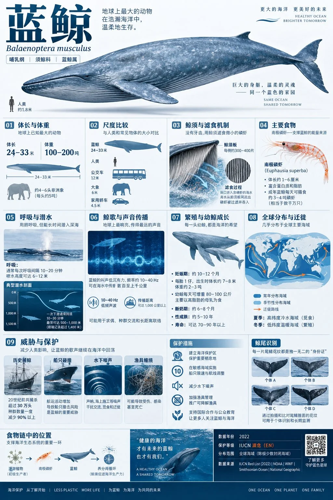

# Blue Whale Ecology Encyclopedia Card

**中文标题：** 蓝鲸生态百科信息卡  
**ID:** `gi25-x-854` · **Mode:** `generate`  
**Categories:** `poster-typography`  
**Tags:** `x-twitter`, `community`, `gpt-image-2.5`, `x-direct`, `zh`



### Blue Whale Ecology Encyclopedia Card

```text
一张 2:3 竖版蓝鲸生态百科信息卡，融合自然历史博物馆、海洋保护设计与极简编辑美学。顶部展示一头成年蓝鲸的完整侧面科学摄影式图像，以白色背景突出巨大流线身体、背鳍、胸鳍、尾鳍和腹部褶沟，同时以极小的人类剪影作为比例参照；配超大标题“蓝鲸”、斜体学名“Balaenoptera musculus”、分类标签“哺乳纲／须鲸科”、全球海域分布地图和迁徙路径。

中部通过视觉层级强化海洋生态知识，完整包含九大模块：体长与体重范围；与人类、公交车等尺度比较；鲸须与滤食机制；主要食物磷虾；呼吸与潜水方式；鲸歌与声音传播；繁殖与幼鲸成长；全球分布及季节迁徙；历史捕鲸、船只碰撞、水下噪声、渔具缠绕等威胁及保护措施。

加入“鲸尾识别”“潜水剖面”“食物链”“迁徙路线”和“保护威胁占比表达”，但所有比例必须有真实来源才能显示。整体采用深海蓝、鲸体蓝灰、冰川白和石墨灰，警示区域用小面积橙红；背景为极浅冷灰，配0.5pt分割线和低透明色块。底部标示数据年份、物种保护等级、地域范围和来源，禁止脱离年份展示种群数量或虚构环保结论。
```

- **Recommended model:** `gpt-image-2.5-sunburst`
- **Settings:** _(defaults)_
- **Source:** [community](https://x.com/Mrpinecone888/status/2110703773941440789) — @Mrpinecone888
- **License note:** Original public X post; quoted with attribution — remix with attribution
- **Notes:** Collected directly from X; original post https://x.com/Mrpinecone888/status/2110703773941440789; post text names GPT Image 2.5; discovered via Bin0754/gpt-image-gallery index, prompt re-verified against the original X post via api.fxtwitter.com; verified=True
- **Preview:** `previews/gi25-x-854.webp`
